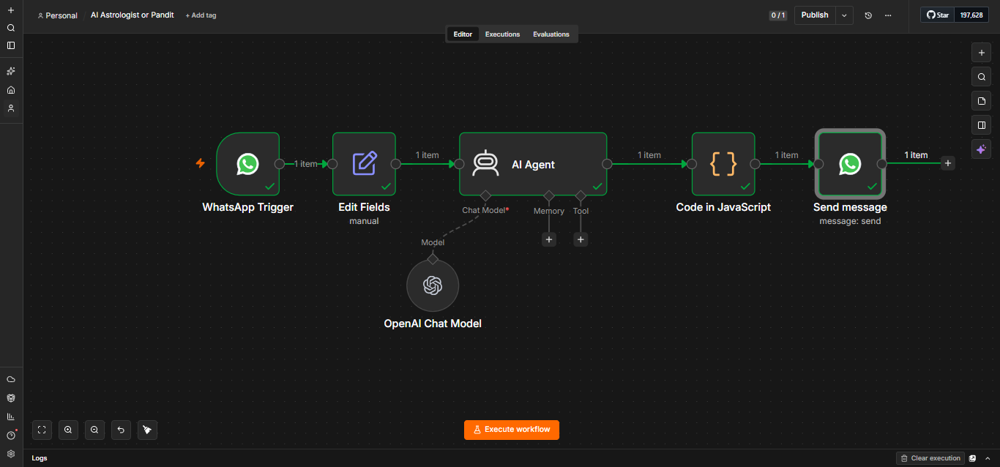
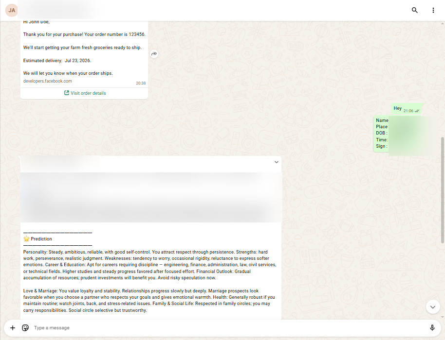

# AI Astrologist or Pandit

A WhatsApp-based Vedic astrology response assistant built with n8n and OpenAI. It receives a text message containing a user's birth details, passes that text to an AI Agent with a Vedic astrology role prompt, cleans and shortens the generated response, and sends the reply back to the same WhatsApp sender.

> **Important:** This project generates astrology-style content for entertainment and personal reflection. Astrology is not a scientifically validated method for predicting events or assessing health, finances, relationships, or other real-world outcomes. Do not use its responses as a substitute for medical, legal, financial, or other professional advice.

## Key Features

- Receives inbound WhatsApp text messages
- Extracts the message body from the WhatsApp Trigger payload
- Passes the user's birth information to an OpenAI-powered AI Agent
- Prompts for missing birth date, birth time, or birth place rather than inventing those details
- Requests a personalized Vedic astrology-style reading when the required details are present
- Asks the AI Agent to reply in the same language as the user (Hindi, English, or Hinglish)
- Requests a respectful, structured response covering personality, career, relationships, family, general guidance, and other astrology-themed topics
- Cleans excessive blank lines and repeated whitespace from the AI response
- Truncates long output before sending the response through WhatsApp
- Replies to the WhatsApp sender using the sender's WhatsApp ID from the trigger event

## Workflow Overview

The supplied workflow contains six connected nodes:

1. `WhatsApp Trigger` receives incoming WhatsApp message events.
2. `Edit Fields` maps `messages[0].text.body` into a field named `user_info`.
3. `AI Agent` receives the extracted text and uses its system instructions to generate an astrology-style response or ask for missing birth information.
4. `OpenAI Chat Model` supplies the language model to the AI Agent. The supplied export selects `gpt-5-mini`.
5. `Code in JavaScript` reads the AI Agent's `output`, normalizes whitespace, and shortens responses longer than 3,500 characters.
6. `Send message` sends the cleaned response to the WhatsApp sender using the `wa_id` from the original WhatsApp Trigger.

The AI Agent has no connected memory or external tools in the supplied workflow. Each execution is therefore based on the incoming message and the model's configured instructions, not a connected conversation-history store.

## Expected User Input

The prompt expects the user to provide:

- Date of birth
- Time of birth
- Place of birth

If one or more of these details are missing, the AI Agent is instructed to ask only for the missing information. The workflow does not independently validate the birth details or calculate a verified birth chart before sending the text to the model.

## Astrology Response Topics

The AI Agent's system prompt asks for astrology-style content relating to:

- Personality, strengths, and weaknesses
- Career and education
- Finance
- Love and relationships
- Marriage
- Health and family
- Spiritual growth and general life guidance
- Lucky colour, number, and day
- Gemstone suggestions where appropriate
- Simple Vedic remedies

The system prompt also instructs the agent to avoid certainty, fear-based claims, and extreme predictions. These are prompt instructions, not a guarantee that model output will always comply.

## Technology Stack

- n8n
- WhatsApp Business Cloud API
- WhatsApp Trigger
- WhatsApp send-message node
- OpenAI Chat Model (`gpt-5-mini` in the supplied export)
- n8n AI Agent
- JavaScript (n8n Code node)

## Workflow File

[Download n8n Workflow JSON](./workflow.json) — Sanitized workflow export for importing into n8n.

## Screenshots

### 1. n8n Workflow Architecture



### 2. WhatsApp Astrology Conversation Example



The conversation screenshot has been redacted to remove the sample user's identifying birth details. It shows the interaction format only, not proof that astrological statements are factual or predictive.

## Setup

1. Import `workflow.json` into your n8n instance. The exported workflow is inactive by default.
2. Connect your WhatsApp Business API credentials to the `WhatsApp Trigger` and `Send message` nodes.
3. Replace `REPLACE_WITH_YOUR_WHATSAPP_PHONE_NUMBER_ID` in the `Send message` node with your own WhatsApp Business phone-number ID.
4. Connect your OpenAI credentials to the `OpenAI Chat Model` node.
5. Configure your WhatsApp Business webhook and ensure inbound message events reach the trigger.
6. Test using text messages that contain all three required birth details.
7. Test missing-date, missing-time, and missing-place cases to confirm the agent asks for the missing information.
8. Test with Hindi, English, and Hinglish messages to review the language behavior.
9. Test non-text WhatsApp messages and add a guard or alternate handling path before enabling the workflow for general use.
10. Activate the workflow only after credentials, message handling, recipient routing, and response length have been checked.

The export removes credential references, webhook IDs, and instance-specific metadata. The original WhatsApp Business phone-number ID has been replaced with a placeholder. Reconnect your own accounts after importing.

## Current Limitations and Recommended Improvements

The following limitations are visible in the supplied workflow export:

- **Text messages only:** `Edit Fields` reads `messages[0].text.body`. Image, audio, document, sticker, and other non-text message payloads are not handled by this mapping. Add a message-type check and a clear fallback reply.
- **Birth details are not independently validated:** The workflow sends the message text directly to the AI Agent. It relies on the prompt to identify missing details and does not validate date formats, time formats, place names, or whether the details are internally consistent.
- **No birth-chart calculation node:** The workflow does not connect to a Panchang, ephemeris, chart-calculation service, or astrology database. It asks the language model to produce a reading from the text supplied.
- **No conversation memory:** The AI Agent's Memory input is not connected. Follow-up messages may not retain earlier birth details unless the user repeats them.
- **Fixed WhatsApp Business phone-number ID:** The send node uses a configured phone-number ID. Replace the placeholder with the ID belonging to your own WhatsApp Business account.
- **Prompt rules are not guaranteed safeguards:** The system message asks the model to avoid certainty and harmful predictions, but prompt instructions alone do not guarantee every answer will follow those requirements.
- **Response truncation can cut off content:** The Code node shortens text after 3,500 characters. A long reading can end mid-sentence or omit later sections. Consider asking the model for a concise answer first and adding a clear continuation flow if longer readings are required.
- **No explicit error handling:** The workflow does not show a dedicated route for OpenAI failures, empty model output, WhatsApp delivery errors, or unsupported input.
- **Privacy considerations:** Birth date, birth time, birthplace, and WhatsApp message content can be personal information. Inform users what is collected and how it is used, and avoid storing or sharing it unnecessarily.

Use this project as a conversational astrology-themed assistant, not as a source of verified predictions or professional advice.

## Repository Structure

```text
AI-Astrologist-or-Pandit/
├── screenshots/
│   ├── README.md
│   ├── workflow-overview.png
│   └── whatsapp-astrology-conversation.png
├── README.md
└── workflow.json
```


## Author

<p align="left">
  <b>Jasvant Malvi</b><br>
  <a href="https://github.com/jasvantMalvi">GitHub</a> ·
  <a href="https://www.linkedin.com/in/jasvant-malvi-810305429/">LinkedIn</a>
</p>
