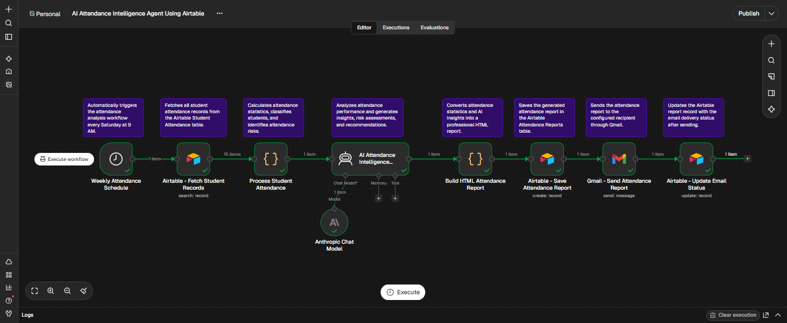

# AI Attendance Intelligence Agent Using Airtable

An AI-powered attendance monitoring and reporting workflow built using n8n, Airtable, and OpenAI.

The system processes student attendance records, calculates attendance statistics, classifies attendance performance, and generates an intelligent weekly report.

## Key Features

- Automated attendance data retrieval from Airtable
- Student attendance analysis
- Attendance percentage calculation
- Attendance classification into performance categories
- AI-generated attendance insights
- Weekly attendance report generation
- Automated reporting workflow

## Sample Trial Results

The demonstration dataset produced the following results:

| Metric | Result |
|---|---:|
| Total Students | 15 |
| Total Classes | 900 |
| Present | 727 |
| Absent | 173 |
| Average Attendance | 80.78% |

### Attendance Categories

| Category | Students |
|---|---:|
| Excellent | 2 |
| Good | 6 |
| Warning | 5 |
| Critical | 4 |

*These figures represent a sample trial dataset, not verified real-world attendance records.*

## Technology Stack

- n8n — Workflow automation
- Airtable — Attendance data storage
- OpenAI API — AI-powered insights
- JavaScript — Data processing and calculations

## Project Structure

```text
AI-Attendance-Intelligence-Agent-Using-Airtable/
├── README.md
├── workflow.json
└── screenshots/
    ├── README.md
    └── workflow-overview.png
```

## Setup Requirements

- n8n instance
- Airtable account and attendance base
- OpenAI API credentials
- Configured Airtable connection
- Imported workflow with your own credentials

## Important Notes

- The reported figures are from a demonstration dataset.
- AI-generated insights depend on the accuracy of the supplied attendance records.
- Configure your own Airtable and OpenAI credentials before execution.
- Do not publish API keys, access tokens, or private Airtable data.

## Author

**Jasvant Malvi**

- GitHub: https://github.com/jasvantMalvi
- LinkedIn: https://www.linkedin.com/in/jasvant-malvi-810305429/

## Project Files

- [Download n8n Workflow JSON](./workflow.json) — Sanitized workflow export for importing into n8n.
- [View Project Screenshots](./screenshots/) — Workflow overview and visual documentation.

## Workflow Screenshot




