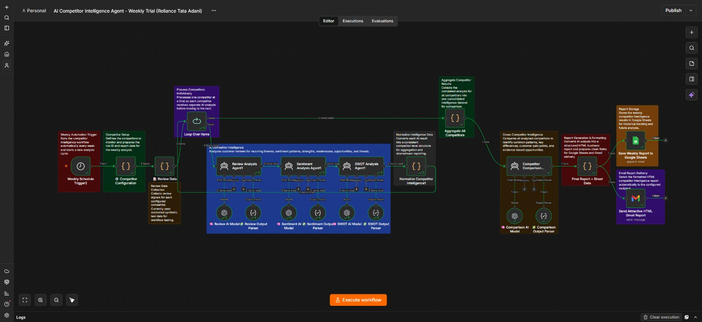

# AI Competitor Intelligence Agent

A weekly AI-powered competitor intelligence workflow built using n8n, OpenAI, JavaScript, Google Sheets, and Gmail.

The workflow analyzes supplied competitor review data, identifies customer feedback patterns, performs sentiment analysis and SWOT analysis, compares competitors, and generates a structured HTML report.

## Project Overview

This project demonstrates how AI agents can transform review data into structured competitor intelligence.

The workflow is designed to analyze three competitors in a single weekly reporting cycle.

**Important:** The current version is a trial using synthetic review data. It does not currently demonstrate live review scraping or verified real-world customer feedback collection.

## Key Features

- Weekly scheduled execution
- Competitor configuration
- Review data preparation
- Individual competitor processing
- AI-powered review analysis
- Customer sentiment analysis
- Positive, neutral, and negative sentiment percentages
- SWOT analysis
- Competitor data normalization
- Cross-competitor comparison
- Strategic recommendations
- HTML report generation
- Google Sheets report storage
- Automated Gmail report delivery

## Workflow Architecture

1. **Weekly Schedule Trigger:** Starts the competitor intelligence workflow weekly.
2. **Competitor Configuration:** Defines the competitors and prepares the report date and run ID.
3. **Review Data:** Provides the review dataset for each configured competitor.
4. **Loop Over Items:** Processes competitors individually.
5. **Review Analysis Agent:** Identifies customer strengths, weaknesses, complaints, and recurring themes.
6. **Sentiment Analysis Agent:** Calculates positive, neutral, and negative sentiment percentages.
7. **SWOT Analysis Agent:** Generates strengths, weaknesses, opportunities, and threats.
8. **Normalize Competitor Intelligence:** Organizes AI outputs into a consistent structure.
9. **Aggregate All Competitors:** Combines the individual competitor results.
10. **Competitor Comparison Agent:** Produces cross-competitor insights and strategic recommendations.
11. **Final Report + Sheet Data:** Generates the HTML report and prepares spreadsheet data.
12. **Save Weekly Report to Google Sheets:** Stores the weekly results.
13. **Send Attractive HTML Gmail Report:** Delivers the formatted report by email.

## Technology Stack

| Technology | Purpose |
|---|---|
| n8n | Workflow automation |
| OpenAI GPT-5-mini | AI review, sentiment, SWOT, and comparison analysis |
| JavaScript | Data normalization and HTML report generation |
| Google Sheets | Weekly report storage |
| Gmail | Automated report delivery |

## Report Sections

- Individual competitor review analysis
- Sentiment percentages and keywords
- SWOT analysis for each competitor
- Executive summary
- Competitor summaries
- Key differences
- Common strengths and weaknesses
- Customer patterns
- Differentiation opportunities
- Strategic recommendations
- Data limitations

## Project Files

- `workflow.json` — Sanitized n8n workflow export
- `screenshots/` — Workflow overview and execution evidence

## Important Limitations

- The current trial uses synthetic review data.
- AI analysis is based only on the supplied dataset.
- The workflow does not currently prove live review collection.
- Strategic recommendations should be treated as analysis of the supplied test data, not verified market research.
- Configure your own OpenAI, Google Sheets, and Gmail credentials before execution.

## Setup Requirements

- n8n instance
- OpenAI API credentials
- Google Sheets OAuth2 credentials
- Gmail OAuth2 credentials
- Competitor review dataset
- Google Sheet with the required report columns

Import the workflow and configure your own credentials and spreadsheet references before testing.

## Privacy and Security

Never publish API keys, OAuth tokens, private email addresses, spreadsheet IDs, or sensitive business information in the public workflow export.

## Author

**Jasvant Malvi**

- GitHub: https://github.com/jasvantMalvi
- LinkedIn: https://www.linkedin.com/in/jasvant-malvi-810305429/

## Project Files

- [Download n8n Workflow JSON](./workflow.json) — Sanitized workflow export for importing into n8n.
- [View Project Screenshots](./screenshots/) — Workflow overview and visual documentation.

## Workflow Screenshot

