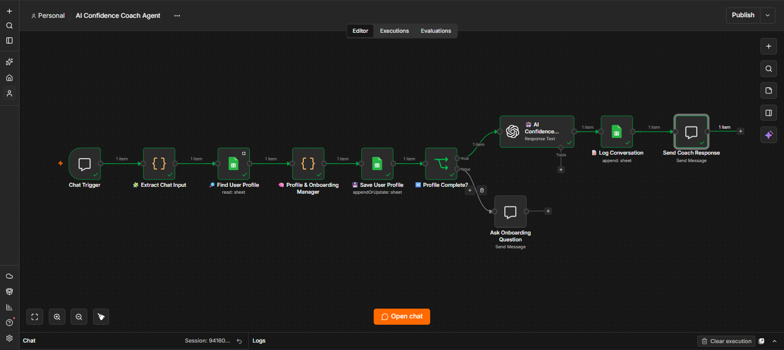
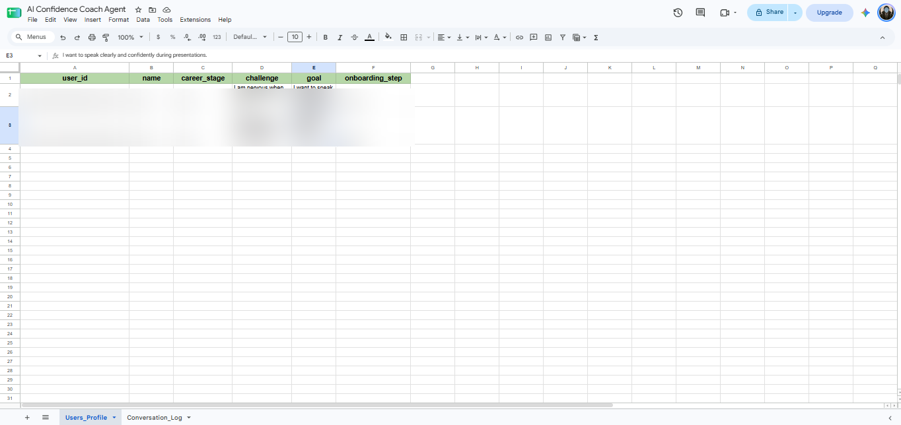
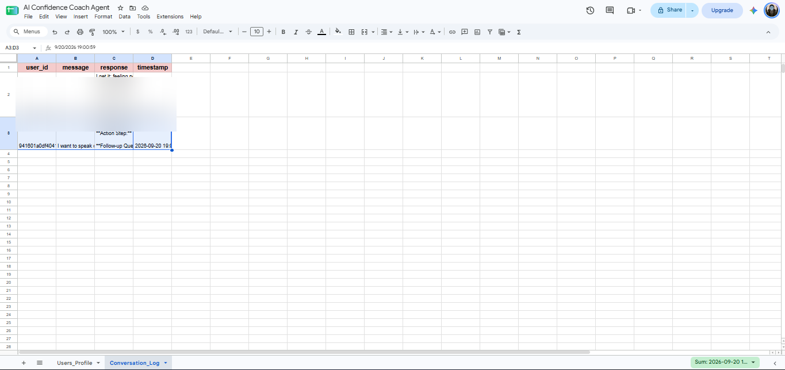

# AI Confidence Coach Agent

A personalized AI coaching chat built with n8n, the n8n Chat Trigger, OpenAI GPT-4o-mini, and Google Sheets. It asks new users a short onboarding sequence, saves their profile, and then gives profile-aware confidence coaching in response to each new message.

The onboarding profile captures the user's name, career stage, main confidence challenge, and main goal. Once all four fields are available, the workflow routes the message to the AI Confidence Coach. The coach is instructed to provide practical, direct, supportive advice and no more than one or two actions at a time.

> **Scope:** This is a general-purpose confidence coaching assistant. It is not a therapist or medical service, does not diagnose mental-health conditions, and does not replace professional support.

## Key Features

- Public n8n Chat Trigger with an initial greeting
- Extracts the incoming chat message and a user/session identifier
- Creates an India-local timestamp using the `Asia/Kolkata` timezone
- Looks up an existing user profile in Google Sheets
- Runs a four-field onboarding sequence for new or incomplete profiles:
  1. Name
  2. Career stage
  3. Main confidence challenge
  4. Main goal
- Saves and updates profile fields using Google Sheets `appendOrUpdate`
- Routes the user to the coach only after all four profile fields are populated
- Uses OpenAI GPT-4o-mini to generate personalized coaching responses
- Logs completed coaching exchanges to a separate Google Sheets tab
- Sends the coaching response back through the n8n chat response node

## Workflow Overview

The supplied export contains **10 operational nodes**.

1. `Chat Trigger` — receives chat messages, displays the initial greeting, and uses response nodes to return messages.
2. `🧩 Extract Chat Input` — extracts:
   - `user_message` from `chatInput`, `message`, or `text`
   - `user_id` from `userId`, `user_id`, `sessionId`, or `session_id`
   - `timestamp` formatted in `Asia/Kolkata`
3. `🔎 Find User Profile` — searches the `Users_Profile` sheet for the extracted `user_id`.
4. `🧠 Profile & Onboarding Manager` — determines whether the user is new or existing, saves the current answer to the active onboarding field, calculates whether the profile is complete, and prepares the next onboarding question.
5. `💾 Save User Profile` — upserts the profile record using `user_id` as the matching column.
6. `🔀 Profile Complete?` — routes complete profiles to the AI Coach and incomplete profiles to the onboarding question response.
7. `Ask Onboarding Question` — sends the next required onboarding question.
8. `🤖 AI Confidence Coach` — uses the stored profile and current message to produce a personalized coaching response with GPT-4o-mini.
9. `📝 Log Conversation` — appends the user message, AI response, user ID, and timestamp to the conversation log.
10. `Send Coach Response` — sends the logged AI response back to the chat.

### Main data path

```text
Chat Trigger
     ↓
Extract Chat Input
     ↓
Find User Profile
     ↓
Profile & Onboarding Manager
     ↓
Save User Profile
     ↓
Profile Complete?
     ├── No  → Ask Onboarding Question
     └── Yes → AI Confidence Coach
                    ↓
              Log Conversation
                    ↓
              Send Coach Response
```

## Onboarding Profile

The workflow collects four required profile fields.

| Field | Purpose |
|---|---|
| `name` | How the coach addresses the user |
| `career_stage` | Student, Job Seeker, Working Professional, Entrepreneur, or another user-provided stage |
| `challenge` | The user's main confidence challenge |
| `goal` | What the user wants to become more confident at |
| `onboarding_step` | Tracks the next required field or `completed` |

The profile manager saves each answer against the current onboarding step, then checks that the name, career stage, challenge, and goal are all non-empty before marking the profile complete.

## Google Sheets Structure

The supplied spreadsheet screenshots show two tabs.

### `Users_Profile`

| Column | Purpose |
|---|---|
| `user_id` | User/session identifier used for profile lookup and upsert |
| `name` | User's name |
| `career_stage` | Current career or life stage |
| `challenge` | Main confidence challenge |
| `goal` | Main confidence goal |
| `onboarding_step` | Current onboarding state or `completed` |

### `Conversation_Log`

| Column | Purpose |
|---|---|
| `user_id` | User/session identifier |
| `message` | User's message after onboarding |
| `response` | AI coach response |
| `timestamp` | Message timestamp in `Asia/Kolkata` |

The workflow appends to `Conversation_Log` after the AI Coach responds. The current workflow does not read this tab back into the AI prompt; it is a record of completed coaching exchanges, not a conversation-memory retrieval mechanism.

## AI Coaching Behaviour

The AI Confidence Coach prompt instructs GPT-4o-mini to:

- Personalize its response using the user's name, career stage, challenge, and goal.
- Focus on the current message and the user's stated goal.
- Give practical advice rather than generic motivational quotes.
- Break difficult problems into small, manageable steps.
- Give no more than one or two practical actions at a time.
- Ask a follow-up question when it will improve the coaching.
- Encourage practice and real-world action.
- Avoid repeatedly asking for information already stored in the profile.
- Keep responses conversational and reasonably concise.
- Avoid diagnosing mental-health conditions or claiming to be a therapist or medical professional.

A typical completed response is designed to include a brief acknowledgment, useful insight, one practical action, and a follow-up question when useful.

## Technology Stack

- n8n
- n8n Chat Trigger and Chat response nodes
- JavaScript (n8n Code nodes)
- OpenAI GPT-4o-mini
- Google Sheets

## Workflow File

[Download n8n Workflow JSON](./workflow.json) — Sanitized export of the supplied 10-node workflow. The workflow is inactive by default. Credential references, webhook IDs, instance metadata, and the original Google Spreadsheet ID have been removed or replaced.

## Screenshots

### 1. Workflow Architecture



### 2. User Profile Sheet



### 3. Conversation Log Sheet



The sheet screenshots show the column structure only. Sample user IDs, names, confidence challenges, goals, messages, responses, and timestamps have been obscured for public sharing.

## Setup

1. Import `workflow.json` into your n8n instance. The exported workflow is inactive.
2. Create a Google Spreadsheet with two tabs named `Users_Profile` and `Conversation_Log`.
3. Add the exact column headers shown in the Google Sheets Structure section.
4. Replace `REPLACE_WITH_YOUR_GOOGLE_SHEET_ID` in the three Google Sheets nodes.
5. Connect your Google Sheets OAuth credentials.
6. Connect your OpenAI credentials to `🤖 AI Confidence Coach`.
7. Configure the n8n Chat Trigger's public chat URL and review the access settings before exposing it.
8. Test onboarding with a new chat session and provide the four profile answers one at a time.
9. Verify that the profile row is updated after each onboarding answer.
10. After completing onboarding, send a confidence-related message and verify that the response is personalized.
11. Confirm that the user message, AI response, user ID, and India-local timestamp are appended to `Conversation_Log`.
12. Test a returning session and verify that the same profile is found and updated.

## Current Limitations and Recommended Improvements

The following limitations are visible in the supplied workflow JSON:

- **User identity may be session-based:** `Extract Chat Input` falls back to `sessionId` and `session_id` when `userId` or `user_id` is unavailable. If the Chat Trigger supplies a session identifier rather than a stable person-level identity, a new chat session may create a second profile for the same person. Use a stable authenticated user ID if profiles must persist across sessions or devices.
- **Public chat endpoint:** `Chat Trigger` is configured with `public: true`. The supplied workflow does not show a user allowlist, authentication gate, or rate-limiting step. Review access settings before deploying it publicly.
- **Conversation log is not used as memory:** `Conversation_Log` is append-only in this workflow. The AI Coach receives the profile and current message, but no node retrieves prior conversation rows and injects them into the prompt.
- **Onboarding exchanges are not logged:** The incomplete-profile branch goes to `Ask Onboarding Question`; it does not pass through `Log Conversation`. Onboarding values are stored in `Users_Profile`, but are not recorded in `Conversation_Log`.
- **Profile matching depends on `user_id`:** The Sheets lookup and upsert both use `user_id`. Duplicate, missing, or unstable IDs can lead to separate or incorrect profile records.
- **No input validation:** The onboarding manager checks whether fields are non-empty but does not validate whether answers are meaningful or appropriate for the requested field.
- **No explicit reset or edit-profile flow:** The supplied workflow does not provide a command to restart onboarding or change a stored profile field directly.
- **No structured output parser:** The AI response is passed to the chat response node as text; there is no JSON schema or separate response validation step.
- **No error-handling branch:** The workflow has no dedicated route for OpenAI errors, Google Sheets failures, empty lookup results that behave unexpectedly, or response-node errors.
- **No session memory node:** The workflow stores the profile and completed exchanges in Sheets, but does not attach a dedicated conversational memory node to the AI Coach.
- **No coaching progress tracker:** The workflow does not create action plans, reminders, check-ins, confidence scores, or progress metrics. It provides conversational advice and logs the exchange.
- **Not clinical care:** The prompt explicitly says not to diagnose mental-health conditions or claim to be a therapist or medical professional. The tool should remain positioned as general confidence coaching.

## Repository Structure

```text
AI-Confidence-Coach-Agent/
├── screenshots/
│   ├── README.md
│   ├── workflow-overview.png
│   ├── user-profile-sheet.png
│   └── conversation-log-sheet.png
├── README.md
└── workflow.json
```
