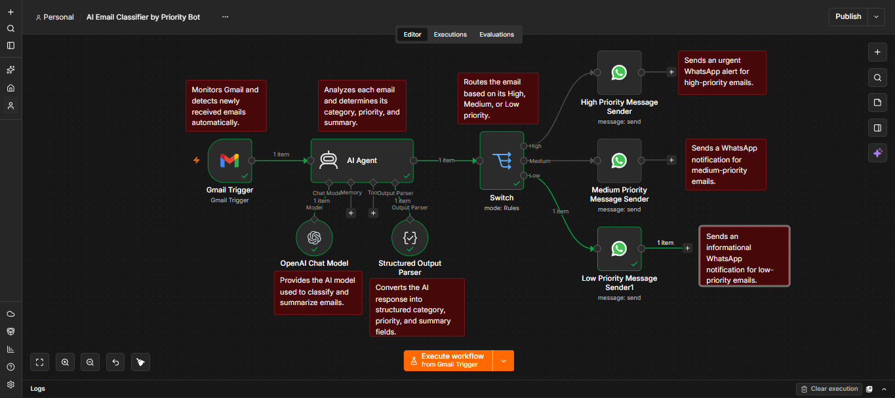
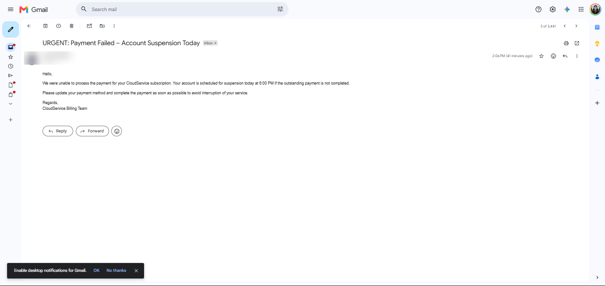
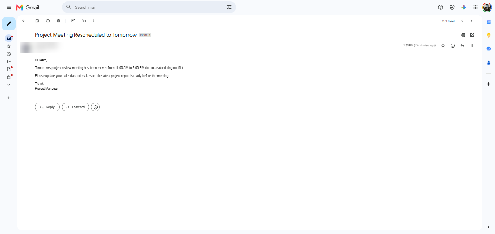
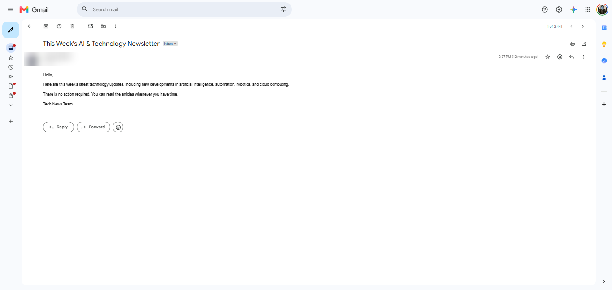
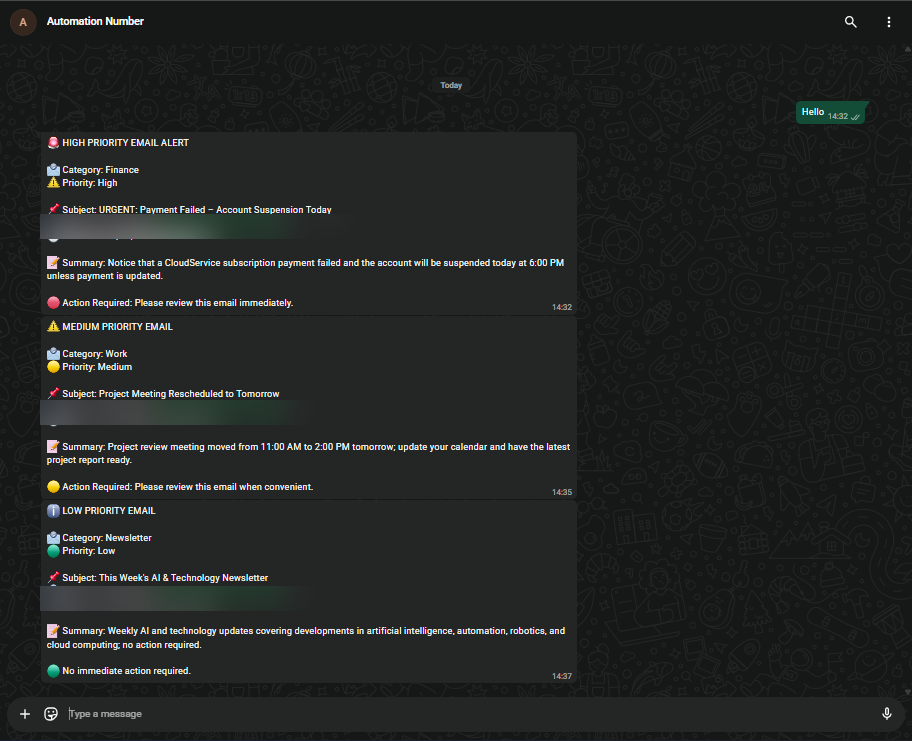

# AI Email Classifier by Priority Bot

An email classification and notification workflow built with n8n, Gmail, OpenAI, and WhatsApp. It detects newly received Gmail messages, classifies each email by category and priority, generates a short summary, and routes a WhatsApp alert through a High, Medium, or Low priority branch.

## Key Features

- Monitors Gmail for new messages every minute
- Retrieves the full Gmail message record through a Gmail node
- Uses an OpenAI-powered AI Agent to classify emails
- Assigns a category such as Finance, Work, Security, HR, Promotion, Newsletter, or Support
- Assigns one of three priority levels: High, Medium, or Low
- Generates a concise email summary
- Uses a Structured Output Parser for category, priority, and summary fields
- Routes notifications through a Switch node
- Sends different WhatsApp message formats for High, Medium, and Low priority emails

## Workflow Overview

The exported workflow contains 18 nodes in total, including sticky notes. Its main connected path is:

1. `Gmail Trigger` polls Gmail for newly received emails every minute.
2. `Get a message` retrieves the message using the Gmail message ID.
3. `AI Agent` receives the email subject, sender, and `snippet`, then determines its category, priority, and summary.
4. `OpenAI Chat Model` provides the language model for classification.
5. `Structured Output Parser` defines the expected structured fields: `category`, `priority`, and `summary`.
6. `Switch` routes the result according to `output.priority`.
7. One of three WhatsApp nodes sends the corresponding alert:
   - `High Priority Message Sender`
   - `Medium Priority Message Sender`
   - `Low Priority Message Sender1`

The export also contains a `WhatsApp Trigger` node, but it is disconnected and does not take part in the email-classification flow.

## Priority Levels

| Priority | Notification behavior |
|---|---|
| High | Urgent WhatsApp alert asking the recipient to review the email immediately |
| Medium | WhatsApp notification asking the recipient to review the email when convenient |
| Low | Informational WhatsApp notification; no immediate action required |

## Technology Stack

- n8n
- Gmail Trigger and Gmail message retrieval
- OpenAI Chat Model (`gpt-5-mini` in the supplied export)
- n8n AI Agent
- Structured Output Parser
- Switch node
- WhatsApp Business Cloud API

## Workflow File

[Download n8n Workflow JSON](workflow.json) — Sanitized workflow export for importing into n8n.

## Screenshots

### 1. n8n Workflow Architecture


### 2. Example High-Priority Email


### 3. Example Medium-Priority Email


### 4. Example Low-Priority Email


### 5. WhatsApp Priority Notifications


## Setup

1. Import `workflow.json` into your n8n instance. The exported workflow is inactive by default.
2. Connect your Gmail OAuth credentials to `Gmail Trigger` and `Get a message`.
3. Configure the Gmail Trigger polling settings and any mailbox filters you want to apply.
4. Connect your OpenAI credentials to `OpenAI Chat Model`.
5. Connect your WhatsApp Business API credentials to all three WhatsApp sender nodes.
6. Replace `REPLACE_WITH_YOUR_WHATSAPP_PHONE_NUMBER_ID` in the three WhatsApp nodes with your WhatsApp Business phone number ID.
7. Replace `REPLACE_WITH_YOUR_WHATSAPP_RECIPIENT_NUMBER` with the intended notification recipient's phone number in international format.
8. Test one email for each priority branch and verify the WhatsApp output.
9. Review the AI Agent prompt and Structured Output Parser configuration before activating the workflow.

The export removes credential references, webhook IDs, and instance-specific metadata. The original WhatsApp phone number ID and recipient phone number have been replaced with placeholders. Configure your own accounts and values after importing.

## Current Limitations and Recommended Improvements

The following issues are visible in the supplied workflow export:

- **AI prompt and parser format conflict:** The AI Agent prompt asks for one line in `Category | Priority | Summary` format, while the connected Structured Output Parser expects a JSON object with `category`, `priority`, and `summary`. Align the prompt with the parser schema; otherwise structured parsing may fail.
- **WhatsApp recipient is hard-coded:** All three WhatsApp sender nodes use the same fixed recipient number and phone number ID. Configure these placeholders for your own account, and use dynamic routing if different users should receive their own alerts.
- **Disconnected WhatsApp Trigger:** A WhatsApp Trigger node exists in the export but has no connections. It does not participate in email classification and can be removed if it is not needed for a separate future workflow.
- **Only the email snippet is classified:** The AI Agent prompt passes `$json.snippet`, not a guaranteed complete email body. Important context beyond the snippet may be missed. Consider passing the full plain-text body after the Gmail retrieval step.
- **No Gmail filters are configured:** The Gmail Trigger has an empty filters object, so the workflow does not explicitly exclude newsletters, spam, automated messages, or senders that should not generate alerts.
- **AI classification is not guaranteed:** Urgent language, automated billing messages, and context can lead to incorrect priority assignments. Review High-priority alerts before taking consequential action.
- **Email content is sent to an AI service and WhatsApp:** Consider privacy and data-handling requirements before using the workflow for confidential, regulated, or sensitive email content.
- **No explicit fallback route:** The Switch defines High, Medium, and Low outputs. Unexpected or malformed priority values do not have a documented fallback branch.

The email and WhatsApp screenshots show examples of the intended classification and alert behavior. They do not establish accuracy for all incoming email types.

## Repository Structure

```text
AI-Email-Classifier-by-Priority-Bot/
├── screenshots/
│   ├── README.md
│   ├── workflow-overview.png
│   ├── high-priority-email.png
│   ├── medium-priority-email.png
│   ├── low-priority-email.png
│   └── whatsapp-priority-alerts.png
├── README.md
└── workflow.json
```

## Author

<p align="left">
  <b>Jasvant Malvi</b><br>
  <a href="https://github.com/jasvantMalvi">GitHub</a> ·
  <a href="https://www.linkedin.com/in/jasvant-malvi-810305429/">LinkedIn</a>
</p>
