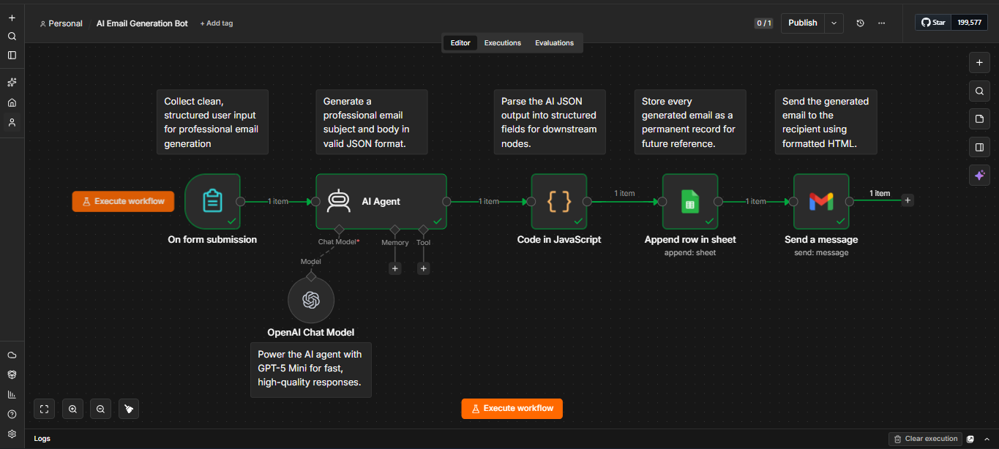
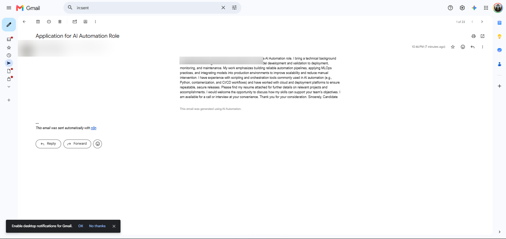
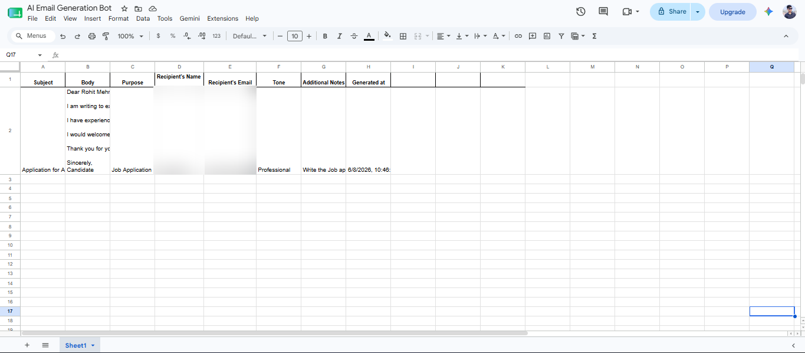

# AI Email Generation Bot

An AI-assisted email generation and delivery workflow built with n8n, OpenAI, Google Sheets, and Gmail. A user submits an n8n form with the email purpose, recipient details, preferred tone, and additional notes. An AI Agent generates a subject and email body in JSON, JavaScript parses the response, Google Sheets stores the generated email and request metadata, and Gmail sends the formatted email to the submitted recipient.

> **Important:** This workflow sends the generated email automatically after the Google Sheets append step. There is no human approval or preview-confirmation step between generation and sending.

## Key Features

- Collects email requirements through an n8n form
- Supports seven email purposes: Job Application, Follow-up Email, Meeting Request, Leave Request, Thank You Email, Business Proposal, and Scholarship Application
- Supports six tone options: Professional, Friendly, Formal, Casual, Confident, and Polite
- Generates a subject and complete email body using an OpenAI-powered AI Agent
- Requests JSON-only model output with `subject` and `body` fields
- Parses the AI response using a JavaScript Code node
- Adds a generation timestamp using `Asia/Kolkata`
- Stores the generated email and selected form metadata in Google Sheets
- Sends the generated email through Gmail using an HTML wrapper

## Workflow Overview

The supplied workflow contains six functional nodes and six sticky notes.

1. `On form submission` displays the **AI Email Generator** form and captures:
   - `Full Name`
   - `Recipient's Name`
   - `Recipient's Email`
   - `Email Purpose`
   - `Tone`
   - `Additional Notes`
2. `AI Agent` receives the form details and is instructed to generate a suitable subject and complete email body. It is asked to return only JSON:
   ```json
   {
     "subject": "",
     "body": ""
   }
   ```
3. `OpenAI Chat Model` supplies the model for the AI Agent. The supplied workflow selects `gpt-5-mini`.
4. `Code in JavaScript` parses the AI Agent's `output` using `JSON.parse()`, extracts the subject and body, adds metadata fields, and generates a timestamp in the `Asia/Kolkata` timezone.
5. `Append row in sheet` saves the subject, body, purpose, recipient details, tone, additional notes, and generation timestamp in the configured Google Sheet.
6. `Send a message` sends the formatted HTML email to the submitted recipient using Gmail.

## Form Fields

| Field | Purpose |
|---|---|
| `Full Name` | Name of the person generating the email |
| `Recipient's Name` | Name used to personalize the email greeting |
| `Recipient's Email` | Destination email address |
| `Email Purpose` | Selects the type of email to generate |
| `Tone` | Selects the writing style |
| `Additional Notes` | Supplies context and specific points to include |

The AI Agent prompt also refers to email length and language, but those fields are **not present** in the supplied form definition. The JavaScript node attempts to save `Email Length` and `Language` metadata, but these values are blank unless the fields are added or supplied by another source.

## AI Email Generation

The AI Agent's system prompt defines the assistant as an email-writing assistant for personal, academic, and business communication. It instructs the model to:

- Understand the purpose and recipient context
- Generate a concise, relevant subject
- Adapt wording to the selected tone
- Produce a complete email with an appropriate greeting and closing
- Use only the information provided
- Avoid invented facts
- Return only valid JSON with `subject` and `body`

The system prompt contains additional length options (Short, Medium, Detailed) and language handling instructions, but the current form does not expose those options.

## Google Sheets Structure

The supplied spreadsheet screenshot shows these columns:

| Column | Purpose |
|---|---|
| `Subject` | Generated email subject |
| `Body` | Generated email body |
| `Purpose` | Selected email purpose |
| `Recipient's Name` | Recipient name |
| `Recipient's Email` | Destination email |
| `Tone` | Selected tone |
| `Additional Notes` | User-provided context |
| `Generated at` | Generation timestamp in India time |

The sheet acts as a record of generated emails. The workflow appends a new row for each form submission; it does not search for or update an earlier email record.

## Email Delivery

The Gmail node:
- Uses `Recipient's Email` as the destination
- Uses the generated `Subject` as the email subject
- Places the generated `Body` inside a simple HTML email layout
- Adds the footer text: `This email was generated using AI Automation.`

The workflow sends the email after the Google Sheets append node. If the sheet append fails, the Gmail node is not reached. If Gmail fails after the sheet append succeeds, the generated email record may exist even though delivery failed.

## Technology Stack

- n8n
- n8n Form Trigger
- AI Agent
- OpenAI Chat Model (`gpt-5-mini` in the supplied export)
- JavaScript (n8n Code node)
- Google Sheets
- Gmail
- HTML email formatting

## Workflow File

[Download n8n Workflow JSON](./workflow.json) — Sanitized workflow export for importing into n8n.

## Screenshots

### 1. n8n Workflow Architecture


### 2. Generated Email Sent Through Gmail


### 3. Google Sheets Email Record


The screenshots show one example Job Application email and its saved record. They are examples of the workflow output, not a guarantee that every generated email is factually correct or appropriate to send without review.

## Setup

1. Import `workflow.json` into your n8n instance. The exported workflow is inactive by default.
2. Open the Form Trigger and publish or activate the form according to your n8n setup.
3. Connect your OpenAI credentials to `OpenAI Chat Model`.
4. Create a Google Spreadsheet with the eight headers listed above.
5. Replace `REPLACE_WITH_YOUR_GOOGLE_SHEET_ID` in `Append row in sheet` with your spreadsheet ID and select the correct worksheet.
6. Connect your Google Sheets OAuth credentials.
7. Connect your Gmail OAuth credentials to `Send a message`.
8. Submit a test form using an email address you control.
9. Check the AI Agent output and verify that it contains valid JSON with non-empty `subject` and `body` values.
10. Confirm that the Google Sheets row is appended and the Gmail message reaches the intended recipient.
11. Review the generated email before using the workflow for important business or personal communications.

The export removes credential references, webhook IDs, the original Google Spreadsheet ID, and instance-specific metadata. Reconnect your own OpenAI, Google Sheets, and Gmail credentials after importing.

## Current Limitations and Recommended Improvements

The following limitations are visible in the supplied workflow export:

- **Automatic sending without approval:** The generated email is sent immediately after it is saved to Google Sheets. Add a review-and-approve step before Gmail delivery to avoid sending inaccurate or unintended content.
- **No sender name in the AI prompt:** The form collects `Full Name`, but the AI Agent prompt does not include it. The generated email therefore cannot reliably use the sender's actual name in its signature.
- **Prompt/form mismatch:** The system prompt refers to Email Length and Language, but the form does not contain those fields. Add them to the form and pass them explicitly, or remove the unused instructions and metadata references.
- **JavaScript metadata key mismatch:** The Code node reads `Recipient Name` and `Recipient Email`, while the actual form labels are `Recipient's Name` and `Recipient's Email`. The separate Google Sheets mapping reads the correct form labels, but the Code node's `recipient_name` and `recipient_email` metadata fields will be blank.
- **Potential trailing newline in the Google Sheets column mapping:** The append node maps the recipient name using the key `Recipient's Name` with a carriage-return/line-feed suffix. Confirm that the actual spreadsheet header has the same hidden characters. If it does not, correct the mapping key to match the header exactly.
- **No JSON parse error handling:** The Code node calls `JSON.parse()` directly. Invalid or malformed model output stops the workflow. Add a validation and retry/error route.
- **No generated-content validation:** The workflow does not check whether subject and body are empty, whether the output is too long, or whether recipient details are consistent with the request.
- **No recipient confirmation:** The form email field is validated as an email input, but the workflow does not ask the user to confirm the destination before sending.
- **No duplicate submission protection:** Every successful form submission appends a new sheet row and sends an email. Repeated submissions can create duplicate messages.
- **No delivery-status tracking:** The spreadsheet stores generated content and a generation timestamp, but it does not store a delivery status, Gmail message ID, or send-failure reason.
- **No dedicated retry or failure notifications:** There is no explicit recovery path for OpenAI, Google Sheets, or Gmail failures.
- **HTML content is inserted directly:** The generated body is inserted into the HTML email template. If the body contains HTML, it may be interpreted as markup. Consider escaping plain-text output or explicitly requiring and validating a safe HTML format.

Use an approval step and verify recipients and generated content before relying on this workflow for sensitive or business-critical communications.

## Repository Structure

```text
AI-Email-Generation-Bot/
├── screenshots/
│   ├── README.md
│   ├── workflow-overview.png
│   ├── generated-email-example.png
│   └── google-sheets-email-log.png
├── README.md
└── workflow.json
```

## Author

<p align="left">
  <b>Jasvant Malvi</b><br>
  <a href="https://github.com/jasvantMalvi">GitHub</a> ·
  <a href="https://www.linkedin.com/in/jasvant-malvi-810305429/">LinkedIn</a>
</p>
