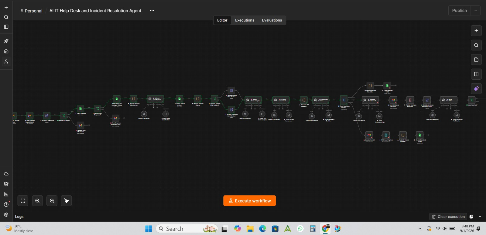

# AI IT Help Desk and Incident Resolution Agent

An AI-powered IT support automation system built using n8n, OpenAI, Gmail, and Google Sheets.

The system processes employee IT support requests, verifies employee information, analyzes incidents, assesses priority, and determines whether an issue should be resolved, troubleshot, or escalated to the IT team.

## Project Overview

Traditional IT help desks often require manual request classification, incident investigation, priority assignment, and ticket management.

This project automates several stages of the IT support process while including human approval and escalation for incidents requiring additional attention.

## Key Features

- Gmail-based IT support request intake
- Automatic request validation
- Employee verification using Google Sheets
- Previous ticket history retrieval
- AI-powered issue classification
- Similar incident identification
- AI root cause analysis
- Priority and SLA deadline assessment
- Automated resolution decision-making
- AI-generated troubleshooting instructions
- Email-based employee communication
- IT manager approval process
- IT engineer assignment
- Ticket updates in Google Sheets
- Employee resolution verification
- Incident escalation

## Workflow Architecture

1. **Request Reception:** Gmail Trigger receives incoming IT support requests.
2. **Request Validation:** Request details are normalized and checked for required information.
3. **Employee Verification:** Google Sheets is used to verify employee records.
4. **Ticket History:** Previous employee tickets and similar incidents are retrieved.
5. **Issue Classification:** AI analyzes and classifies the IT issue.
6. **Root Cause Analysis:** AI investigates possible causes using incident history and context.
7. **Priority Assessment:** AI evaluates incident priority and calculates an SLA deadline.
8. **Resolution Decision:** The workflow selects automated resolution, troubleshooting, or escalation.
9. **Troubleshooting:** AI generates instructions and sends them to the employee by email.
10. **Escalation:** Incidents requiring human attention enter the manager approval and engineer assignment process.
11. **Ticket Management:** Google Sheets stores ticket updates.
12. **Resolution Verification:** The workflow checks whether the employee's issue has been resolved.

## Technology Stack

| Technology | Purpose |
|---|---|
| n8n | Workflow automation |
| OpenAI API | AI classification and analysis |
| Gmail | IT request intake and email communication |
| Google Sheets | Employee records and ticket management |
| JavaScript | Data processing and automation logic |
| Structured Output Parser | Consistent AI responses |

## Project Files

- `workflow.json` — Sanitized n8n workflow export
- `screenshots/` — Workflow architecture and execution screenshots

## Setup Requirements

- n8n instance
- Gmail account and configured credentials
- OpenAI API credentials
- Google Sheets account
- Employee database and ticket spreadsheet
- Required spreadsheet columns and mappings

Import the workflow into n8n and configure your own credentials, spreadsheet IDs, sheet names, and node settings before testing.

## Important Notes

- This is a workflow demonstration, not a hosted IT help desk service.
- The workflow export is inactive by default.
- Configure and test all integrations before using it.
- The exported workflow includes a demo employee-response simulation.
- Review Google Sheets configurations, including ticket closure nodes, before running the workflow.
- Human approval and escalation are included for issues requiring IT-team involvement.

---

## Workflow Screenshots

### 1. Successful Execution

## Workflow Export

[View sanitized n8n workflow](workflow.json)

## Author

  <b>Jasvant Malvi</b> 
  <a href="https://github.com/jasvantMalvi">GitHub</a> ·
  <a href="https://www.linkedin.com/in/jasvant-malvi-810305429/">LinkedIn</a>

