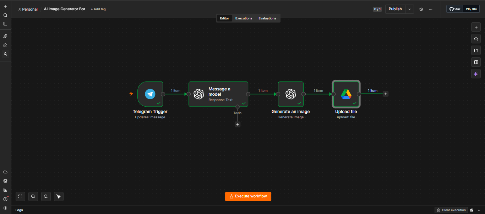
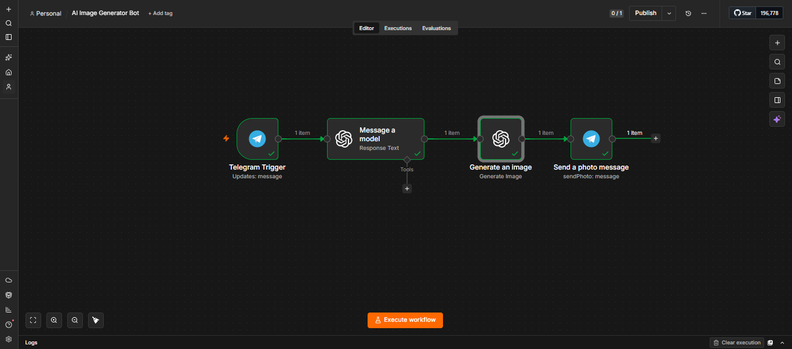
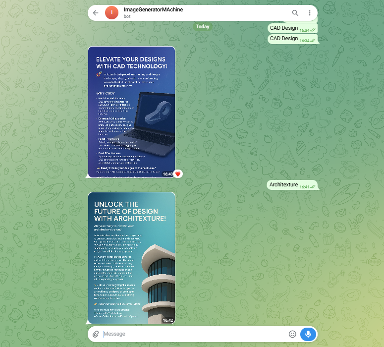

# AI Image Generator Bot

A Telegram-triggered AI content and image generation workflow built with n8n, OpenAI, and Google Drive. A user sends a topic or brief through Telegram. An OpenAI text model creates post copy with a hook, main content, call to action, and five hashtags. An image-generation node then creates a square social-media-style visual based on that copy, and the supplied workflow uploads the generated image to the root of Google Drive.

> **Important workflow distinction:** The included `workflow.json` ends with a Google Drive `Upload file` node. It does **not** contain a Telegram `Send a photo message` node, so this exact export uploads the generated image to Google Drive rather than sending the image back to the Telegram chat. The Telegram photo-delivery screenshots below are from an alternate version of the workflow and are identified as such.

## Key Features

- Receives text prompts through a Telegram bot
- Uses an OpenAI text model to expand a short topic into social-media post copy
- Requests a hook, main content, CTA, and five hashtags
- Uses the generated copy as the prompt context for image generation
- Generates a square 1:1 visual for Instagram/LinkedIn-style social content
- Uses `gpt-image-1-mini` in the supplied image-generation node
- Uploads the generated image file to Google Drive
- Uses the original Telegram prompt as the Google Drive file name

## Workflow Overview — Included JSON

The supplied workflow contains four nodes:

1. `Telegram Trigger` receives an incoming Telegram text message.
2. `Message a model` uses `gpt-4o-mini` to turn the user's message into a professional post with:
   - Hook
   - Main Content
   - CTA
   - Five hashtags
3. `Generate an image` uses `gpt-image-1-mini`. Its prompt combines the generated post copy with a design brief requesting a premium, modern, minimalist, professional 1:1 square social media visual.
4. `Upload file` uploads the generated image to `My Drive` in the root folder. The file name is taken from the original Telegram message text.

The actual connections in the supplied JSON are:

`Telegram Trigger → Message a model → Generate an image → Upload file`

## Models and Prompt Behavior

| Stage | Model | Purpose |
|---|---|---|
| Post-copy generation | `gpt-4o-mini` | Creates the hook, main content, CTA, and five hashtags |
| Image generation | `gpt-image-1-mini` | Generates a square social-media design based on the generated copy |

The image-generation prompt requests a modern, premium design with clean layout, professional typography, gradients, soft shadows, and an Instagram/LinkedIn-ready square composition. The prompt also asks for no watermark; this is an instruction to the model, not a guarantee about every generated result.

## Input

The workflow reads the text from:

`Telegram Trigger → message.text`

The supplied JSON does not define a separate form, topic selector, platform selector, style selector, or image-size selector. The post format and image design instructions are fixed in the node prompts.

## Output

### Included JSON — Google Drive

The supplied JSON sends the generated image binary to Google Drive's `Upload file` node. The destination is the root folder of `My Drive`, and the node name is dynamically set from the original Telegram message text.

The included workflow does not create a dedicated output folder or return a Google Drive link to the Telegram user.

### Alternate Telegram Photo-Delivery Version — Screenshots Only

The Telegram conversation screenshot shows generated images arriving in the chat. A separate workflow screenshot also shows a `Send a photo message` node after image generation. These visuals document an alternate version of the project. That Telegram photo-send node is **not** part of the included `workflow.json`; the supplied JSON uses Google Drive upload instead.

## Technology Stack

- n8n
- Telegram Trigger
- OpenAI text generation (`gpt-4o-mini`)
- OpenAI image generation (`gpt-image-1-mini`)
- Google Drive
- Telegram Bot API
- n8n binary file handling

## Workflow File

[Download n8n Workflow JSON](./workflow.json) — Sanitized export of the four-node Google Drive upload workflow.

## Screenshots

### 1. Included Workflow — Google Drive Upload



### 2. Alternate Workflow — Telegram Photo Delivery



This is a different workflow version: it ends with `Send a photo message`, which is not present in the included JSON export.

### 3. Telegram Image Output Example



This chat screenshot demonstrates the alternate Telegram photo-delivery behavior. It should not be interpreted as the output path of the included Google Drive upload JSON.

The supplied Google Drive screenshot is not included as an output-evidence image because it shows a general Drive home view rather than the generated image file or its destination folder contents.

## Setup — Included Google Drive Version

1. Import `workflow.json` into your n8n instance. The exported workflow is inactive by default.
2. Connect your Telegram credentials to `Telegram Trigger`.
3. Connect your OpenAI credentials to both `Message a model` and `Generate an image`.
4. Connect your Google Drive OAuth credentials to `Upload file`.
5. Confirm the Google Drive upload node targets the intended destination. The supplied node is configured for the root of `My Drive`.
6. Send a text prompt to the Telegram bot, such as `CAD Design` or `Architecture`.
7. Verify the text model output contains a suitable post brief and that the image-generation node receives it.
8. Confirm that the generated image is uploaded to Google Drive and check the output filename.
9. Test different topics and inspect the generated image before using it publicly.

The export removes credential references, webhook IDs, and instance-specific metadata. Reconnect your own Telegram, OpenAI, and Google Drive credentials after importing.

## Current Limitations and Recommended Improvements

The following limitations are visible in the supplied workflow export:

- **No Telegram image reply in the included JSON:** The JSON connects image generation to Google Drive upload. Add a Telegram `Send a photo message` node if the intended behavior is to return the generated image directly to the user.
- **Screenshots show multiple versions:** One screenshot shows Telegram photo delivery, while the included JSON uses Google Drive upload. Keep this distinction clear when presenting or importing the project.
- **Google Drive root destination:** Generated images are uploaded to the root of `My Drive`. Create a dedicated output folder to keep generated assets organized.
- **Filename is the raw Telegram prompt:** The `Upload file` name is taken directly from the original message text. Prompts with slashes, very long text, or repeated names may lead to awkward or duplicate filenames. Add a JavaScript filename-sanitization step.
- **No output link returned to Telegram:** The included JSON does not send the Drive file URL back to the requester. Add a Telegram text response with the uploaded file link if that is required.
- **Fixed image style and aspect ratio:** The image prompt always asks for a modern, premium, square 1:1 social post. There is no user-controlled image ratio, design style, colour palette, or platform selection.
- **Post copy is not separately stored:** The included JSON does not save the generated copy to Google Sheets or another content database.
- **No retry or error-handling branch:** There is no explicit recovery path for Telegram input errors, text model failures, image-generation failures, or Google Drive upload errors.
- **No content review or approval:** The workflow does not ask the user to approve the generated copy or image before the output is uploaded.
- **Prompt injection and unsafe content checks are not visible:** The workflow does not include a moderation or validation step for user prompts or generated content.
- **No cost or usage controls:** The workflow does not impose per-user generation limits or track model usage.
- **No evidence that all designs are platform-compliant:** The prompt requests Instagram and LinkedIn-ready content, but there is no automated check for platform-specific dimensions, text legibility, or policy compliance.

Review generated copy and visuals before publishing them. Model-generated text and images can contain inaccurate, unsuitable, or poorly rendered content.

## Repository Structure

```text
AI-Image-Generator-Bot/
├── screenshots/
│   ├── README.md
│   ├── workflow-drive-upload.png
│   ├── alternate-telegram-photo-delivery.png
│   └── telegram-generated-image-example.png
├── README.md
└── workflow.json
```
