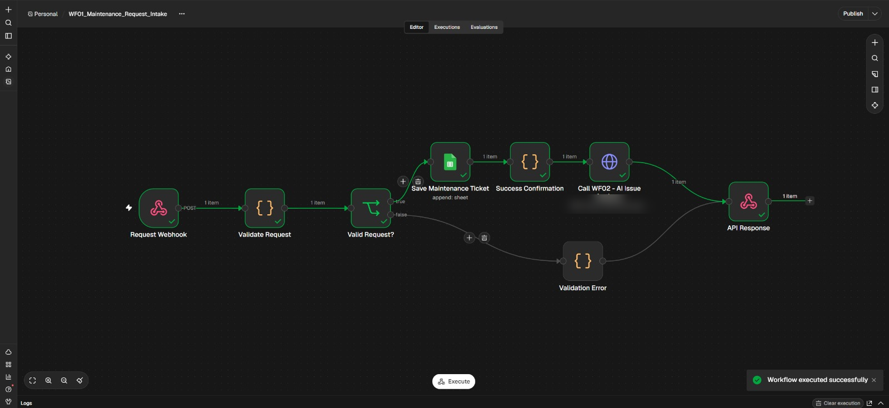
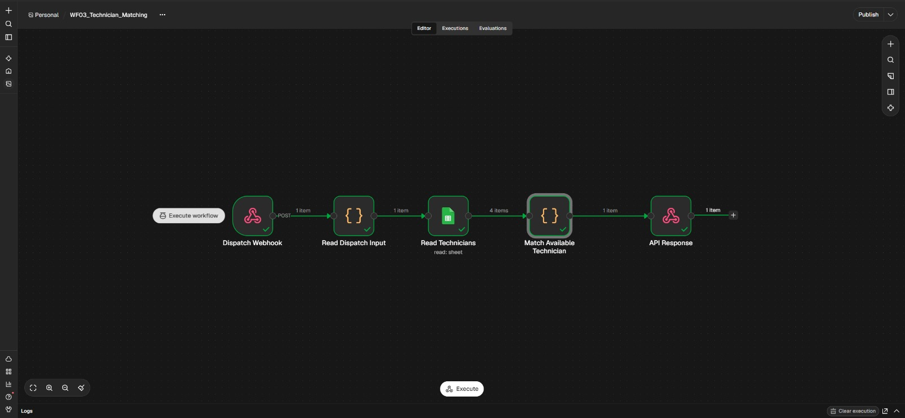

# Project Screenshots

These screenshots document the four separate n8n workflows included in the AI Maintenance Dispatch prototype.

## WF01 — Maintenance Request Intake

Receives a POST request, validates required employee and issue details, applies basic keyword-based category and priority rules, saves the ticket to Google Sheets, and returns a JSON response. The supplied WF01 export does **not** call WF02 automatically.

## WF02 — AI Issue Analyzer

The workflow contains a Gemini HTTP Request node, but the node is disconnected. The active route uses a mock node that returns a fixed HVAC / High-priority analysis example. It does not currently provide live AI analysis.

## WF03 — Technician Matching

Reads technician data from Google Sheets and returns a candidate based on exact skill match, availability, and active-job capacity. The supplied workflow does not update the original ticket or notify the technician.

## WF04 — Status Validation

Checks the submitted ticket ID and status value against an allowed list, then returns a JSON response. The supplied workflow does not write the validated status back to Google Sheets.

These are workflow design screenshots. They do not by themselves prove that all four workflows are connected into a complete end-to-end dispatch process.