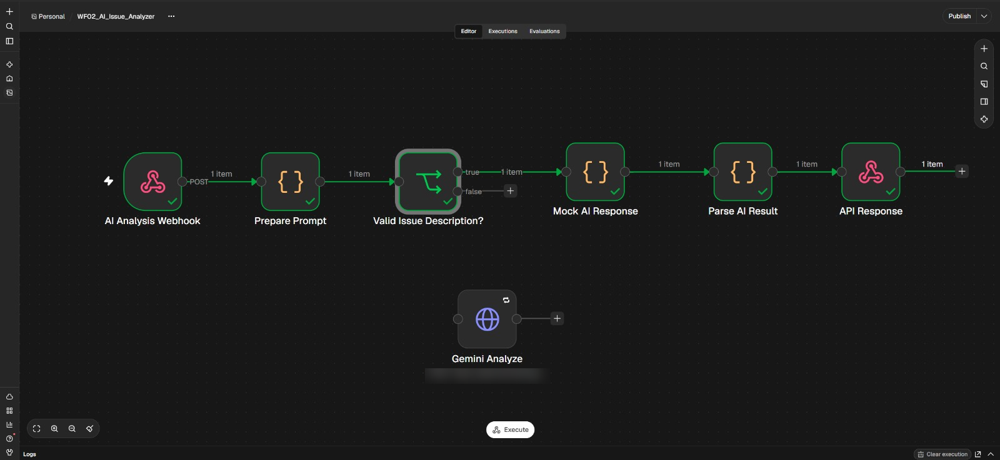
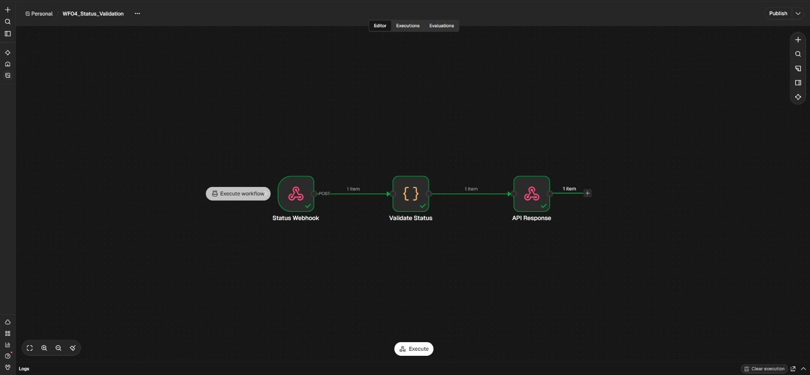

# Project Screenshots

These screenshots document the four n8n workflows included in this repository.

## WF01 — Maintenance Request Intake

Accepts and validates maintenance requests, saves valid tickets, and invokes the issue-analysis workflow.

## WF02 — AI Issue Analyzer

Shows the current issue-analysis workflow. The active path uses mock AI output; the Gemini HTTP Request node is present but disconnected.

## WF03 — Technician Matching

Reads technician records and matches an available technician based on skills and workload.

## WF04 — Status Validation

Validates a ticket status payload and returns a structured API response.
