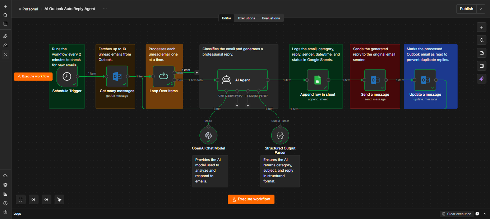
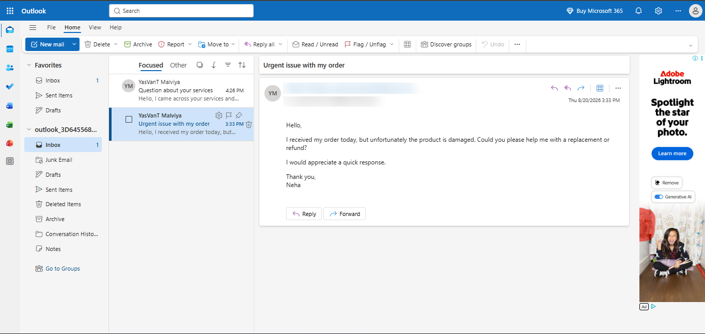
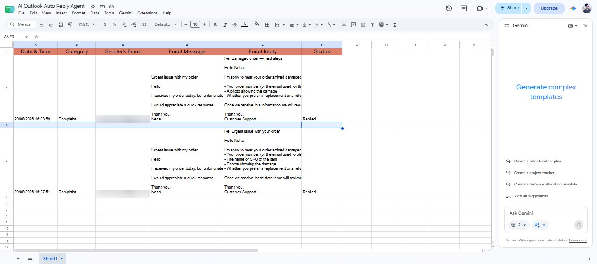

# Screenshots

These screenshots were supplied with the project. Mailbox addresses in the examples have been blurred for public sharing.

## 1. n8n Workflow Overview

Shows the two-minute schedule, unread email retrieval, one-at-a-time loop, AI Agent with GPT-5 Mini and structured output parsing, Google Sheets logging, Outlook send step, and mark-as-read update.

## 2. Outlook Inbox Example

Sample incoming email used to demonstrate automated classification and reply handling.

## 3. Google Sheets Log

Example log layout with date/time, category, sender, original message, AI reply, and status columns.
