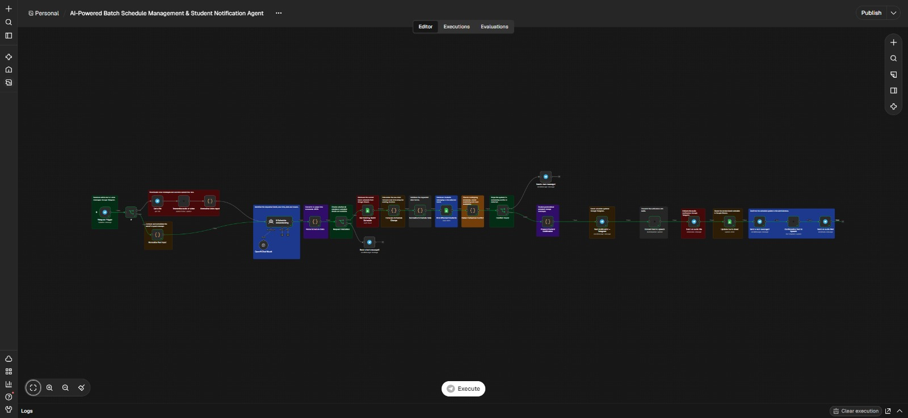
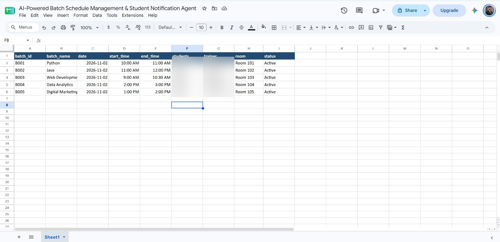
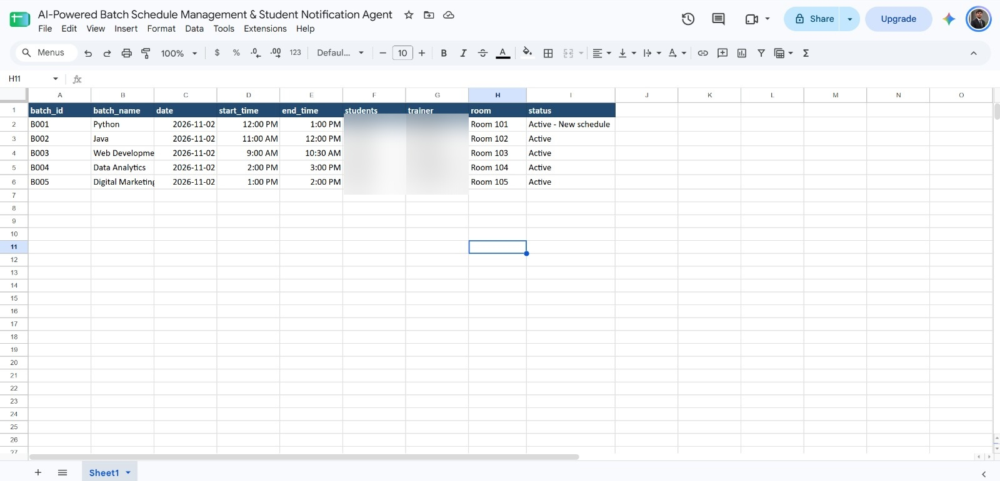
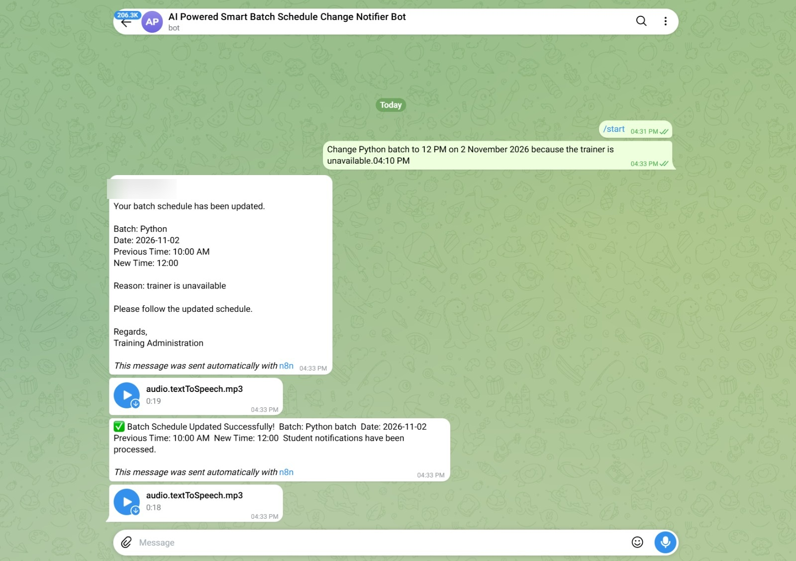

# AI-Powered Batch Schedule Management & Student Notification Agent

An n8n workflow that lets an administrator request a batch schedule change through Telegram using text or a voice message. The workflow transcribes voice input with ElevenLabs, uses GPT-5 Mini to extract the requested batch, date, new start time, and reason, reads batch data from Google Sheets, calculates a new end time using the existing duration, attempts to check room/trainer conflicts, and then sends Telegram text/audio messages and updates the schedule record.

> **Important implementation note:** This is a prototype / demonstration workflow, not a production-ready student-notification system. The exported JSON contains material lookup, conflict-check, and recipient-routing defects. These are described explicitly below. The example screenshots show a tested change to the Python batch from 10:00 AM–11:00 AM to 12:00 PM–1:00 PM on 2 November 2026, but they do not prove that other batches, conflict cases, or individual student delivery work correctly.

## Key Features in the Export

- Receives administrator requests through a Telegram bot
- Accepts typed text or voice input
- Downloads voice messages from Telegram and transcribes them with ElevenLabs Speech-to-Text
- Uses GPT-5 Mini to extract `intent`, `batch_name`, `new_time`, `date`, and `reason`
- Parses the AI response into structured JSON
- Checks that a schedule-change request includes a batch name, new time, and date
- Reads batch records from Google Sheets
- Calculates the new end time while preserving the duration of the selected existing batch
- Includes code intended to detect overlapping time slots that share a trainer or room
- Prepares a text notification for each comma-separated student name in the `students` cell
- Sends Telegram text and generated audio messages
- Updates a matching Google Sheets row and sends the administrator a confirmation

## Workflow Overview

The supplied n8n export contains **44 nodes: 26 operational nodes and 18 sticky notes**.

### 1. Telegram input

1. `Telegram Trigger` receives incoming Telegram messages.
2. `If` checks whether the incoming message contains a Telegram voice file ID.
3. For voice input, `Get a file` downloads the audio and `Transcribe audio or video` sends it to ElevenLabs Speech-to-Text.
4. `Normalize Voice Input` stores the transcript as `user_input` and marks the input type as `voice`.
5. For non-voice input, `Normalize Text Input` takes `message.text`, trims it, and marks the input type as `text`.

Both input routes continue to `AI Schedule Understanding`.

### 2. AI request extraction

`AI Schedule Understanding` uses the supplied current date in the `Asia/Kolkata` timezone and the administrator's message. The system prompt asks GPT-5 Mini to return:

- `intent`: `change_schedule`, `check_schedule`, or `general_question`
- `batch_name`
- `new_time` in 24-hour `HH:mm` format
- `date` in `YYYY-MM-DD` format
- `reason`

`Parse Schedule Data` parses the returned JSON. `Request Validation` only accepts `change_schedule` requests with a non-empty batch name, new time, and date.

**Scope caveat:** Although the AI prompt lists `check_schedule` and `general_question` as supported intents, the current workflow has no handling path for either intent. They go to the generic request-error reply.

### 3. Existing schedule and time calculation

1. `Get Existing Batch Schedule` reads the Google Sheets worksheet.
2. `Compare Schedule Change` uses the first input row, reads its existing start and end times, calculates the duration, converts the requested start time to minutes, and calculates a new end time using the same duration.
3. `Normalize Schedule Date` validates that the requested date is in `YYYY-MM-DD` format.

The time calculation code rejects invalid time strings, non-positive existing durations, and a new time that would push the end time past midnight.

### 4. Affected students and conflict check

`Find Affected Students` is configured to filter the spreadsheet by `batch_name`. `Detect Schedule Conflict` contains interval-overlap logic and checks whether an overlapping row uses the same room or trainer. `Conflict Found` routes a detected conflict to a Telegram warning; otherwise it continues to message preparation.

**Critical caveat:** The current upstream filter returns rows for the selected batch only, while the conflict-check code explicitly skips that batch. It therefore does not receive the other batches it needs to compare and cannot reliably detect conflicts as configured. See the limitations section.

### 5. Student notifications and schedule update

`Prepare Student Notification` splits the `students` cell on commas and creates one notification item per student name. The message includes the batch, date, previous time, new time, and reason.

The workflow then:

1. Sends the text notification with `Text Notification – Telegram`.
2. Converts the notification to speech using ElevenLabs in `Convert text to speech`.
3. Sends an audio message using `Send an audio file`.
4. Updates the selected row in Google Sheets using `Update row in sheet`.
5. Sends a text confirmation to the administrator using `Send a text message3`.
6. Converts the administrator confirmation to audio and sends it using `Confirmation Text to Speech` and `Send an audio file1`.

**Recipient caveat:** The sheet stores student names but no individual Telegram chat IDs. The text notification's `chatId` is taken from the original `Telegram Trigger` message, meaning the messages are sent to the administrator/requester's chat, not to each student. The audio notification follows the text reply's chat ID, so it also returns to that same chat. The screenshots show this behavior in the administrator's chat.

## Google Sheets Structure

The supplied spreadsheet screenshots show these columns:

| Column | Purpose |
|---|---|
| `batch_id` | Batch record identifier |
| `batch_name` | Batch/course label, such as Python or Java |
| `date` | Scheduled date in `YYYY-MM-DD` format |
| `start_time` | Existing batch start time |
| `end_time` | Existing batch end time |
| `students` | Comma-separated student names used to prepare message text |
| `trainer` | Assigned trainer name |
| `room` | Assigned room |
| `status` | Current schedule status; the demonstrated update writes `Active - New schedule` |

The screenshots show five sample batches on 2 November 2026. The Python batch is shown changing from 10:00 AM–11:00 AM to 12:00 PM–1:00 PM. The other sample batch records remain unchanged in the after screenshot.

## Example Administrator Request

```text
Change Python batch to 12 PM on 2 November 2026 because the trainer is unavailable.
```

The example output shown in Telegram states the old and new times, the reason, and a confirmation that student notifications have been processed. In the current JSON, the per-student Telegram messages are actually delivered to the requester's chat, not to individual student accounts.

## Technology Stack

- n8n
- Telegram Bot API
- OpenAI GPT-5 Mini
- ElevenLabs Speech-to-Text
- ElevenLabs Text-to-Speech
- Google Sheets
- JavaScript / n8n Code nodes
- `Asia/Kolkata` timezone handling

## Workflow File

[Download n8n Workflow JSON](./workflow.json) — Sanitized export of the supplied 44-node workflow. The JSON is inactive and requires your own credentials and Google Sheets ID after import.

## Screenshots

### 1. n8n Workflow Architecture



### 2. Google Sheets — Original Batch Schedule



### 3. Google Sheets — Updated Batch Schedule



### 4. Telegram Request and Confirmation



The screenshots are sample execution evidence from 1–2 November 2026. Student and trainer names have been obscured in the public copies.

## Setup

1. Import `workflow.json` into your n8n instance. The exported workflow is inactive.
2. Connect your Telegram bot credentials to `Telegram Trigger` and all Telegram send/download nodes.
3. Connect your OpenAI credentials to `OpenAI Chat Model`.
4. Connect your ElevenLabs credentials to the speech-to-text and text-to-speech nodes.
5. Create a Google Spreadsheet with the exact headers listed in the Google Sheets Structure section.
6. Replace `REPLACE_WITH_YOUR_GOOGLE_SHEET_ID` in all three Google Sheets nodes and select the correct worksheet.
7. Use a private Telegram bot/chat for administrator commands. The current workflow does not check whether the sender is authorized; add an allowlist check before enabling it.
8. Fix the batch lookup and conflict-query logic before using the workflow to change real schedules.
9. Add individual student Telegram chat IDs or another valid delivery destination to the data model, then change notification routing to use those IDs.
10. Test text requests, voice requests, invalid requests, unknown batch names, multiple students, overlapping schedules, and no-conflict updates before activation.

The workflow export removes credential references, Telegram webhook IDs, instance metadata, and the original Google Spreadsheet ID. It preserves node configuration and connections while replacing the spreadsheet ID with a setup placeholder.

## Current Limitations and Required Fixes

The following issues are visible in the supplied workflow JSON:

1. **Existing batch lookup is not filtered:** `Get Existing Batch Schedule` has no filter configured. `Compare Schedule Change` then reads `$input.first().json`, so it may use the first row returned by Google Sheets rather than the batch name extracted by the AI. A request for a different batch can calculate and update the wrong row.
2. **Conflict query filters out the schedules needed for comparison:** `Find Affected Students` filters by `batch_name`, which returns the selected batch's record. `Detect Schedule Conflict` then skips rows whose batch name equals the selected batch. It therefore has no other batch rows left to test for overlap. Fetch all active schedules for the requested date, then exclude only the target row in the conflict code.
3. **Student messages are sent to the administrator:** `Prepare Student Notification` outputs student names only, while `Text Notification – Telegram` uses the original Telegram trigger's chat ID. The sheet has no individual student chat IDs. Add per-student IDs and route each message to the matching recipient. Until fixed, do not describe the workflow as delivering direct student notifications.
4. **Admin confirmation repeats for each student item:** `Prepare Student Notification` creates one output item per student name, but the sheet update and admin confirmation/audio nodes are downstream of that per-student output. For a batch with multiple comma-separated students, the same batch row can be updated repeatedly and the administrator can receive duplicate confirmations/audio messages. Move the batch update and admin confirmation to a single post-notification branch.
5. **Date value is not written from the requested date:** `Normalize Schedule Date` validates `normalized_date`, but `Update row in sheet` maps the `date` column from the existing row's `date` field rather than `normalized_date`. A requested date change is therefore not saved to the spreadsheet.
6. **Intent support is incomplete:** The AI prompt lists `check_schedule` and `general_question`, but `Request Validation` only routes `change_schedule`. Add separate branches or remove unsupported intents from the prompt.
7. **No authorization check for the administrator:** Any Telegram user able to message the bot may reach the schedule-change flow. Validate the incoming Telegram user/chat ID against an administrator allowlist before processing commands.
8. **No explicit no-op route:** `Compare Schedule Change` calculates `actual_change`, but no later node checks it. A request for the current start time can still proceed through notifications and write a new status.
9. **Date validation is format-only:** `Normalize Schedule Date` checks a `YYYY-MM-DD` pattern but does not validate whether the date exists on the calendar or whether it is an allowed scheduling date.
10. **No robust failure or rollback handling:** There are no dedicated error branches for transcription, AI parsing, Google Sheets reads/writes, Telegram delivery, or ElevenLabs failures. A failure partway through the chain can leave notifications and sheet state out of sync.
11. **No confirmation/approval step before writing:** A fully populated AI interpretation proceeds toward the change without showing a preview and requesting administrator confirmation. Add a confirmation step before applying changes to prevent accidental schedule edits.
12. **Student data model is insufficient for delivery:** `students` is a comma-separated name string, not a structured student list. It cannot reliably map each student to a Telegram account and is fragile when names contain commas. Use one row per student or a structured roster table with student ID and Telegram chat ID.

## Suggested Production Flow

A safer design would: authorize the administrator → parse and validate the request → find exactly one batch by `batch_name` plus date → calculate the new time → fetch all active batches for that date → check room/trainer overlaps → send a change preview to the administrator → require confirmation → update the target row once → notify each student using their own chat ID → log delivery success/failure → send one administrator summary.

## Repository Structure

```text
AI-Powered-Batch-Schedule-Management-and-Student-Notification-Agent/
├── screenshots/
│   ├── README.md
│   ├── workflow-overview.jpg
│   ├── batch-schedule-before.jpg
│   ├── batch-schedule-after.jpg
│   └── telegram-schedule-change.jpg
├── README.md
└── workflow.json
```
