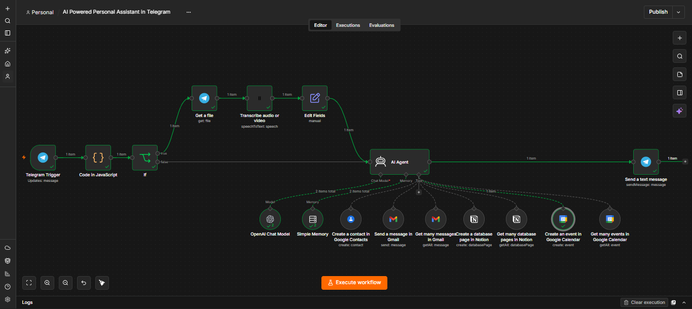

# AI Powered Personal Assistant in Telegram

An AI-powered personal assistant built using n8n and Telegram, designed to handle text and voice interactions through a conversational interface.

## Key Features

- Telegram-based text interaction
- Voice message handling
- AI-powered conversational responses
- Audio transcription and processing
- Automated task handling through connected tools
- Personalized assistant responses

## Workflow Overview

1. Receive text or voice messages through Telegram.
2. Identify the incoming message type.
3. Process text directly or transcribe voice input.
4. Send the processed input to the AI assistant.
5. Generate a relevant response.
6. Deliver the response through Telegram.

## Technology Stack

- n8n — Workflow automation
- Telegram Bot API — User interaction
- OpenAI API — AI processing
- JavaScript — Data processing
- Speech-to-text integration — Voice transcription

## Project Structure

```text
AI-Powered-Personal-Assistant-in-Telegram/
├── README.md
├── workflow.json
└── screenshots/
    ├── README.md
    └── workflow-overview.png
```

## Setup Requirements

- n8n instance
- Telegram Bot Token
- OpenAI API credentials
- Voice transcription integration, if required
- Configured workflow tools and credentials

## Important Notes

- Available features depend on the tools and integrations configured in the workflow.
- Configure your own credentials before importing and testing.
- Never publish API keys, bot tokens, or private user data.

## Author

**Jasvant Malvi**

- GitHub: https://github.com/jasvantMalvi
- LinkedIn: https://www.linkedin.com/in/jasvant-malvi-810305429/

## Project Files

- [Download n8n Workflow JSON](./workflow.json) — Sanitized workflow export for importing into n8n.
- [View Project Screenshots](./screenshots/) — Workflow overview and visual documentation.

## Workflow Screenshot



