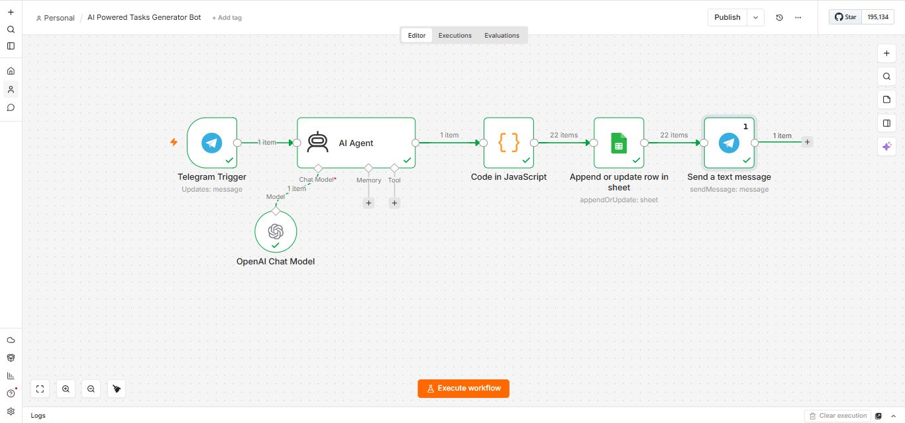
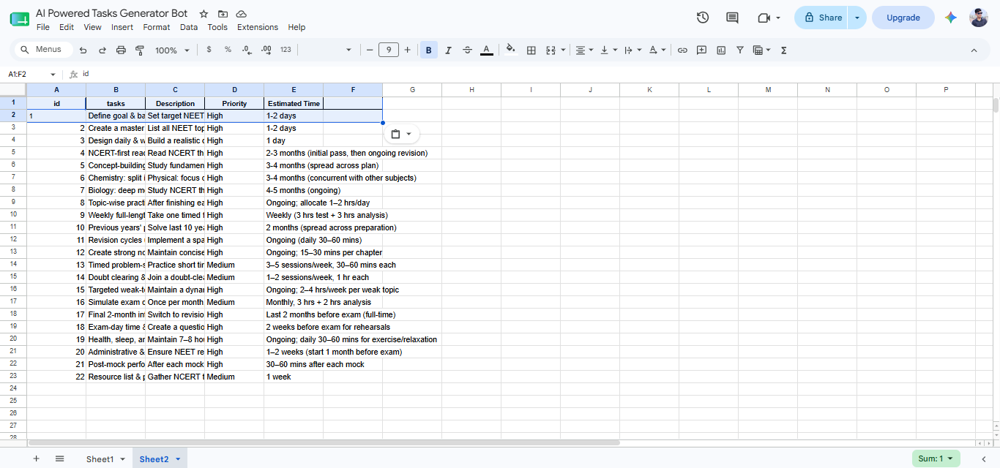
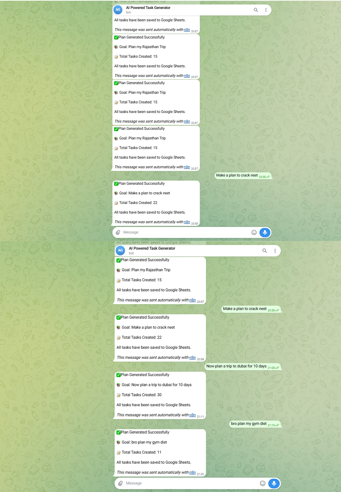

# AI Powered Tasks Generator Bot

A Telegram-based AI task-planning workflow built with n8n, OpenAI, and Google Sheets. A user sends a goal or request through Telegram. An AI Agent breaks it into structured, actionable tasks, JavaScript converts the JSON task array into individual records, Google Sheets stores the task rows, and Telegram sends a summary of the generated plan.

## Key Features

- Receives natural-language goals through Telegram
- Handles multiple planning domains, including study, travel, shopping, work/business, health/fitness, personal tasks, and daily productivity
- Uses an OpenAI-powered AI Agent to break a goal into sequential, actionable tasks
- Requests task titles, descriptions, priority, estimated time, deadline, and category
- Encourages day-wise or week-wise sequencing for multi-step goals
- Parses the AI Agent's JSON response with JavaScript
- Converts each task into an individual output item
- Appends task records to Google Sheets
- Sends a Telegram confirmation containing the original goal and number of tasks generated

## Workflow Overview

The supplied JSON contains six nodes connected in this order:

`Telegram Trigger → AI Agent → Code in JavaScript → Append row in sheet → Send a text message`

The `OpenAI Chat Model` node connects to the AI Agent's Chat Model input.

1. **Telegram Trigger** receives a text message from a Telegram user.
2. **AI Agent** uses the incoming message as the planning request. Its system instructions ask it to understand the goal, group tasks logically, adapt the plan to complexity and timeframe, and return strict JSON.
3. **OpenAI Chat Model** supplies `gpt-5-mini` to the AI Agent.
4. **Code in JavaScript** parses the AI Agent's `output` using `JSON.parse()`, reads the `tasks` array, and creates one n8n item per task.
5. **Append row in sheet** writes each task item to the configured Google Sheets worksheet.
6. **Send a text message** replies to the Telegram sender with the original goal, the number of task items generated, and a confirmation that the tasks were saved.

## Task Output Format

The AI Agent is instructed to return JSON with a `tasks` array. Each task is expected to contain:

| Field | Description |
|---|---|
| `task_title` | Short, action-oriented task title |
| `description` | Practical details describing what to do |
| `priority` | `High`, `Medium`, or `Low` |
| `estimated_time` | Estimated duration or time range |
| `deadline` | Day-wise or date-based deadline |
| `category` | Task category, such as Study, Travel, Work, or Personal |

The prompt asks the model to use a day-wise plan for short multi-step goals and day-/week-wise sequencing for larger goals. For recurring tasks, it asks the model to include the frequency in the description.

## Google Sheets Structure

The supplied sheet screenshot shows the following columns:

| Column | Mapped value |
|---|---|
| `id` | Task index within the generated plan (`1`, `2`, `3`, …) |
| `tasks` | `task_title` |
| `Description` | `description` |
| `Priority` | `priority` |
| `Estimated Time` | `estimated_time` |

**Important:** Although the AI prompt and JavaScript output include `deadline` and `category`, the Google Sheets node does not map either field. Those two values are therefore not stored in the visible task sheet. Add matching columns and mappings if you want them retained.

The supplied Google Sheets node uses the `append` operation. It adds new task rows; it does not update an existing task by ID.

## Telegram Confirmation

After the Google Sheets node completes, the workflow sends a Telegram message containing:

- A success heading
- The original user goal
- Total task items created
- A confirmation that the tasks were saved to Google Sheets

The count is calculated from the items output by `Code in JavaScript`.

## Technology Stack

- n8n
- Telegram Bot API
- AI Agent (n8n LangChain node)
- OpenAI Chat Model (`gpt-5-mini` in the supplied export)
- JavaScript (n8n Code node)
- Google Sheets
- JSON parsing and structured task mapping

## Workflow File

[Download n8n Workflow JSON](./workflow.json) — Sanitized export for importing into n8n.

## Screenshots

### 1. n8n Workflow Architecture



### 2. Google Sheets Task Records



### 3. Telegram Plan Generation Examples



The screenshots show sample task plans and saved rows. They demonstrate the output format, not a guarantee that every generated plan is complete or optimal.

## Setup

1. Import `workflow.json` into your n8n instance. The export is inactive by default.
2. Create a Telegram bot and connect your Telegram credentials to `Telegram Trigger` and `Send a text message`.
3. Connect your OpenAI credentials to `OpenAI Chat Model`.
4. Create a Google Spreadsheet with these headers: `id`, `tasks`, `Description`, `Priority`, and `Estimated Time`.
5. Replace `REPLACE_WITH_YOUR_GOOGLE_SHEET_ID` in `Append row in sheet` with your spreadsheet ID and select the correct worksheet.
6. Connect your Google Sheets OAuth credentials.
7. Send a test goal through Telegram, for example: `Make a 7-day plan to prepare for my Python interview`.
8. Check that the AI Agent returns valid JSON, the Code node produces one item per task, the sheet receives the corresponding rows, and Telegram reports the correct task count.
9. Add `Deadline` and `Category` sheet columns and mappings if those fields need to be saved.
10. Activate the workflow only after testing malformed inputs and repeated requests.

The export removes credential references, webhook IDs, the original Google Spreadsheet ID, and instance-specific metadata. Reconnect your own Telegram, OpenAI, and Google Sheets accounts after importing.

## Current Limitations and Recommended Improvements

The following limitations are visible in the supplied workflow export:

- **Deadline and category are not saved:** The prompt and Code node produce these fields, but the Google Sheets append mapping only includes ID, task title, description, priority, and estimated time. Add columns and mappings for both fields.
- **Task IDs restart for every plan:** JavaScript assigns `id: index + 1`. Each new request therefore starts at ID `1`, so IDs are not globally unique across plans or users. Use a unique task ID and store a plan/request ID.
- **No user or chat ID stored with tasks:** The Telegram reply uses the triggering user's ID, but the sheet mapping does not retain that ID. Add `telegram_user_id` or `chat_id` so tasks can later be filtered by owner.
- **No plan identifier:** Tasks from different goals are stored in the same worksheet without a plan/group ID. It is difficult to determine which task rows belong to one generated plan.
- **No task lifecycle fields:** The sheet does not contain status, completion date, or progress fields. This workflow generates and stores tasks; it does not provide task completion tracking, editing, or deletion.
- **JSON parsing can stop the run:** The Code node throws an error if the model output is invalid JSON. Add validation, a retry strategy, and a user-facing error path.
- **No explicit validation of task fields:** The Code node trusts the returned JSON and does not check for missing titles, invalid priorities, empty task arrays, or absent required fields.
- **Empty task array may interrupt the workflow:** If the model returns no tasks, the Code node returns zero items. The downstream append and Telegram confirmation path may not execute as intended.
- **Append-only behavior:** The supplied Google Sheets node uses `append`; it does not perform an upsert despite the operation description visible in the screenshot.
- **No approval or editing step:** The plan is saved automatically. There is no confirmation step allowing the user to revise the task plan before persistence.
- **No error notification path:** OpenAI, Google Sheets, or Telegram failures are not handled through dedicated recovery branches.

Use the generated plan as a draft. Review deadlines and estimated durations before treating them as commitments.

## Repository Structure

```text
AI-Powered-Tasks-Generator-Bot/
├── screenshots/
│   ├── README.md
│   ├── workflow-overview.png
│   ├── google-sheets-task-records.png
│   └── telegram-plan-generation.png
├── README.md
└── workflow.json
```
