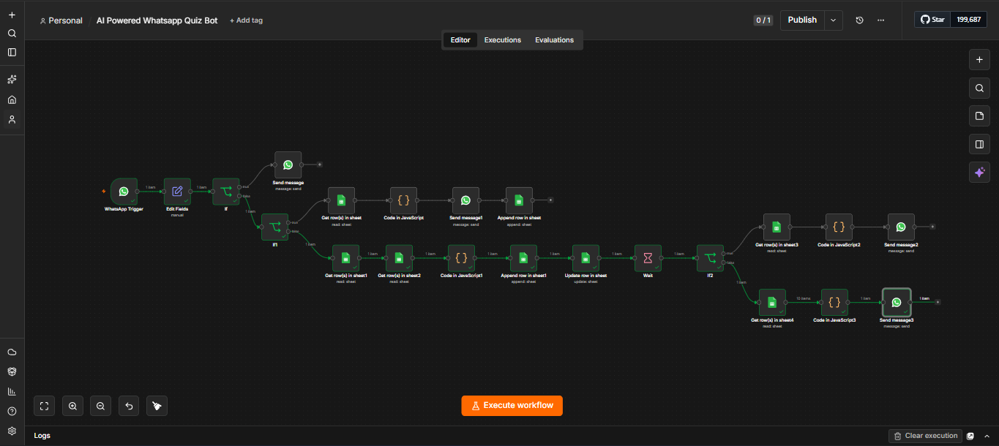
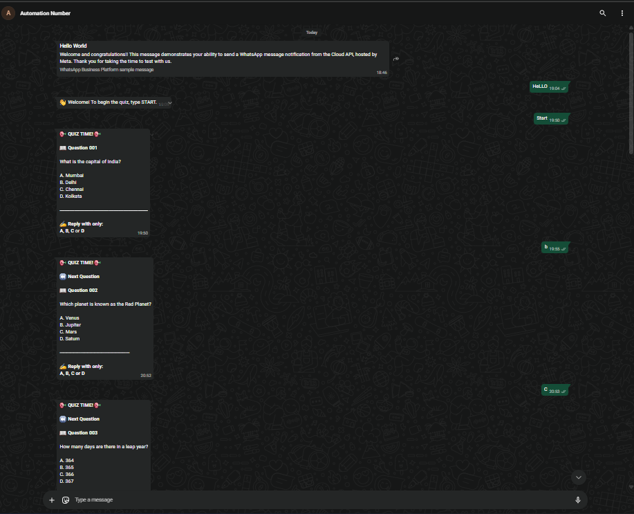

# AI-Powered WhatsApp Quiz Bot

An n8n workflow that delivers a sequential multiple-choice quiz through WhatsApp and uses Google Sheets to store questions, participant progress, and answers.

## Key Features

- WhatsApp-based quiz interaction
- START command to begin the quiz
- Multiple-choice questions with four options
- Answer validation against a Google Sheets question bank
- Participant progress tracking
- Response logging and score calculation
- Final result summary delivered through WhatsApp

## Workflow Overview

1. A WhatsApp message triggers the workflow.
2. Greeting messages receive instructions to type `START`.
3. `START` retrieves the first question (`Q001`) from the question bank.
4. The workflow sends the question and four options to the participant.
5. A participant's reply is compared with the stored correct answer.
6. The response, correctness, score, and timestamp are appended to the response log.
7. The participant's current question is updated and the next question is sent.
8. After question 10, the workflow calculates a result summary and sends it over WhatsApp.

## Technology Stack

- n8n
- WhatsApp Business Cloud API
- Google Sheets
- JavaScript (n8n Code nodes)

## Google Sheets Structure

The workflow uses three sheets in one spreadsheet:

| Sheet | Purpose |
|---|---|
| `Quiz_Questions` | Stores question IDs, question text, options A–D, and correct answers |
| `Quiz_Stage` | Stores participant phone number, current question ID, and last-question timestamp |
| `Quiz_Responses` | Stores submitted answers, correctness, score, and response timestamp |

### Expected Columns

**Quiz_Questions**

`Question_ID`, `Question`, `Option_A`, `Option_B`, `Option_C`, `Option_D`, `Correct_Answer`

**Quiz_Stage**

`Phone_No`, `Current_Question_ID`, `Last_Question_Time`

**Quiz_Responses**

`Phone_No`, `Question_ID`, `Student_Answer`, `Correct_Answer`, `Is_Correct`, `Score`, `Response_Time`

## Workflow File

**Download n8n Workflow JSON**

[Download WhatsApp Quiz Bot Workflow](workflow.json) — Sanitized workflow export for importing into n8n.


## Screenshots

### n8n Workflow


### WhatsApp Quiz Conversation


## Setup

1. Download `workflow.json` and import it into n8n.
2. Create a Google Spreadsheet with the three sheet tabs and columns listed above.
3. Configure your own WhatsApp Trigger and WhatsApp Business credentials.
4. Connect your Google Sheets credential and select your spreadsheet in the Google Sheets nodes.
5. Set your own WhatsApp Phone Number ID in the WhatsApp send nodes.
6. Add at least 10 question rows with IDs `Q001` through `Q010`.
7. Test with a participant number that can message your WhatsApp Business number.

The workflow export is sanitized: account credential references, webhook IDs, the original spreadsheet ID, and the original WhatsApp Phone Number ID have been removed. Configure your own values after import.

## Current Limitations

This is a rule-based quiz workflow. It does not use an AI model to generate questions.

The current workflow:
- compares incoming text with the stored correct answer;
- does not explicitly reject replies outside A/B/C/D;
- can create duplicate stage rows if a participant sends `START` repeatedly;
- calculates the final result from all response rows for that phone number, so repeat attempts can mix results;
- does not provide a dedicated recovery path when a participant replies without an active quiz-stage row.

These limitations should be addressed before using the workflow for multiple independent quiz attempts or production use.

## Repository Structure

```text
AI-Powered-WhatsApp-Quiz-Bot/
├── screenshots/
│   ├── workflow-overview.png
│   └── quiz-conversation.png
├── README.md
└── workflow.json
```


## Author

<p align="left">
  <b>Jasvant Malvi</b><br>
  <a href="https://github.com/jasvantMalvi">GitHub</a> ·
  <a href="https://www.linkedin.com/in/jasvant-malvi-810305429/">LinkedIn</a>
</p>
