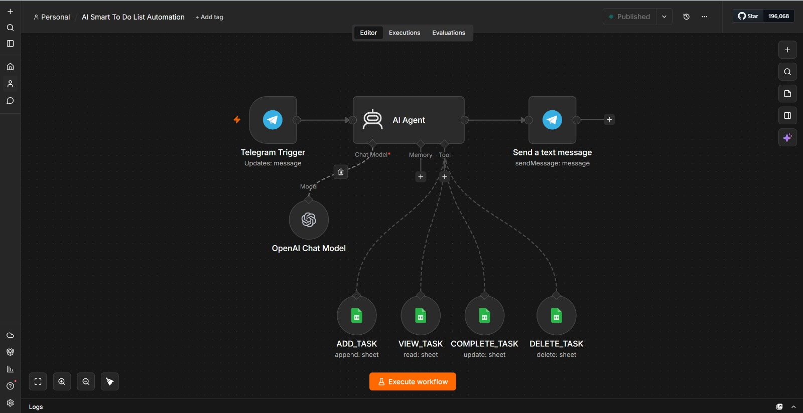
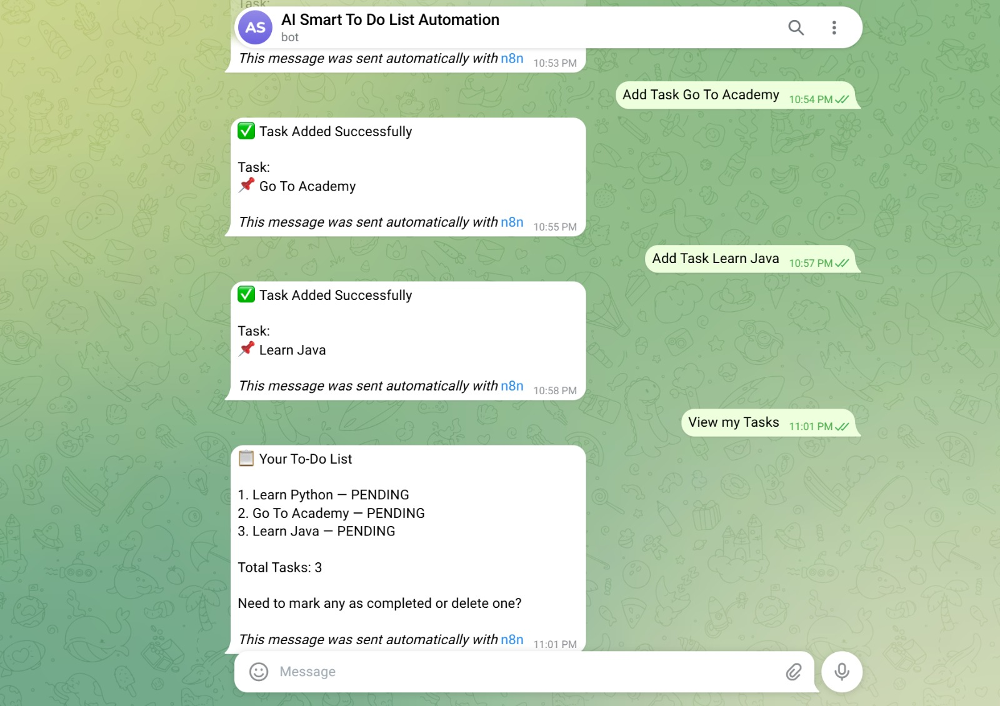
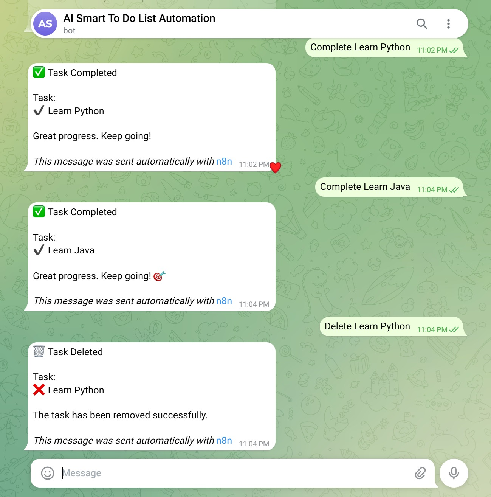
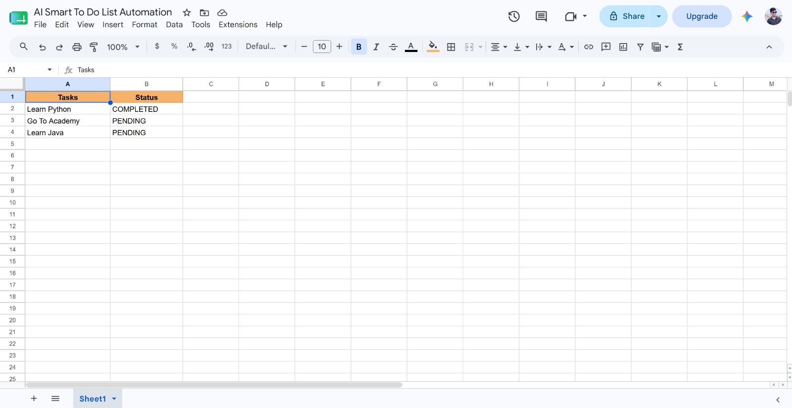

# AI Smart To-Do List Automation

An AI-powered task management assistant built with n8n. Users interact with the assistant through Telegram, while an AI Agent interprets requests and uses Google Sheets tools to manage task records.

## Key Features

- Add new tasks through natural-language Telegram messages
- View tasks stored in Google Sheets
- Mark matching tasks as completed
- Delete a matching task
- Provide help and clarify incomplete requests
- Send the assistant's response back through Telegram

## Workflow Overview

1. Telegram Trigger receives an incoming text message.
2. The AI Agent interprets the user's intent and message.
3. The OpenAI Chat Model provides language understanding.
4. The agent can call one of four Google Sheets tools:
   - `ADD_TASK` appends a task with status `PENDING`.
   - `VIEW_TASK` retrieves task records.
   - `COMPLETE_TASK` updates the matching task's status to `COMPLETED`.
   - `DELETE_TASK` deletes the row identified by the agent.
5. The AI Agent prepares a response.
6. The Telegram send-message node replies to the originating chat.

## Technology Stack

- n8n
- Telegram Bot API
- OpenAI Chat Model
- Google Sheets
- n8n AI Agent and Google Sheets tools

## Google Sheets Structure

The supplied workflow maps two columns:

| Column | Purpose |
|---|---|
| `Tasks` | Task title |
| `Status` | Task state, initially `PENDING` and updated to `COMPLETED` |

The current workflow does not include a Telegram user ID or chat ID column.

## Workflow File

[Download n8n Workflow JSON](workflow.json) — Sanitized workflow export for importing into n8n.

## Screenshots

### 1. n8n Workflow Architecture


### 2. Adding and Viewing Tasks in Telegram


### 3. Completing and Deleting Tasks


### 4. Google Sheets Task Database


## Setup

1. Import `workflow.json` into your n8n instance.
2. Create a Telegram bot and configure your own Telegram credentials.
3. Configure your own OpenAI credentials for the Chat Model node.
4. Create a Google Spreadsheet with `Tasks` and `Status` columns.
5. Replace `REPLACE_WITH_YOUR_GOOGLE_SHEET_ID` with your spreadsheet ID in the Google Sheets nodes.
6. Select the correct spreadsheet and worksheet in each Google Sheets tool.
7. Connect the credentials to the relevant nodes and test each operation from Telegram.

The export removes account-specific credential references, webhook IDs, and the original spreadsheet ID. Credentials must be configured again after import.

## Current Limitations and Recommended Improvements

The following limitations are visible in the supplied workflow configuration:

- **No user isolation:** The sheet contains only `Tasks` and `Status`. There is no Telegram user/chat ID, so the workflow does not enforce per-user task ownership.
- **Deletion relies on an AI-selected row number:** A wrong row selection could delete the wrong task. Add deterministic lookup and confirmation before deletion.
- **Duplicate task names are ambiguous:** Completion matches using the task name, rather than a unique task ID.
- **No explicit delete confirmation:** The workflow has no separate confirmation step before deleting a task.
- **View and update operations need ownership filters:** Add a user identifier and filter every read, update, and delete operation by that identifier.

These safeguards should be implemented before using the workflow with multiple users or real personal task data.

## Repository Structure

```text
AI-Smart-To-Do-List-Automation/
├── screenshots/
│   ├── README.md
│   ├── workflow-overview.png
│   ├── telegram-task-management.png
│   ├── telegram-task-completion-deletion.png
│   └── google-sheets-task-database.png
├── README.md
└── workflow.json
```
