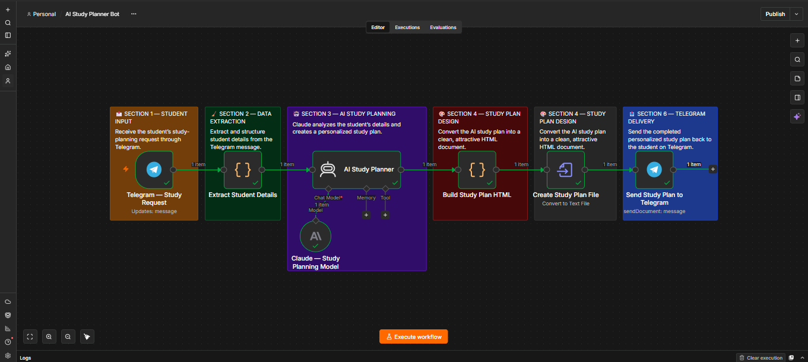
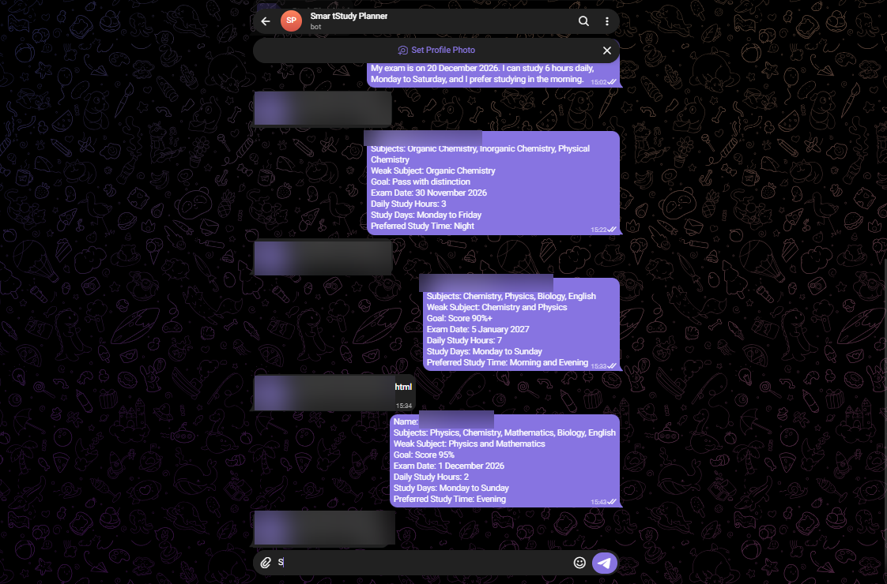
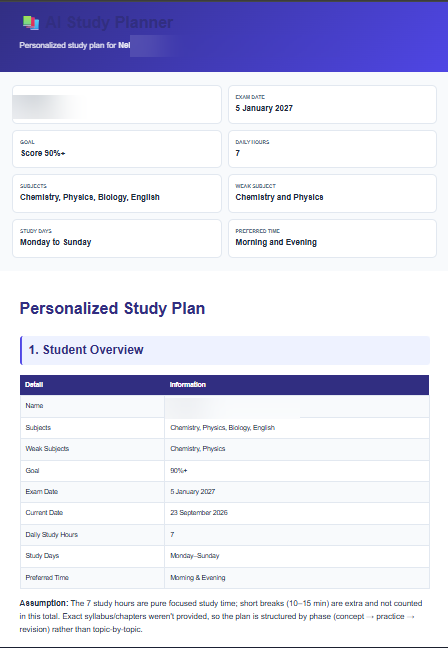
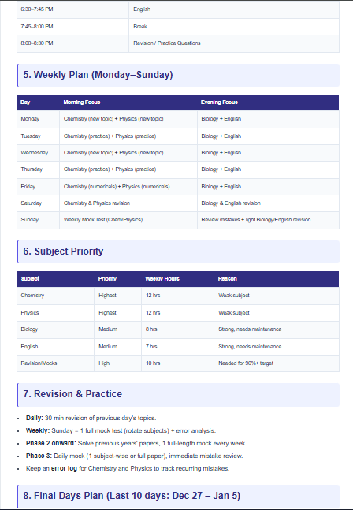

# AI Study Planner Bot

A Telegram-based study-planning workflow built with n8n and Claude. It receives a student's structured study request, extracts the supplied details, asks Claude to generate a personalized study plan, formats the answer into a styled HTML document, and sends the document back to the same Telegram chat.

The study-planning prompt is designed to account for the student's subjects, weak subjects, goal, exam date, daily study-hour limit, preferred study days, preferred study time, and the current date supplied by n8n.

> **Scope:** This workflow generates and delivers a study-plan document. It does not create calendar events, send scheduled study reminders, track completed tasks, or monitor the student's actual study progress.

## Key Features

- Receives study-plan requests through Telegram message updates
- Extracts the student's name, subjects, weak subject, goal, exam date, daily study hours, study days, and preferred study time
- Uses the Telegram first name as a fallback if the `Name:` field is missing
- Uses Claude Sonnet 5 through an n8n AI Agent to generate the plan
- Supplies the current date dynamically using the n8n `$now` expression
- Instructs the model to calculate the exam countdown using the current date
- Sets daily study hours as a hard planning limit in the AI instructions
- Gives additional attention to weak subjects while maintaining other subjects
- Requests daily timetable, weekly plan, revision, practice, mock tests, and final-days guidance
- Converts the AI's Markdown-style response into a styled HTML document
- Creates a personalized filename based on the student's name
- Sends the generated `.html` study plan document back to the originating Telegram chat

## Workflow Overview

The supplied export contains **13 nodes**: 7 operational nodes and 6 sticky notes.

1. `Telegram — Study Request` — receives Telegram `message` updates.
2. `Extract Student Details` — reads the incoming Telegram text and extracts:
   - `Name`
   - `Subjects`
   - `Weak Subject`
   - `Goal`
   - `Exam Date`
   - `Daily Study Hours`
   - `Study Days`
   - `Preferred Study Time`

   It also captures the Telegram user ID, username, first name, original message, and extraction timestamp. If a field is missing, the code fills it with `Not specified`; the name falls back to the Telegram first name or `Student`.
3. `AI Study Planner` — combines the extracted details, original message, and current date into the AI prompt, then requests a complete personalized study plan.
4. `Claude — Study Planning Model` — supplies the `claude-sonnet-5` model to the AI Agent.
5. `Build Study Plan HTML` — reads the AI output and student details, converts basic Markdown structures into HTML, escapes the student data used in the page, adds a responsive page style, and builds a name-based filename.
6. `Create Study Plan File` — converts the HTML string into a text/HTML file using the generated filename.
7. `Send Study Plan to Telegram` — sends the generated document to the chat ID from the original Telegram trigger.

### Main data path

```text
Telegram Study Request
        ↓
Extract Student Details
        ↓
AI Study Planner (Claude Sonnet 5)
        ↓
Build Study Plan HTML
        ↓
Create Study Plan File (.html)
        ↓
Send Study Plan to Telegram
```

## Student Input Format

The JavaScript extraction node expects field labels in a multiline Telegram message. For example:

```text
Name: Neha Patel
Subjects: Chemistry, Physics, Biology, English
Weak Subject: Chemistry and Physics
Goal: Score 90%+
Exam Date: 5 January 2027
Daily Study Hours: 7
Study Days: Monday to Sunday
Preferred Study Time: Morning and Evening
```

The extractor searches for each label followed by a colon. The labels should be present as separate lines for deterministic extraction. If a field is omitted or typed differently, it may be returned as `Not specified` and the AI may make an assumption.

## Study Plan Sections Requested from Claude

The system prompt requests these nine sections:

1. **Student Overview** — short table of student details
2. **Exam Countdown** — days remaining until the exam
3. **Study Strategy** — how to divide available study time
4. **Daily Schedule** — timetable within the supplied daily study-hour limit
5. **Weekly Plan** — Monday–Saturday or the specified study days
6. **Subject Priority** — extra attention to weak subjects
7. **Revision & Practice** — revision, questions, and mock tests
8. **Final Days Plan** — study approach near the exam
9. **Important Tips** — 5–7 practical tips

The prompt tells Claude to use the dynamically supplied current date, avoid inventing the preparation period, treat daily hours as a hard limit, state assumptions for missing information, and ask the student to update an exam date that has already passed.

The countdown and the time allocation are generated by the AI model; there is no separate JavaScript verification step for date arithmetic or total study-hour calculations in the supplied workflow.

## HTML Study Plan Document

The `Build Study Plan HTML` node:

- Reads the AI plan from `output`, `text`, or `response`
- Retrieves the original student details from `Extract Student Details`
- Converts basic headings, bold text, bullet lists, numbered lists, and Markdown tables
- Escapes the student data fields inserted into the HTML template
- Creates a responsive layout with student details, plan content, tables, and styled section headings
- Generates a filename in the format `AI_Study_Plan_<Student_Name>.html`

The output is an HTML file, not a PDF. The Telegram node sends it as a document attachment.

## Technology Stack

- n8n
- Telegram Bot API
- n8n Code node (JavaScript)
- n8n AI Agent
- Anthropic Claude Sonnet 5
- Markdown-to-HTML formatting
- HTML/CSS
- n8n Convert to File node

## Workflow File

[Download n8n Workflow JSON](./workflow.json) — Sanitized export of the supplied 13-node workflow. The exported workflow is inactive and has credential references, webhook IDs, and instance-specific metadata removed. Reconnect your own Telegram and Anthropic credentials after import.

## Screenshots

### 1. n8n Workflow Architecture



### 2. Telegram Study Requests and HTML File Delivery



### 3. Generated HTML Study Plan — Student Overview



### 4. Generated HTML Study Plan — Weekly and Revision Sections



The sample screenshots show example plans generated on **23 September 2026**. They are historical sample outputs, not a fresh plan for the current date. The plan depends on the accuracy and completeness of the student's submitted information and the AI-generated calculations.

## Setup

1. Import `workflow.json` into your n8n instance. The exported workflow is inactive.
2. Connect your Telegram Bot credentials to `Telegram — Study Request` and `Send Study Plan to Telegram`.
3. Connect your Anthropic credentials to `Claude — Study Planning Model`.
4. Confirm that the `claude-sonnet-5` model is available to your Anthropic integration. If it is not available in your account or n8n node version, select a model supported by your environment.
5. Start a conversation with the Telegram bot and send a study request using the exact field labels shown in the Student Input Format section.
6. Check the `Extract Student Details` node output to make sure each field is extracted correctly.
7. Review the AI Agent output and verify that the exam countdown and daily study-hour allocation are reasonable.
8. Confirm that `Build Study Plan HTML` creates a valid HTML string and a sensible filename.
9. Verify that the `.html` document is delivered to the same Telegram chat.
10. Test missing fields, invalid or past exam dates, unusual student names, and different study-day preferences before activating the workflow.

The sanitized export removes credential references, webhook IDs, workflow IDs, instance metadata, and pin data. Configure your own integrations after import.

## Current Limitations and Recommended Improvements

The following limitations are visible in the supplied workflow JSON:

- **Text input only:** The Telegram Trigger listens for message updates, and `Extract Student Details` reads `message.text`. Voice messages, photos, and documents are not processed by this workflow.
- **No explicit input validation:** Missing fields are filled with `Not specified`; the workflow does not stop and ask the student to provide required information before generating the plan.
- **Field labels must match:** The extraction code looks for labels such as `Daily Study Hours:` and `Preferred Study Time:`. Alternative wording, typos, or a single-paragraph request can cause fields to be missed.
- **AI assumptions can affect the plan:** The system prompt allows reasonable assumptions when information is missing. It asks the model to state those assumptions, but does not validate them against student input.
- **Exam countdown is not independently validated:** The current date is dynamically supplied to Claude, but there is no JavaScript date calculation or separate check of the generated countdown.
- **Daily-hour limit is prompt-based:** The AI is instructed to treat study hours as a hard limit, but the workflow does not independently calculate and verify the total timetable duration.
- **HTML conversion supports only basic Markdown:** The conversion code handles common headings, bold text, lists, and simple pipe-delimited tables. Complex Markdown, nested lists, code blocks, or unusual table formatting may not render exactly as intended.
- **Numbered and bullet lists are transformed with simple regular expressions:** Complex nested list formatting is not fully supported by the current converter.
- **No persistent student profile:** The workflow does not save student details or previous plans in a database or Google Sheets.
- **No reminders or progress tracking:** It sends the plan once. It does not schedule daily reminders, record completed study sessions, or revise the plan based on progress.
- **No calendar integration:** The plan is delivered as an HTML document; its time slots are not added to Google Calendar.
- **No explicit error handling:** There is no dedicated error route for Telegram input failures, Claude errors, invalid AI output, HTML conversion errors, or document delivery failures.
- **No dedicated output parser:** The AI output is consumed as text/Markdown, not validated against a structured schema.

## Repository Structure

```text
AI-Study-Planner-Bot/
├── screenshots/
│   ├── README.md
│   ├── workflow-overview.png
│   ├── telegram-study-plan-delivery.png
│   ├── html-study-plan-overview.png
│   └── html-study-plan-weekly-plan.png
├── README.md
└── workflow.json
```


## Author

<p align="left">
  <b>Jasvant Malvi</b><br>
  <a href="https://github.com/jasvantMalvi">GitHub</a> ·
  <a href="https://www.linkedin.com/in/jasvant-malvi-810305429/">LinkedIn</a>
</p>
