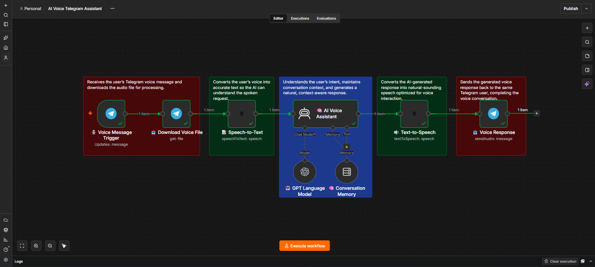
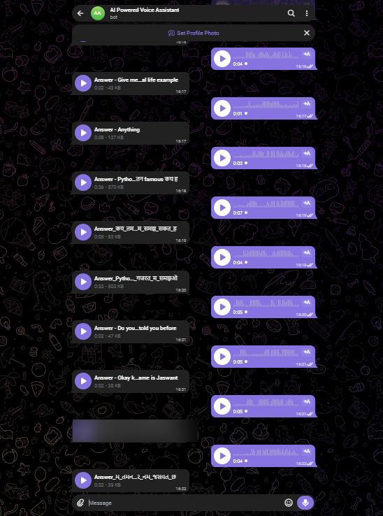

# AI Voice Telegram Assistant

A voice-first conversational assistant built with n8n, Telegram, ElevenLabs, and OpenAI. It receives a Telegram voice message, downloads and transcribes the audio, asks an AI Agent to interpret the spoken request and write a concise response, converts that response back into speech, and sends the generated audio to the same Telegram chat.

The AI prompt is designed to respond in English, Hindi, Gujarati, or a natural mix such as Hinglish, based on the detected language of the user's voice message.

> **Scope:** This workflow handles Telegram voice messages and returns audio replies. It does not send a separate text reply, execute external actions, or connect to tools such as Gmail, Calendar, or task management.

## Key Features

- Receives Telegram message updates through a Telegram Trigger
- Downloads the voice attachment using the Telegram voice file ID
- Transcribes speech with ElevenLabs Speech-to-Text
- Uses GPT-5 Mini through an n8n AI Agent to interpret the transcription
- Includes detailed response instructions for concise, natural, speech-friendly answers
- Instructs the assistant to handle common speech-to-text errors and conversational references
- Instructs the assistant to respond in English, Hindi, Gujarati, Hinglish, or Gujarati-English combinations according to the user's language
- Connects an n8n Conversation Memory node configured with a 10-message context window
- Converts the generated answer to speech using ElevenLabs Text-to-Speech
- Uses the configured ElevenLabs voice, labelled `Roger - Laid-Back, Casual, Resonant`
- Sends the resulting audio file back to the originating Telegram chat

## Workflow Overview

The supplied export contains **13 nodes**: 8 operational nodes and 5 sticky notes.

1. `🎙️ Voice Message Trigger` — listens for Telegram `message` updates.
2. `📥 Download Voice File` — downloads the attachment using `message.voice.file_id`.
3. `📝 Speech-to-Text` — uses ElevenLabs Speech-to-Text to produce a transcription in the `text` field.
4. `🧠 AI Voice Assistant` — receives the transcript and asks the model to interpret the user's intended meaning and return only the response that should be spoken back.
5. `🤖 GPT Language Model` — provides the `gpt-5-mini` model to the AI Agent.
6. `🧠 Conversation Memory` — provides a memory buffer configured with `contextWindowLength: 10`.
7. `🔊 Text-to-Speech` — converts the AI Agent's `output` into audio with the configured ElevenLabs voice.
8. `📤 Voice Response` — sends the generated audio to the Telegram chat ID from the original trigger message.

### Main data path

```text
Telegram Voice Message
        ↓
Download Voice File
        ↓
ElevenLabs Speech-to-Text
        ↓
AI Voice Assistant (GPT-5 Mini + Conversation Memory)
        ↓
ElevenLabs Text-to-Speech
        ↓
Telegram Audio Reply
```

## AI Assistant Behaviour

The system prompt is written for a voice interaction. It tells the assistant to:

- Answer the user's question directly and avoid unnecessary introductions.
- Interpret likely transcription mistakes without focusing on grammar errors.
- Use recent conversational context for references such as "it", "this", "again", or "why".
- Ask a clarification question only when required information is genuinely missing.
- Keep replies natural when spoken aloud, with short sentences and limited formatting.
- Detect and follow the user's language: English, Hindi, Gujarati, Hinglish, or Gujarati-English.
- Retain English technical terms when that sounds natural in Hindi or Gujarati responses.
- Provide safe, responsible information for sensitive topics.

The AI Agent is instructed to return only the final spoken response. The workflow passes that response into Text-to-Speech rather than sending it as a Telegram text message.

## Language Support

The system prompt explicitly describes these language behaviours:

| User's voice message | Expected response style |
|---|---|
| English | Clear, natural English |
| Hindi | Natural Hindi |
| Gujarati | Natural Gujarati |
| Hindi + English | Natural Hinglish |
| Gujarati + English | Natural Gujarati-English mix |

Language detection is instructed in the AI Agent prompt; the workflow does not contain a separate language-classification node.

## Technology Stack

- n8n
- Telegram Bot API
- ElevenLabs Speech-to-Text
- OpenAI GPT-5 Mini
- n8n AI Agent
- n8n Conversation Memory
- ElevenLabs Text-to-Speech

## Workflow File

[Download n8n Workflow JSON](./workflow.json) — Sanitized export of the supplied 13-node workflow. The export is inactive and has credential references and webhook IDs removed. Reconnect your own services before testing.

## Screenshots

### 1. n8n Workflow Architecture



### 2. Telegram Voice Conversation



The screenshots demonstrate the workflow design and example audio replies. They are sample evidence, not a guarantee of uninterrupted service or correct transcription for every accent, language, or recording.

## Setup

1. Import `workflow.json` into your n8n instance. The exported workflow is inactive.
2. Connect your Telegram Bot credentials to `🎙️ Voice Message Trigger`, `📥 Download Voice File`, and `📤 Voice Response`.
3. Connect your ElevenLabs API credentials to `📝 Speech-to-Text` and `🔊 Text-to-Speech`.
4. Connect your OpenAI credentials to `🤖 GPT Language Model`.
5. Verify that the required ElevenLabs nodes are installed and available in your n8n environment.
6. Test with a short Telegram voice message in English.
7. Test Hindi and Gujarati messages separately and review the transcription and generated audio.
8. Test a second voice message in the same conversation to verify that conversational memory works as intended.
9. Test a text-only Telegram message. The supplied workflow currently assumes a voice attachment and has no text-message filter or alternate route.
10. Activate the workflow only after confirming that the audio is transcribed and the reply is sent to the correct Telegram chat.

## Current Limitations and Recommended Improvements

The following issues are visible in the supplied workflow JSON:

- **Conversation Memory uses the transcript as the session key:** The `Conversation Memory` node sets `sessionKey` to `={{ $json.text }}`. Because this value changes with each spoken message, separate voice messages can be treated as different memory sessions. Use a stable identifier such as the originating Telegram `message.chat.id` (or a deliberate user-level ID) so conversation context is shared across messages from the same user.
- **Telegram Trigger listens for all message updates:** It subscribes to `message`, not only voice messages. However, `Download Voice File` expects `message.voice.file_id`. A text-only message or another message type can reach the download node without a voice file ID and fail. Add a voice-message filter and, if needed, a separate text-message path.
- **No explicit error handling:** There is no visible fallback branch for Telegram download errors, ElevenLabs transcription failures, AI Agent errors, text-to-speech failures, or Telegram send failures.
- **No transcription review or confidence gate:** The transcript is sent directly to the AI Agent. The workflow does not check transcription confidence or ask the user to confirm a potentially inaccurate transcript.
- **No explicit audio-size or duration validation:** The workflow does not include a pre-processing check for long, empty, or unsupported audio files.
- **No separate text response:** The AI Agent's answer is converted to speech and sent as audio. There is no Telegram text reply node for users who cannot play audio or prefer to read.
- **Language handling relies on the model prompt:** The prompt asks the model to detect English, Hindi, Gujarati, and mixed-language speech. There is no dedicated language classifier or explicit post-transcription language validation.
- **No user access control:** The workflow contains no allowlist or authorization step. Anyone who can access the Telegram bot may be able to invoke it, subject to the bot's Telegram access and connected service limits.
- **Audio filename is based on the transcription:** `Voice Response` constructs the file name using the speech-to-text result. Long or unusual transcriptions may create awkward filenames; a short sanitized filename would be more robust.
- **Model memory is limited:** The Conversation Memory node is configured with a 10-message context window. Even after fixing the session key, older conversation context will not be retained indefinitely.
- **No external action tools are connected:** The AI Agent has no connected tools. It can answer conversational requests but cannot actually send emails, create calendar events, modify files, or execute other external tasks.

## Repository Structure

```text
AI-Voice-Telegram-Assistant/
├── screenshots/
│   ├── README.md
│   ├── workflow-overview.png
│   └── telegram-voice-conversation.png
├── README.md
└── workflow.json
```
