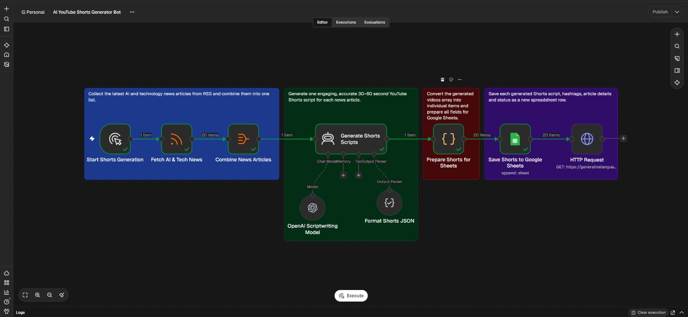
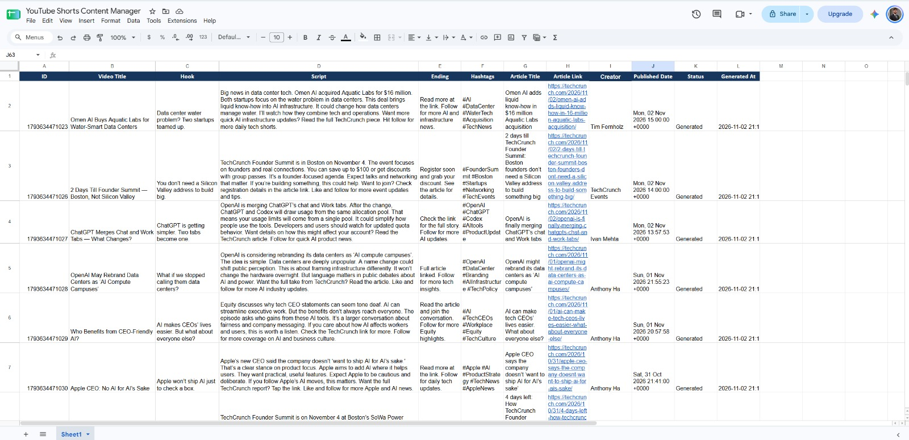

# AI YouTube Shorts Generator Bot

An n8n workflow that turns AI and technology news articles from the TechCrunch RSS feed into short-form YouTube script drafts. It aggregates the feed items, asks an OpenAI-powered AI Agent to write one 30–60 second script per article, validates the response with a Structured Output Parser, splits the generated scripts into individual items, and appends the results to a Google Sheets content tracker.

> **Scope clarification:** This workflow generates scripts and stores them in Google Sheets. It does not render videos, create voiceovers, upload Shorts to YouTube, or schedule/publish content.

## Key Features

- Manual execution from the n8n editor
- Fetches AI and technology news from the TechCrunch Artificial Intelligence RSS feed
- Aggregates the retrieved RSS items into one article list
- Uses GPT-5 Mini through an n8n AI Agent to generate one script per supplied article
- Requests a title, hook, 30–60 second script, ending, hashtags, and original article metadata
- Uses a Structured Output Parser to require a JSON `videos` array
- Converts the generated `videos` array into individual n8n items
- Assigns a generated record ID and `Generated` status to each item
- Appends each script and its source metadata to Google Sheets
- Records the generated timestamp in the `Asia/Kolkata` timezone

## Workflow Overview

The supplied export contains **13 nodes**: 7 operational nodes and 6 sticky-note / output-parser support nodes.

1. `Start Shorts Generation` — manually starts the workflow.
2. `Fetch AI & Tech News` — reads articles from `https://techcrunch.com/category/artificial-intelligence/feed/`.
3. `Combine News Articles` — aggregates all RSS items into a single item containing a `data` array.
4. `Generate Shorts Scripts` — sends the aggregated article data to an AI Agent. The prompt supplies article title, content snippet (or content), link, creator, and publication date.
5. `OpenAI Scriptwriting Model` — supplies the `gpt-5-mini` chat model to the AI Agent.
6. `Format Shorts JSON` — provides a structured output schema with a `videos` array.
7. `Prepare Shorts for Sheets` — reads `output.videos`, creates one n8n item per generated script, joins hashtags into a space-separated string, creates an ID using `Date.now() + index`, sets status to `Generated`, and records the `Asia/Kolkata` generation timestamp.
8. `Save Shorts to Google Sheets` — appends one row for each prepared script.
9. `HTTP Request` — runs after the Sheets append. Its current request body is a fixed Gemini prompt about writing a 30-second script on Artificial Intelligence; it does not use the generated Shorts data.

## Script Output Format

The AI Agent is instructed to return one script for every supplied RSS article. The structured output schema contains:

| Field | Purpose |
|---|---|
| `video_title` | Title for the YouTube Short |
| `hook` | Opening attention-grabber |
| `script` | Conversational 30–60 second script |
| `ending` | Closing line / call to action |
| `hashtags` | Array of relevant hashtags |
| `article_title` | Original RSS article title |
| `article_link` | Original article URL |
| `creator` | Article creator / author metadata |
| `published_date` | Original RSS publication date |

The system prompt asks for simple English, short sentences, an explicit call to action, 4–5 relevant hashtags, and factual consistency with the supplied article. It also tells the model not to combine multiple articles into one script or invent information.

## Google Sheets Content Tracker

The supplied spreadsheet screenshot shows these columns:

| Column | Purpose |
|---|---|
| `ID` | Generated record identifier |
| `Video Title` | Generated Shorts title |
| `Hook` | Opening hook |
| `Script` | Full script text |
| `Ending` | Closing statement / call to action |
| `Hashtags` | Space-separated hashtags |
| `Article Title` | Original news headline |
| `Article Link` | Original article URL |
| `Creator` | RSS creator / author |
| `Published Date` | Original publication date |
| `Status` | Set to `Generated` |
| `Generated At` | Generation timestamp in `Asia/Kolkata` |

The Google Sheets node uses the `append` operation. Each generated script becomes a new row; the workflow does not update an existing row or check for previously processed article URLs.

## Technology Stack

- n8n
- TechCrunch RSS
- OpenAI GPT-5 Mini
- n8n AI Agent
- Structured Output Parser
- JavaScript (n8n Code node)
- Google Sheets
- Google Gemini API endpoint (in the additional HTTP Request node)

## Workflow File

[Download n8n Workflow JSON](./workflow.json) — Sanitized export of the supplied 13-node workflow. The workflow is inactive by default and requires your own credentials and spreadsheet ID.

## Screenshots

### 1. n8n Workflow Architecture



### 2. Google Sheets Shorts Content Tracker



The screenshots show a sample execution with 20 generated records. This is sample execution evidence and does not imply that the scripts have been reviewed, rendered into videos, or published to YouTube.

## Setup

1. Import `workflow.json` into your n8n instance. The exported workflow is inactive.
2. Connect your OpenAI credentials to `OpenAI Scriptwriting Model`.
3. Create a Google Spreadsheet with the 12 headers listed in the Google Sheets Content Tracker section.
4. Replace `REPLACE_WITH_YOUR_GOOGLE_SHEET_ID` in `Save Shorts to Google Sheets`.
5. Connect your Google Sheets OAuth credentials and select the correct worksheet.
6. Test the RSS node and confirm the expected article fields are present.
7. Execute the AI Agent and verify that the parser returns one object per input article.
8. Check the item count after `Prepare Shorts for Sheets`; it should match the number of returned scripts.
9. Confirm the Google Sheets append node writes one complete row per script.
10. Review or remove the trailing `HTTP Request` node. It currently sends a fixed Gemini prompt unrelated to the generated news scripts.
11. Run the workflow manually after confirming the output sheet and credentials.

The sanitized export removes credential references, the original Google Spreadsheet ID, webhook IDs, and instance-specific metadata. Reconnect your own services after import.

## Current Limitations and Recommended Improvements

The following limitations are visible in the supplied workflow JSON:

- **Manual trigger only:** News collection and script generation start only when a user manually executes the workflow. There is no schedule trigger.
- **Single RSS source:** The workflow reads only the TechCrunch Artificial Intelligence feed. It does not aggregate multiple publishers or news categories.
- **No article filtering or deduplication:** All RSS items returned by the feed are aggregated. The workflow does not filter by publication age, remove duplicate URLs, or limit the article count before sending content to the AI Agent.
- **One large AI request:** All aggregated articles are included in one AI Agent prompt. A large feed response can create a long prompt, increase token usage, or exceed model context/output limits.
- **Exact one-script-per-article output depends on the AI response:** The prompt asks for one script per article and the parser validates the JSON shape, but the workflow does not separately compare input article count with output script count.
- **No source fact verification:** The AI Agent works from RSS title and snippet/content fields. It does not open the full article or independently verify claims.
- **No content review state:** Each row is saved with `Status = Generated`. There is no approval, revision, or rejected status path.
- **No video creation:** The workflow creates written scripts only. It does not generate visuals, voice, captions, background music, or a rendered MP4.
- **No YouTube publishing:** There is no YouTube upload, channel selection, scheduling, or publishing node.
- **Append-only storage:** Re-running the workflow can append the same article's script again. There is no URL-based duplicate check or upsert.
- **ID collision is possible:** IDs are generated using `Date.now() + index`; separate executions started within the same millisecond could theoretically produce overlapping IDs.
- **Trailing HTTP Request is unrelated to the main result:** It is connected after the Sheets append, uses a hard-coded Gemini 2.5 Flash `generateContent` endpoint and a fixed prompt (`Write a 30-second YouTube Shorts script about Artificial Intelligence.`). It does not receive the generated article/script data, and its output is not saved by another node. The HTTP node export does not explicitly define an HTTP method. Review this node's method, body, credential, and purpose; remove it if it is not needed.
- **No error recovery:** There is no explicit path for RSS failures, malformed AI output, parser failure, or Google Sheets append errors.

## Repository Structure

```text
AI-YouTube-Shorts-Generator-Bot/
├── screenshots/
│   ├── README.md
│   ├── workflow-overview.jpg
│   └── google-sheets-content-manager.jpg
├── README.md
└── workflow.json
```


## Author

<p align="left">
  <b>Jasvant Malvi</b><br>
  <a href="https://github.com/jasvantMalvi">GitHub</a> ·
  <a href="https://www.linkedin.com/in/jasvant-malvi-810305429/">LinkedIn</a>
</p>
