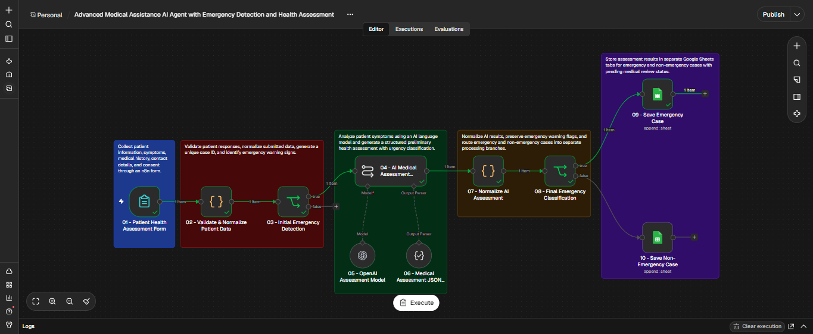
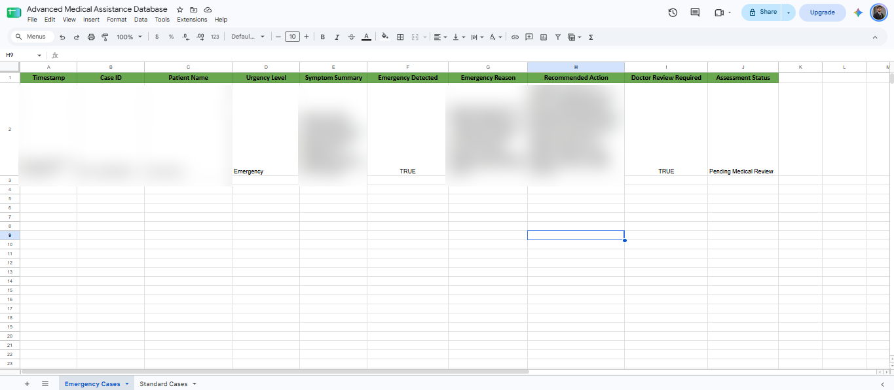

# Screenshots

These screenshots were supplied with the project. The spreadsheet screenshot has been redacted: patient identifiers and detailed health narratives are blurred for public portfolio sharing.

## 1. n8n Workflow Overview

Shows the patient health assessment form, data normalization, initial emergency detection, AI assessment with GPT-5 Mini and a structured parser, final classification, and separate Google Sheets branches.

## 2. Emergency Case Record

Example row in the `Emergency Cases` tab. The sample patient's timestamp, case ID, name, symptom summary, emergency reason, and recommended action are blurred. The urgency classification, emergency flag, doctor-review flag, and pending review status remain visible.
