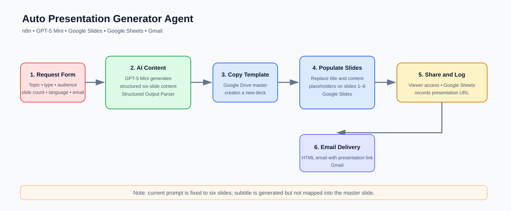

# Auto Presentation Generator Agent

An n8n workflow that turns a submitted presentation brief into a six-slide Google Slides deck. It uses GPT-5 Mini to generate structured slide content, copies a master Google Slides template, replaces slide placeholders, records the presentation details in Google Sheets, and emails the presentation link to the requester.

<details>
<summary><strong>Project snapshot</strong></summary>

| Item | Details |
|---|---|
| Workflow platform | n8n |
| AI model | OpenAI GPT-5 Mini |
| Presentation output | Google Slides |
| Tracking | Google Sheets |
| Delivery | Gmail (HTML email) |
| Input | n8n form |
| Tested example | IR Spectroscopy — Education — 6 slides — Students — English |

</details>

## Workflow overview

```text
Presentation Request Form
          ↓
Collect Presentation Request (AI Agent)
   ├── OpenAI Content Generation Model (GPT-5 Mini)
   └── Validate Presentation JSON (Structured Output Parser)
          ↓
Duplicate Master Presentation (Google Drive)
          ↓
Populate Google Slides (replace template placeholders)
          ↓
Share Presentation Access (viewer access)
          ↓
Log Presentation in Google Sheets
          ↓
Email Generated Presentation (Gmail)
```

The supplied n8n export contains **15 nodes**: 9 functional nodes and 6 sticky-note annotations.

## Input form

The form collects six fields:

| Field | Input |
|---|---|
| Presentation Topic | Text |
| Presentation Type | Education, Official, Professional |
| Number of Slides | Number |
| Target Audience | Students, Boss, Family |
| Presentation Language | English, Hindi, Gujarati |
| Email Address | Email |

## AI-generated slide structure

The connected Structured Output Parser expects these fields:

- `presentation_title`
- `presentation_subtitle`
- `slide2_title` and `slide2_points`
- `slide3_title` and `slide3_points`
- `slide4_title` and `slide4_points`
- `slide5_title` and `slide5_points`
- `slide6_title` and `slide6_points`

The prompt defines six fixed slides: Cover, Introduction, Key Concepts, Detailed Explanation, Applications, and Conclusion. Slides 2–6 are instructed to contain exactly three concise bullet points each.

## Workflow stages

### 1. Collect the presentation request

`Presentation Request Form` captures the topic, presentation type, slide count, audience, language and recipient email.

### 2. Generate structured slide content

`Collect Presentation Request` uses `OpenAI Content Generation Model` (GPT-5 Mini). `Validate Presentation JSON` checks the response against the expected JSON structure before the workflow continues.

### 3. Copy the master template

`Duplicate Master Presentation` makes a separate copy of the Google Slides master template in the configured destination folder. The copy is named using the submitted topic.

### 4. Populate the slides

`Populate Google Slides` uses the ID returned by the copy step and replaces 11 title/content placeholders for the cover title and slides 2–6.

### 5. Share the presentation

`Share Presentation Access` assigns viewer access. The public workflow export has been corrected to share the file ID returned by `Duplicate Master Presentation`, rather than the fixed test-presentation ID present in the original export.

The source configuration sets the permission type to `anyone` with the `reader` role. This means anyone with the link may be able to view the presentation; change this setting for private or organization-only use.

### 6. Log the presentation

`Log Presentation in Google Sheets` appends the creation date, topic, type, requested slide count and generated Google Slides URL.

### 7. Email the result

`Email Generated Presentation` sends the requester an HTML email containing the presentation details and a link to open the Google Slides file.

## Screenshots



The architecture diagram summarizes the workflow. The supplied screenshots of the master template, generated slides, Google Sheets log and Gmail delivery are included in the downloadable project package.

## Example run shown in the supplied screenshots

The screenshots document a run using:

- Topic: **IR Spectroscopy**
- Presentation type: **Education**
- Requested slide count: **6**
- Target audience: **Students**
- Language: **English**

The Google Sheets log screenshot shows a record for the generated presentation. The Gmail screenshot shows the “Your AI-Generated Presentation is Ready!” email. The generated deck screenshots show the IR Spectroscopy cover and conclusion slide.

## Important limitations found in the supplied workflow

These points are based on the uploaded n8n JSON and screenshots, not assumptions about other workflow versions.

1. **The requested slide count is currently ignored by the AI prompt.** The form collects `Number of Slides`, but the prompt explicitly asks for six fixed slides and does not reference the submitted number. The Google Sheets log stores the requested number, which could differ from the actual six-slide output.
2. **The presentation subtitle is generated but not inserted.** The parser includes `presentation_subtitle`, but the Google Slides replacement list does not map it to a template placeholder. The supplied generated-cover screenshot still displays “Click to add subtitle”. Add a dedicated subtitle placeholder to the master slide and map it in the Google Slides replacement node.
3. **Presentation type is not fully enforced.** The prompt receives the selected type, but the opening instruction and system message still describe the output as an educational presentation. “Official” or “Professional” selections may therefore not produce a distinct format reliably.
4. **The original sharing node used a hard-coded test file ID.** The provided public `workflow.json` fixes this by referencing the ID returned from the template-copy node. If you use the original workflow in n8n instead of this public export, update that node too.
5. **Anyone-with-the-link sharing is broad.** The source workflow grants public-link viewer access. Use a narrower permission policy where presentation confidentiality matters.
6. **No explicit error-handling route is present.** The exported main path does not show dedicated failure notifications or recovery branches for AI generation, template copying, slide replacement, sharing, sheet logging or email delivery.
7. **The public export is inactive and has placeholders.** Reconnect credentials and enter your own Google resource IDs before importing and running it.

## Setup

1. Import `workflow.json` into your n8n instance. The export is deliberately inactive.
2. Reconnect credentials for OpenAI, Google Drive, Google Slides, Google Sheets and Gmail.
3. In `Duplicate Master Presentation`, set `REPLACE_WITH_MASTER_GOOGLE_SLIDES_TEMPLATE_ID` to your own master-template file ID.
4. Set `REPLACE_WITH_GOOGLE_DRIVE_DESTINATION_FOLDER_ID` to the folder where generated decks should be saved.
5. In `Log Presentation in Google Sheets`, set `REPLACE_WITH_GOOGLE_SHEETS_SPREADSHEET_ID` to your tracking spreadsheet ID and confirm the target sheet has these columns: `Created Date`, `Presentation Topic`, `Presentation Type`, `Number of Slides`, `Presentation URL`.
6. Keep the dynamic file ID expression in `Share Presentation Access` so it shares the newly copied deck, not a previous test deck.
7. Decide whether `anyone` viewer access is appropriate; adjust the sharing permission before using real or confidential content.
8. Add a `{{PRESENTATION_SUBTITLE}}` placeholder to the master title slide and a corresponding replacement entry if you want the generated subtitle to appear.
9. Either change the prompt to use the form's requested slide count, or remove/rename that form field so it does not promise a feature the prompt ignores.
10. Test with a non-confidential topic and confirm the generated slide count, subtitle, permissions, tracking row and email link before activating the workflow.

## Repository contents

```text
Auto-Presentation-Generator-Agent/
├── README.md
├── workflow.json
└── screenshots/
    ├── README.md
    └── workflow-architecture.svg

The downloadable project ZIP also includes six curated screenshots in this folder.
```

## Author

**Jasvant Malvi**

- GitHub: https://github.com/jasvantMalvi
- LinkedIn: https://www.linkedin.com/in/jasvant-malvi-810305429/
