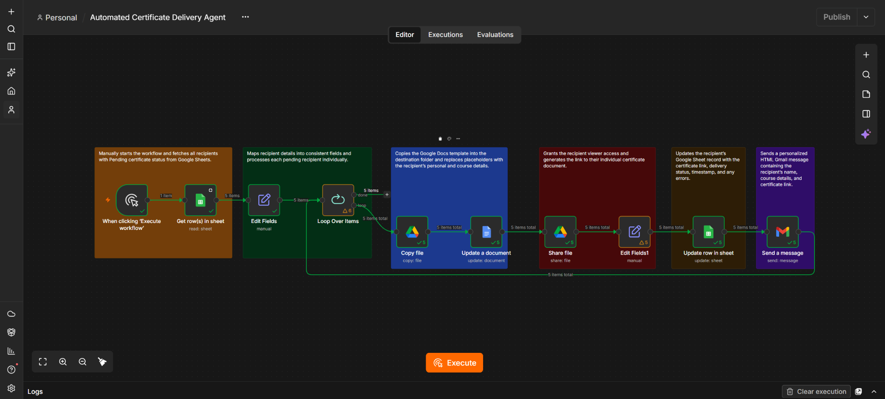
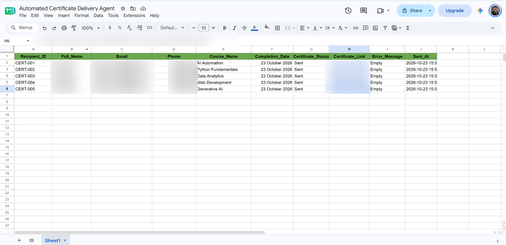
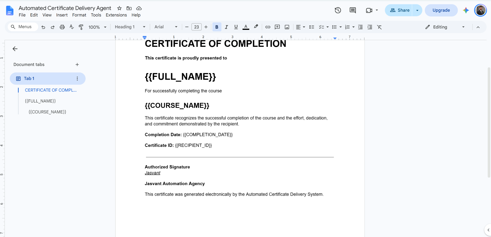
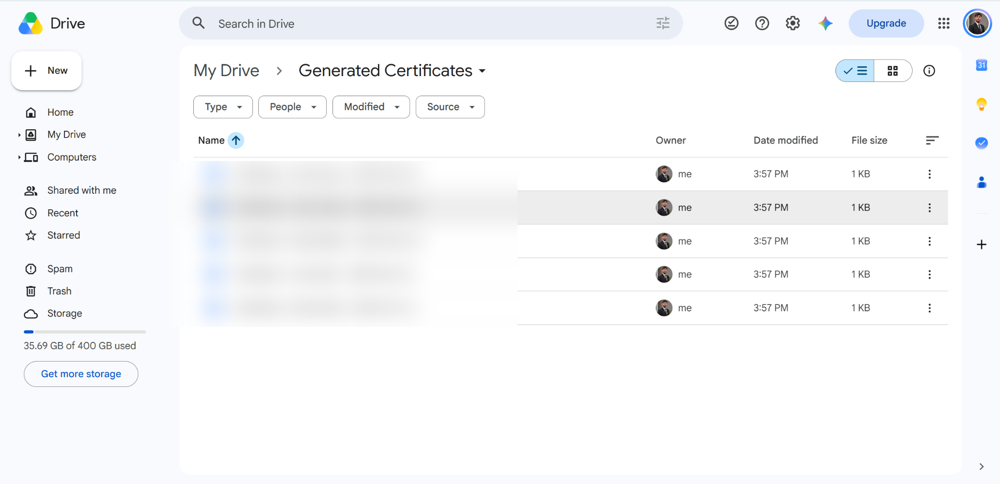
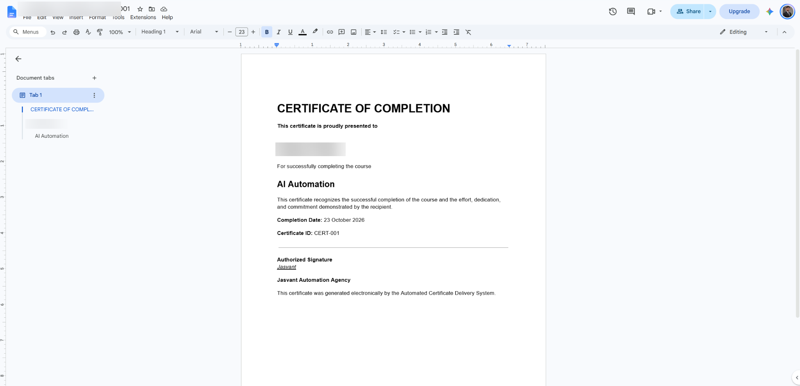
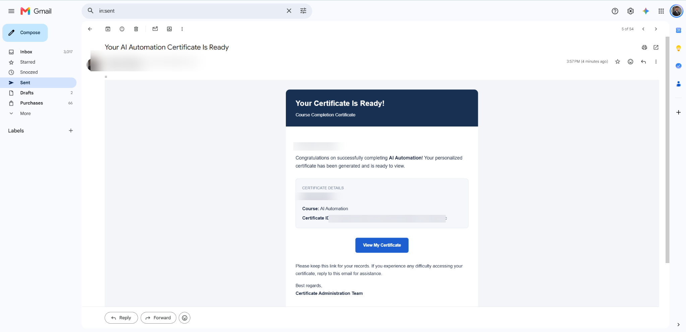

# Automated Certificate Delivery Agent

A Google Sheets-driven certificate generation and delivery workflow built with n8n, Google Drive, Google Docs, and Gmail. It manually retrieves recipient records marked `Pending`, prepares each recipient's details, copies a Google Docs certificate template, replaces the template placeholders, shares the generated document with the recipient, updates the matching spreadsheet row, and sends a personalized HTML certificate email.

> **Scope:** The supplied workflow is started manually from n8n. It is a batch certificate-generation and email-delivery workflow for rows already marked `Pending`; it does not automatically detect course completion or start on a schedule.

## Key Features

- Manually starts a certificate batch from n8n
- Reads recipient records with `Certificate_Status = Pending` from Google Sheets
- Processes the returned recipient rows through a `Loop Over Items` node
- Creates a personalized copy of a Google Docs certificate template for each recipient
- Replaces four template placeholders:
  - `{{FULL_NAME}}`
  - `{{COURSE_NAME}}`
  - `{{COMPLETION_DATE}}`
  - `{{RECIPIENT_ID}}`
- Saves generated certificates in a dedicated Google Drive folder
- Grants the corresponding recipient viewer access to their certificate document
- Builds a direct Google Docs certificate link
- Updates the matching recipient row in Google Sheets
- Sends a branded HTML Gmail message containing the recipient's name, course, certificate ID, and certificate link

## Workflow Overview

The supplied workflow contains **16 nodes**: 10 operational nodes and 6 sticky notes.

1. `When clicking ‘Execute workflow’` starts the workflow manually.
2. `Get row(s) in sheet` retrieves spreadsheet rows where `Certificate_Status` is exactly `Pending`.
3. `Edit Fields` maps the recipient fields into consistent names:
   - `recipientID`
   - `fullName`
   - `email`
   - `courseName`
   - `completionDate`
   - `certificateFileName`
4. `Loop Over Items` routes each pending recipient into the certificate-generation path and receives the final email node's output to continue the loop.
5. `Copy file` creates a copy of the configured Google Docs certificate template in the `Generated Certificates` folder. The new file name is built from the recipient's name and recipient ID.
6. `Update a document` replaces the four placeholders in the copied document with the current recipient's values.
7. `Share file` grants the recipient `reader` access using the recipient's email address.
8. `Edit Fields1` prepares the certificate ID, certificate link, recipient name, recipient email, and course name for downstream nodes.
9. `Update row in sheet` matches the original row using `Recipient_ID` and writes:
   - `Certificate_Status = Sent`
   - `Certificate_Link`
   - `Error_Message = Empty`
   - `Sent_At` in `Asia/Kolkata` time
10. `Send a message` sends the personalized HTML Gmail certificate email.
11. The Gmail node connects back to `Loop Over Items` so the next pending recipient can be processed.

## Certificate Template

The supplied Google Docs template contains these placeholders:

| Placeholder | Value inserted |
|---|---|
| `{{FULL_NAME}}` | Recipient's full name |
| `{{COURSE_NAME}}` | Course name |
| `{{COMPLETION_DATE}}` | Course completion date |
| `{{RECIPIENT_ID}}` | Recipient / certificate record ID |

The template also contains a certificate heading, completion statement, authorized signature, agency name, and an electronic-generation note. The workflow replaces the four placeholders in the copied document; it does not modify the original template.

## Google Sheets Structure

The supplied spreadsheet screenshot shows these columns:

| Column | Purpose |
|---|---|
| `Recipient_ID` | Unique recipient record ID used to match the row during update |
| `Full_Name` | Recipient's full name |
| `Email` | Recipient email address used for document sharing and Gmail delivery |
| `Phone` | Recipient phone number; not used by the supplied workflow |
| `Course_Name` | Course printed on the certificate and in the email |
| `Completion_Date` | Completion date inserted into the certificate |
| `Certificate_Status` | Workflow filter; eligible rows must be `Pending` |
| `Certificate_Link` | Direct link to the generated Google Docs certificate |
| `Error_Message` | Currently written as the literal value `Empty` |
| `Sent_At` | Timestamp recorded in `Asia/Kolkata` time |

The supplied screenshot shows five example records with status `Sent`. The workflow's retrieval node selects only rows whose current status is `Pending`.

## Gmail Delivery

The Gmail node builds a personalized HTML email containing:
- A certificate-ready heading
- A greeting using the recipient's name
- The course name
- The generated certificate ID
- A **View My Certificate** link
- A short assistance message and administrative sign-off

The link is constructed from the copied Google Drive file ID:
`https://docs.google.com/document/d/<copied-file-id>/edit`

## Technology Stack

- n8n
- Google Sheets
- Google Drive
- Google Docs
- Gmail
- n8n Loop Over Items
- HTML email templating
- `Asia/Kolkata` timestamp formatting

## Workflow File

[Download n8n Workflow JSON](./workflow.json) — Sanitized export of the supplied 16-node workflow. The exported workflow is inactive and requires your own Google credentials and resource IDs.

## Screenshots

### 1. n8n Workflow Architecture



### 2. Google Sheets Recipient Tracker



### 3. Certificate Template



### 4. Generated Certificates Folder



### 5. Generated Certificate Example



### 6. Certificate Delivery Email



The screenshots are example execution evidence dated 23 October 2026. Personal recipient names, email addresses, phone numbers, document IDs, and individual certificate links have been obscured in the public screenshot copies.

## Setup

1. Import `workflow.json` into your n8n instance. The exported workflow is inactive.
2. Create a Google Sheet using the ten headers listed in the Google Sheets Structure section.
3. Add recipients and set `Certificate_Status` to `Pending` for records that are ready for delivery.
4. Replace `REPLACE_WITH_YOUR_GOOGLE_SHEET_ID` in both Google Sheets nodes and select the correct worksheet.
5. Create a Google Docs certificate template containing the four exact placeholders shown above.
6. Replace `REPLACE_WITH_YOUR_CERTIFICATE_TEMPLATE_ID` in `Copy file`.
7. Create a Google Drive folder named `Generated Certificates` (or use your own destination folder) and replace `REPLACE_WITH_YOUR_GENERATED_CERTIFICATES_FOLDER_ID`.
8. Connect your Google Sheets, Google Drive, Google Docs, and Gmail credentials in n8n.
9. Correct the `recipientEmail` field name in `Edit Fields1` so it matches the field read by the Gmail node.
10. Test with one recipient record first. Verify the copied document, all four replacements, recipient-only viewer sharing, email recipient, and sheet update.
11. Test Gmail failure handling and confirm a failed delivery does not leave the spreadsheet marked `Sent`.
12. Run the workflow manually only after reviewing the pending rows and confirming that the destination folder and sharing permissions are correct.

The export removes credential references, webhook IDs, instance metadata, the original Google Spreadsheet ID, the original Google Docs template ID, and the original destination folder ID. Configure your own integrations after import.

## Current Limitations and Recommended Improvements

The following issues are visible in the supplied workflow JSON:

- **Recipient email field name mismatch:** `Edit Fields1` creates a field named `=recipientEmail` (including the leading `=`), but the Gmail node reads `recipientEmail`. This mismatch can cause the Gmail `sendTo` expression to resolve to an empty value. Rename the field to `recipientEmail`.
- **Spreadsheet status is updated before email delivery:** `Update row in sheet` runs before `Send a message`. A Gmail failure can therefore leave `Certificate_Status` set to `Sent` even though the email was not delivered. Send the email first, then update the row only after success, or use explicit delivery-status branches.
- **Error handling is not implemented:** `Error_Message` is always written as the literal text `Empty`. There is no error branch to capture Google Drive copy failures, document replacement failures, sharing errors, or Gmail send errors.
- **Manual trigger only:** The workflow does not start when a course is completed or when a sheet row changes. It must be manually executed in n8n. Add a schedule or an appropriate event trigger if automated operation is required.
- **Potential duplicate certificate copies on retries:** If an error occurs after `Copy file` but before the spreadsheet status is updated, the row may remain `Pending`. Running the workflow again can create another certificate copy for the same recipient. Check for an existing `Certificate_Link` or use a deterministic certificate file key before copying.
- **No input validation:** The workflow does not explicitly validate that recipient name, email, course name, completion date, and recipient ID are present and correctly formatted before creating and sharing a certificate.
- **No invalid-email branch:** There is no explicit validation or handling for missing or malformed email addresses before the Drive sharing and Gmail steps.
- **Sharing occurs before email delivery:** The document is shared with the recipient before the email is sent. If the email fails, the recipient may already have access to a certificate that the sheet reports as sent.
- **`Phone` is not used:** The phone field exists in the sheet but is not referenced by any operational node in the supplied workflow.
- **No certificate revocation or resend process:** The workflow creates and shares documents and updates records, but does not include a dedicated resend, correction, revocation, or expiration flow.
- **No automated eligibility check:** It trusts the `Pending` status in Google Sheets. It does not verify course completion from an LMS or another authoritative student record system.
- **Original template and destination are account-specific:** Reconnect your own template and output folder after importing the sanitized JSON; do not expect the original Google Drive links to work.

## Repository Structure

```text
Automated-Certificate-Delivery-Agent/
├── screenshots/
│   ├── README.md
│   ├── workflow-overview.png
│   ├── google-sheets-recipient-tracker.png
│   ├── certificate-template.png
│   ├── generated-certificates-folder.png
│   ├── generated-certificate-example.png
│   └── certificate-delivery-email.png
├── README.md
└── workflow.json
```
