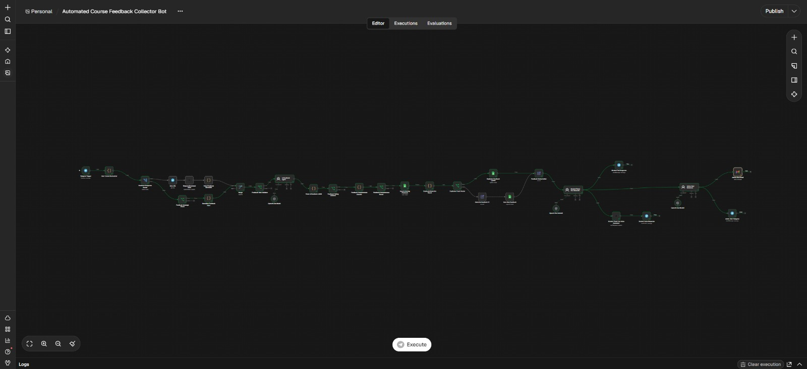
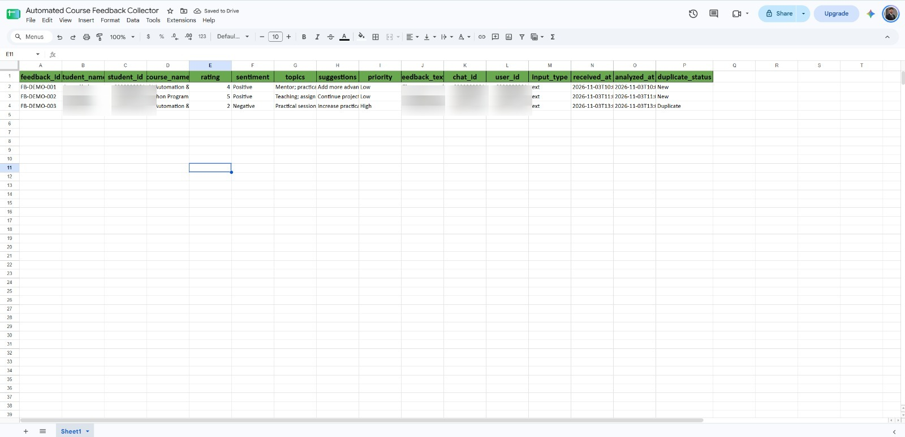
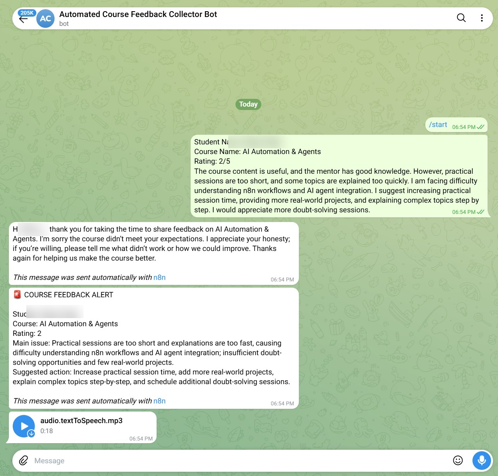
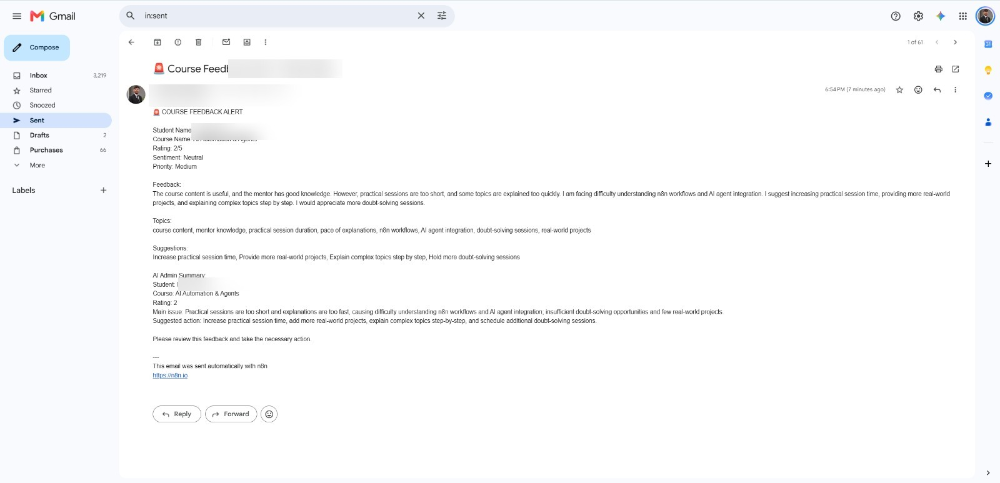

# Automated Course Feedback Collector Bot

A Telegram-based course feedback collection and analysis workflow built with n8n, OpenAI, ElevenLabs, Google Sheets, Telegram, and Gmail. Students can submit structured text feedback or voice messages. Voice messages are transcribed, feedback is analyzed into structured fields, and the workflow checks for duplicate feedback before taking the new/duplicate branch. The student receives an AI-generated thank-you response in text and audio, while an admin alert is generated for Telegram and email.

> **Important:** The supplied workflow export contains several configuration and routing issues that should be fixed before production use. In particular, the admin Telegram alert currently uses the student's incoming chat ID; the new-feedback Google Sheets append mapping is empty in the JSON export; and incomplete feedback / missing ratings have no connected recovery route. These are documented below rather than hidden.

## Key Features

- Receives incoming Telegram text and voice messages
- Extracts Telegram user, chat, message, and timestamp context
- Parses student name, course name, rating, and free-text feedback from structured text messages
- Downloads Telegram voice messages and transcribes them with ElevenLabs Speech-to-Text
- Uses GPT-5 Mini to analyze feedback
- Extracts:
  - Sentiment: Positive, Neutral, or Negative
  - Topics discussed
  - Improvement suggestions
  - Priority: Low, Medium, or High
- Validates feedback completeness and rating presence
- Checks existing Google Sheets feedback for exact normalized-text duplicates
- Generates a feedback ID for new records
- Sends an AI-generated student thank-you message through Telegram
- Generates a spoken thank-you response with ElevenLabs Text-to-Speech
- Creates an admin feedback summary and sends it through Telegram and Gmail

## Workflow Overview

The supplied workflow export contains 32 nodes. Its main path is:

`Telegram Trigger → User Context Normalizer → Feedback Response Router`

### 1. Receive and normalize input

1. `Telegram Trigger` starts when a Telegram message arrives.
2. `User Context Normalizer` extracts the sender's Telegram user ID, username, chat ID, message ID, message timestamp, text, voice file ID, and received timestamp.
3. For structured text submissions, it also parses:
   - `Student Name:`
   - `Course Name:`
   - `Rating: x/5`
   - Remaining lines as the free-text feedback

### 2. Route text and voice feedback

**Voice branch**
1. `Get a file` downloads the Telegram voice file.
2. `Telegram Download Voice` transcribes the audio using ElevenLabs Speech-to-Text.
3. `Voice Feedback Normalize` converts the transcript and Telegram context into the common feedback structure.

**Text branch**
1. `Feedback Message Check` checks whether the extracted feedback text is non-empty.
2. `Normalize Feedback Input` cleans whitespace and normalizes the text fields.

Both branches join at `Merge`, then continue to `Feedback Data Validator`.

### 3. Analyze feedback with AI

1. `Feedback Data Validator` checks that feedback text is not empty.
2. `AI Feedback Agent` uses `gpt-5-mini` to analyze the student feedback and return JSON containing:
   - `student_name`
   - `rating`
   - `sentiment`
   - `topics`
   - `suggestions`
   - `priority`
3. `Parse AI Feedback JSON` parses the AI output and restores student, course, rating, message, and chat context.
4. `Feedback Rating Validator` checks whether a rating is present.
5. `Feedback Completeness Checker` checks whether rating, sentiment, topics, suggestions, and priority are present.
6. `Feedback Completeness Router` allows only complete feedback to continue to duplicate detection.

### 4. Check duplicate submissions

1. `Search Existing Feedback` reads records from the configured Google Sheets worksheet.
2. `Duplicate Detection Result` compares the current feedback text with sheet feedback text after trimming whitespace and converting to lowercase.
3. `Duplicate Check Router` separates duplicate and new submissions.

**Duplicate branch**
- `Duplicate Feedback Update` updates the `duplicate_status` field.
- The node is configured to match rows using `user_id`, not the `row_number` identified by the duplicate-detection code. This is a known mapping issue; see limitations.

**New feedback branch**
- `Generate Feedback ID` creates an ID in the format `FB-<timestamp>`.
- `Save New Feedback` is configured as an append operation in Google Sheets. However, its exported `columns.value` mapping is empty. The target fields need to be mapped before relying on this export to save records.

### 5. Student acknowledgement

Both the new-feedback and duplicate paths connect to `Feedback Status Setter`, then `Student Thank You Generator`.

1. `Student Thank You Generator` uses `gpt-5-mini` to create a short thank-you message.
2. `Student Text Response` sends the text reply to the student's Telegram chat.
3. `Student Thank You Voice Generator` uses ElevenLabs Text-to-Speech.
4. `Student Voice Response` sends the generated audio to the student's Telegram chat.

The supplied connections run both the text and voice response branches; there is no input-type switch that sends only one format.

### 6. Admin notification

1. `Admin Alert Generator` uses a second `gpt-5-mini` model to create an internal summary containing student, course, rating, main issue, and suggested action.
2. `Admin Alert Telegram` sends the generated alert to its configured Telegram chat ID.
3. `Admin Alert Email` sends a detailed plain-text alert to its configured email recipient.

**Routing warning:** In the supplied JSON, the Telegram alert's `chatId` expression references the incoming `Telegram Trigger` message chat ID. That is the student's chat, not a separate admin chat. The sanitized export replaces this with `REPLACE_WITH_ADMIN_TELEGRAM_CHAT_ID`; configure a private admin destination before activation.

## AI Analysis Rules

The `AI Feedback Agent` is instructed to return only JSON with this structure:

```json
{
  "student_name": "",
  "rating": null,
  "sentiment": "",
  "topics": [],
  "suggestions": [],
  "priority": ""
}
```

The prompt asks for sentiment to be `Positive`, `Neutral`, or `Negative`; priority to be `Low`, `Medium`, or `High`; and suggestions to be an empty array when no suggestion is present. It also instructs the model not to invent information.

The priority guidance says:
- **High:** Very low rating, serious complaint, urgent issue, or strongly negative experience
- **Medium:** Moderate concern or improvement request
- **Low:** Positive feedback or minor / non-urgent comment

## Google Sheets Structure

The supplied spreadsheet screenshot shows these columns:

| Column | Purpose |
|---|---|
| `feedback_id` | Generated feedback record ID for new submissions |
| `student_name` | Student name |
| `student_id` | Telegram sender ID in the supplied normalizer |
| `course_name` | Course name parsed from structured text input |
| `rating` | Student rating |
| `sentiment` | AI sentiment classification |
| `topics` | Main topics extracted from feedback |
| `suggestions` | Suggested improvements extracted by AI |
| `priority` | AI-assigned priority |
| `feedback_text` | Original or transcribed feedback |
| `chat_id` | Telegram conversation ID |
| `user_id` | Telegram sender user ID |
| `input_type` | `text` or `voice` |
| `received_at` | Time feedback was received |
| `analyzed_at` | Time AI analysis was completed |
| `duplicate_status` | `New` or `Duplicate` |

The screenshot shows example rows with both `New` and `Duplicate` statuses. The workflow's duplicate comparison is based on normalized feedback text rather than a compound key such as user + course + feedback.

### Google Sheets mapping warning

In the supplied JSON, `Save New Feedback` has `mappingMode: defineBelow` but an empty `columns.value` object. The screenshot shows populated sample rows, but this export does not contain the corresponding append field mappings. Reconfigure the node's column mappings against the actual sheet headers before importing and testing this JSON.

The `Feedback Status Setter` also creates `feedback_status` and `admin_alert_status` values in the workflow item, but there is no later Google Sheets write node that persists those fields. They are not among the screenshot's visible column headers.

## Student Input Format

The text normalizer expects structured labels similar to:

```text
Student Name: Rahul Patel
Course Name: AI Automation & Agents
Rating: 2/5
The course content is useful, but practical sessions are too short.
Please include more real-world projects and doubt-solving sessions.
```

The workflow uses the Telegram sender's first name and ID as fallback context, but the course name is parsed only from the text fields handled by `User Context Normalizer`.

For voice submissions, the workflow transcribes the audio into feedback text. The current voice-normalization code carries `course_name` and the original `rating` from the Telegram text context; it does not parse a course name from the transcription. The AI prompt may infer a rating if the student clearly speaks one in the feedback, but that is model extraction rather than deterministic parsing. As a result, voice submissions can be saved without a course name, and the rating may be missing or misinterpreted.

## Technology Stack

- n8n
- Telegram Bot API
- OpenAI GPT-5 Mini
- ElevenLabs Speech-to-Text
- ElevenLabs Text-to-Speech
- Google Sheets
- Gmail

## Workflow File

[Download n8n Workflow JSON](./workflow.json) — Sanitized export of the supplied 32-node workflow. Reconnect your own credentials and replace the integration placeholders before activation.

## Screenshots

### 1. n8n Workflow Architecture



### 2. Google Sheets Feedback Records



### 3. Telegram Student Feedback and Acknowledgement



### 4. Gmail Admin Feedback Alert



The screenshots contain sample feedback records and messages. Personal names, Telegram IDs, and email addresses have been blurred in the public copies.

## Setup

1. Import `workflow.json` into your n8n instance. The exported workflow is inactive.
2. Connect your Telegram bot credentials to `Telegram Trigger`, `Get a file`, `Student Text Response`, `Student Voice Response`, and the admin Telegram node.
3. Connect your ElevenLabs API credentials to `Telegram Download Voice` and `Student Thank You Voice Generator`.
4. Connect your OpenAI credentials to all three GPT-5 Mini model nodes.
5. Create a Google Spreadsheet with the 16 headers listed in the Google Sheets Structure section.
6. Replace `REPLACE_WITH_YOUR_GOOGLE_SHEET_ID` in `Search Existing Feedback`, `Save New Feedback`, and `Duplicate Feedback Update`.
7. Configure the `Save New Feedback` append node with explicit mappings for all required feedback fields. The supplied export has an empty mapping object.
8. Set `REPLACE_WITH_ADMIN_TELEGRAM_CHAT_ID` to a private administrator chat ID. Do not use the submitter's chat ID for admin alerts.
9. Set `REPLACE_WITH_ADMIN_EMAIL` to the intended administrator email address.
10. Test text and voice input separately. Verify the transcribed text, course name, rating, sentiment, topics, suggestions, and priority.
11. Test new submissions, exact duplicate submissions, feedback without a rating, and repeated feedback from the same Telegram user.
12. Confirm that student acknowledgements go only to the submitting student and admin alerts go only to the admin.
13. Activate the workflow only after repairing the disconnected validation branches and duplicate-row matching.

The export removes credential references, Telegram webhook IDs, the original Google Spreadsheet ID, the original personal admin email, and the student-chat expression from the admin Telegram destination. Reconnect your own services after import.

## Current Limitations and Recommended Improvements

The following issues are visible in the supplied workflow JSON:

- **Admin Telegram alert is routed to the student:** `Admin Alert Telegram` uses the incoming Telegram message's `chat.id`. This sends the internal alert back to the student. Configure a separate private admin chat ID before production.
- **Admin email is hard-coded:** The source workflow sends the admin email to a fixed personal address. The sanitized export replaces it with `REPLACE_WITH_ADMIN_EMAIL`; set the correct administrative mailbox.
- **New feedback append mapping is empty:** `Save New Feedback` has an empty `columns.value` mapping despite the screenshot showing populated rows. Reconfigure the field mappings in n8n before relying on this export.
- **Duplicate update matches by `user_id`:** The duplicate-detection code finds a matching row and captures its `row_number`, but `Duplicate Feedback Update` matches on `user_id`. A student can submit multiple feedback records, so this can update the wrong row. Match using the detected row number or a unique feedback key.
- **Duplicate comparison is exact-text based:** It trims and lowercases feedback text, then compares it against existing rows. Small wording changes are treated as new feedback, while two different students submitting identical text can be treated as duplicates. Use a defined duplicate key, such as student + course + normalized feedback, and decide the desired retention policy.
- **Missing-rating feedback is blocked:** The AI prompt allows `rating: null`, but `Feedback Rating Validator` requires a non-empty rating and its false output is not connected. A submission without a rating cannot reach the save path.
- **Incomplete-feedback route is disconnected:** `Feedback Completeness Router` connects only its complete/true output. Incomplete feedback has no student clarification or review path.
- **Empty text feedback has no response:** `Feedback Message Check` connects only its true output. The false output is not connected to a helpful prompt or error response.
- **Completeness checks require topics:** The checker requires at least one topic, in addition to rating, sentiment, suggestions array, and priority. Very short feedback may be rejected even when it contains useful information.
- **Voice metadata is not extracted from the transcript:** `Voice Feedback Normalize` stores the transcript as feedback text but carries course name and rating from the original message context. It does not parse course/rating labels from the transcript.
- **Voice input type is normalized separately:** The voice branch sets `input_type` to `voice`, while the text branch sets it to `text`; test that both survive the merge and reach the sheet mappings.
- **Text and audio acknowledgements are both sent:** The `Student Thank You Generator` connects to both text and voice response branches without an input-type condition. Students receive both formats for a successful submission, including a voice thank-you for text feedback.
- **Duplicate submissions also continue to acknowledgement and alert generation:** Both duplicate and new branches flow through `Feedback Status Setter` and then the same student and admin notification sequence. Decide whether duplicate submissions should trigger another acknowledgement or admin alert.
- **Status fields are not persisted:** `feedback_status` and `admin_alert_status` are set in `Feedback Status Setter`, but the workflow does not write those values back to the spreadsheet.
- **Priority does not control notification routing:** The AI assigns Low, Medium, or High priority, but there is no IF/Switch node that limits or changes admin alerts based on priority. All accepted feedback reaches the alert flow.
- **Student ID is the Telegram user ID:** The normalizer sets `student_id` from `message.from.id`. If the institution has a separate student ID, collect it explicitly instead of treating Telegram's ID as the academic identifier.
- **Rating range is not independently validated:** The rating validator checks that a value exists, but does not confirm it is between 1 and 5.
- **No explicit admin-alert delivery status tracking:** The workflow sets `admin_alert_status` to `Pending` but does not persist a sent/failed status after Telegram or Gmail delivery.

## Repository Structure

```text
Automated-Course-Feedback-Collector-Bot/
├── screenshots/
│   ├── README.md
│   ├── workflow-overview.jpg
│   ├── google-sheets-feedback-records.jpg
│   ├── telegram-feedback-and-thank-you.jpg
│   └── gmail-admin-feedback-alert.jpg
├── README.md
└── workflow.json
```


## Author

<p align="left">
  <b>Jasvant Malvi</b><br>
  <a href="https://github.com/jasvantMalvi">GitHub</a> ·
  <a href="https://www.linkedin.com/in/jasvant-malvi-810305429/">LinkedIn</a>
</p>
