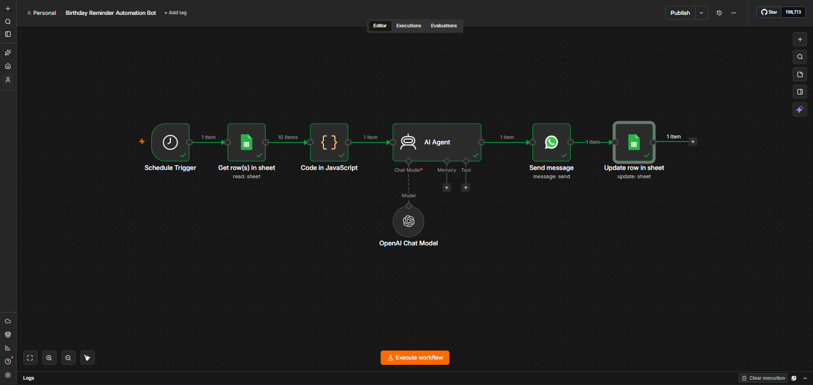
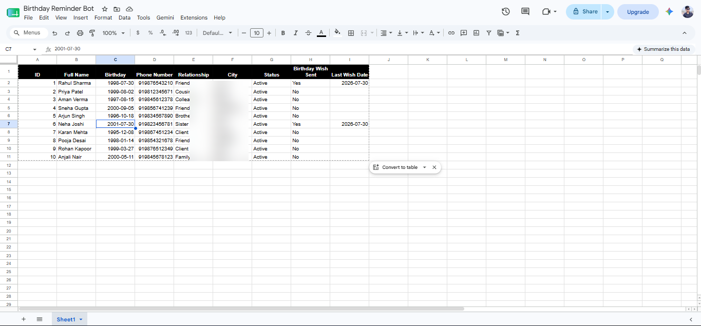
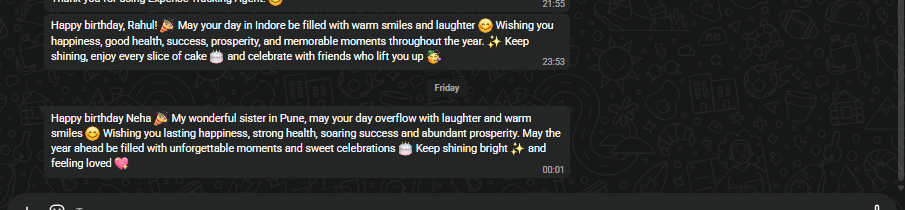

# Screenshots

These screenshots were supplied with the project. Phone numbers in the Google Sheets example have been blurred for public sharing. The WhatsApp image is cropped to show the birthday wishes rather than unrelated earlier chat history.

## 1. n8n Workflow Overview

Shows the daily schedule, Google Sheets contact retrieval, birthday matching code, AI-generated wish, WhatsApp send node, and Google Sheets update node.

## 2. Google Sheets Contact Records

Sample contact table with birthday, relationship, city, active status, and wish-sent tracking fields. Phone numbers are blurred.

## 3. WhatsApp Birthday Messages

Examples of personalized birthday messages generated and sent by the workflow. Note that the supplied workflow export currently uses a hard-coded recipient number; see the main README.
