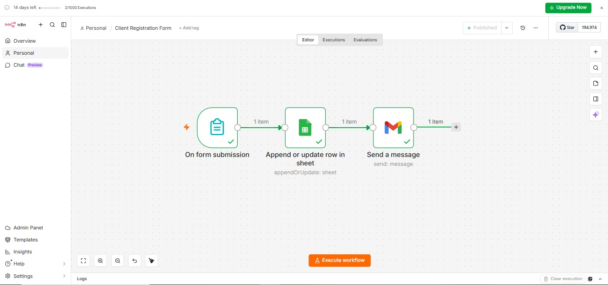

# Screenshots

## Workflow Overview

The screenshot shows the three-node flow:
1. On form submission
2. Append or update row in sheet
3. Send a message through Gmail

No form-submission or welcome-email output screenshot was supplied with this package.
