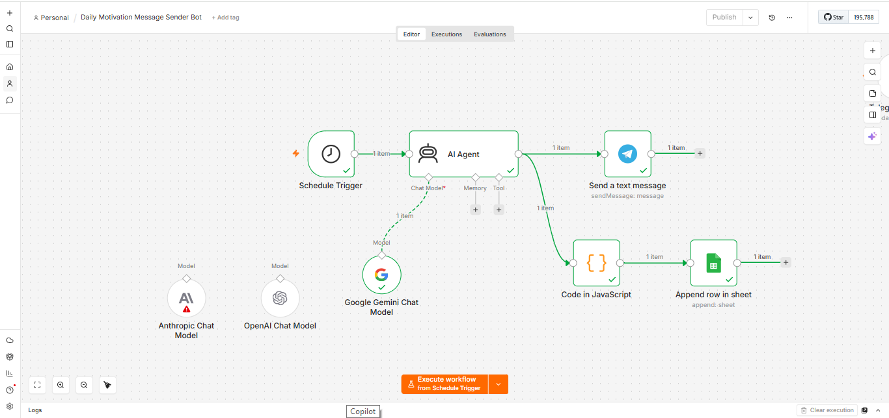
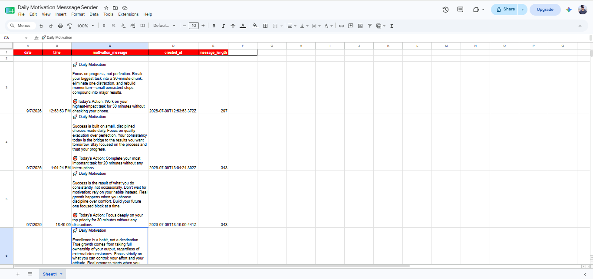
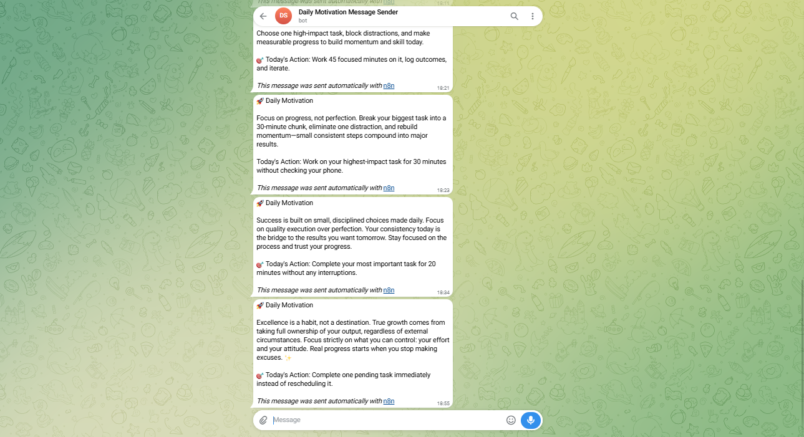

# Screenshots

These screenshots were supplied with the project.

## 1. n8n Workflow Overview

Shows the schedule, AI Agent, connected Gemini model, Telegram delivery, JavaScript log preparation, and Google Sheets append. The Telegram Trigger and OpenAI model are visible as disconnected nodes.

## 2. Google Sheets Message Log

Example records showing the generated message, local date/time, timestamp, and message length.

## 3. Telegram Message Examples

Examples of short motivational messages and practical daily action prompts delivered to Telegram.
