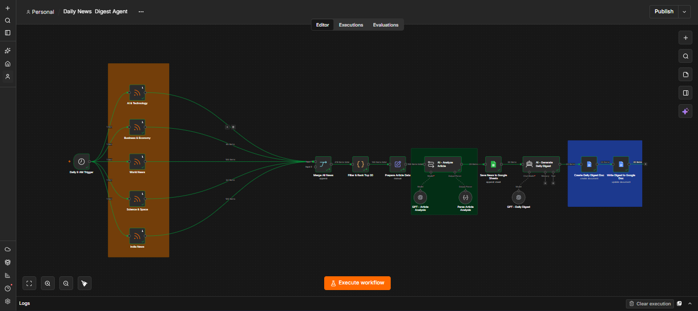
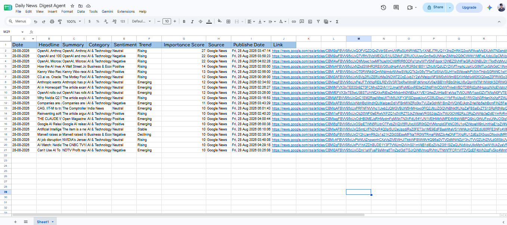
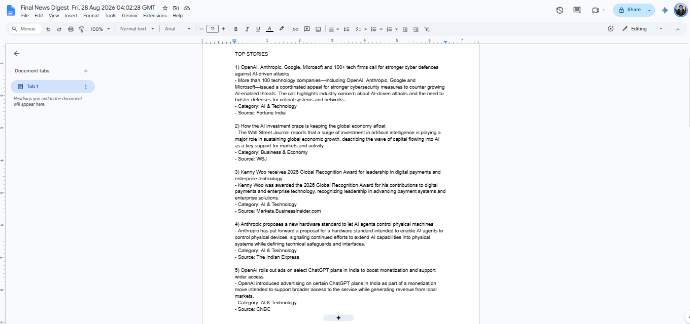
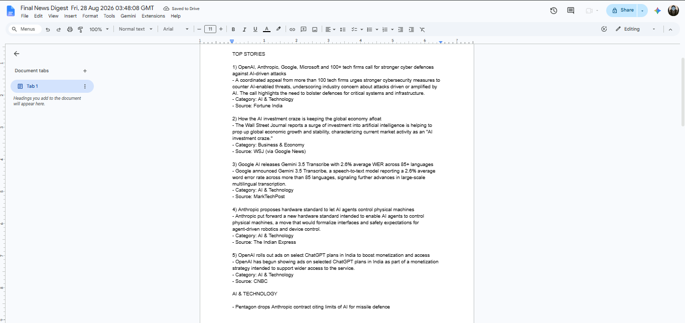
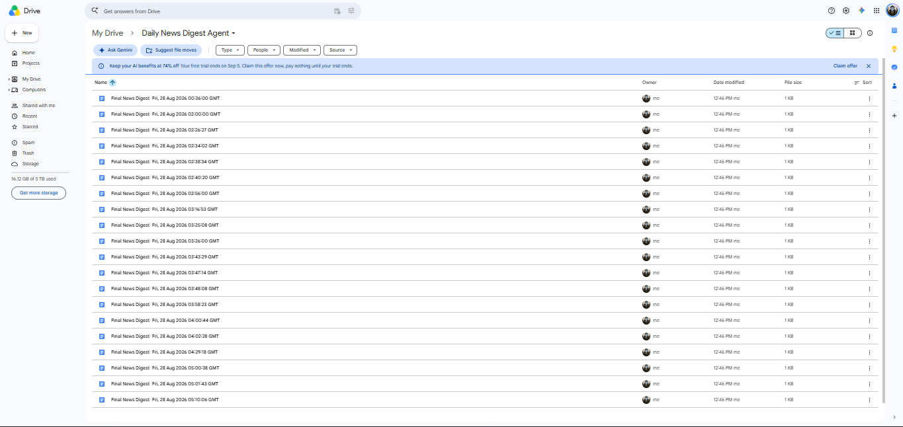

# Daily News Digest Agent

An automated news collection, ranking, analysis, and reporting workflow built with n8n, Google News RSS, OpenAI, Google Sheets, and Google Docs. It runs on a daily schedule, collects stories from five RSS topic searches, removes duplicate headlines, ranks the remaining articles using a keyword-based importance score, and keeps up to 20 articles for AI analysis. The article summaries and classifications are appended to Google Sheets, and a second AI step prepares a structured daily digest that is written to Google Docs.

> **Output behavior to verify:** The supplied Google Drive screenshot shows multiple `Final News Digest` documents for the same date with different times. In the workflow JSON, article items continue into the digest-generation and Google Docs creation nodes without a dedicated aggregation or single-document guard. This suggests the document branch may run more than once in one scheduled execution. Confirm the item count at `AI - Generate Daily Digest` and `Create Daily Digest Doc`; add an aggregation / execute-once step if the intended output is exactly one document per day.

## Key Features

- Runs automatically at 9:00 according to the n8n workflow/instance timezone
- Collects RSS items from five Google News topic searches:
  - Artificial Intelligence
  - Business & Economy
  - World News
  - Science & Space
  - India News
- RSS query URLs use the `when:6h` search window and India English settings (`hl=en-IN`, `gl=IN`, `ceid=IN:en`)
- Merges the five feeds into one article stream
- Removes duplicate articles using normalized headline text
- Calculates a heuristic importance score from high- and medium-priority keywords
- Sorts articles by score and keeps up to 20
- Uses GPT-5 Mini to summarize each article and classify its category, sentiment, and trend
- Saves article-level results and source links to Google Sheets
- Uses a second GPT-5 Mini step to compose a daily digest
- Creates a Google Doc and writes the generated digest into it

## Workflow Overview

The supplied workflow contains 17 nodes: five RSS feed readers, one schedule trigger, one merge node, one JavaScript ranking node, one data-preparation node, one article-analysis chain, one OpenAI model and one structured output parser for article analysis, one Google Sheets append node, one digest-generation AI Agent, one OpenAI model for digest generation, and two Google Docs nodes.

1. `Daily 9 AM Trigger` starts the workflow every day at 9:00. The schedule node does not define a timezone in its own rule, so its effective timezone depends on the n8n workflow or instance setting.
2. Five Google News RSS nodes run in parallel and retrieve stories for their assigned topic. Each feed URL requests stories from the previous six hours.
3. `Merge All News` combines the incoming RSS items into one stream.
4. `Filter & Rank Top 20`:
   - skips items without a headline;
   - normalizes the headline to lowercase and removes punctuation for duplicate detection;
   - keeps the first item for each normalized title;
   - scans the headline and snippet for configured keywords;
   - adds 5 points for each matching high-importance keyword and 2 points for each matching medium-importance keyword;
   - sorts the remaining items by score, highest first;
   - returns up to 20 articles.
5. `Prepare Article Data` maps the RSS title, URL, publication date, snippet, fixed source label (`Google News`), and importance score into consistent fields.
6. `AI - Analyze Article` processes article content with the `GPT - Article Analysis` model. It requests a factual 2–3 sentence summary, one category, one sentiment, and one trend.
7. `Parse Article Analysis` constrains the article-analysis response to a structured JSON object.
8. `Save News to Google Sheets` appends the article data and AI analysis to the configured worksheet.
9. `AI - Generate Daily Digest` receives the article-analysis data and is instructed to create:
   - five top stories;
   - category sections for AI & Technology, Business & Economy, World News, Science & Space, and India News;
   - 3–5 key trends;
   - an overall sentiment overview.
10. `Create Daily Digest Doc` creates a Google Doc in the configured Drive folder.
11. `Write Digest to Google Doc` inserts the AI-generated digest text into the newly created document.

## RSS Feed Sources and Search Windows

| Feed node | Google News RSS query | Search window |
|---|---|---|
| `AI & Technology` | `artificial intelligence` | Previous 6 hours |
| `Business & Economy` | `business economy` | Previous 6 hours |
| `World News` | `world news` | Previous 6 hours |
| `Science & Space` | `science space` | Previous 6 hours |
| `India News` | `India news` | Previous 6 hours |

The five RSS feeds use Google News with India English localization. The workflow stores `Google News` as the article source field. The original publisher name may appear in an RSS headline, but the normalized `Source` field in the Google Sheets mapping is not populated from a dedicated publisher field.

## Importance Scoring

The JavaScript node uses a transparent keyword-weighting approach rather than an AI importance judgment.

**High-importance keywords — 5 points each when present:**

`breaking`, `war`, `attack`, `election`, `president`, `prime minister`, `government`, `crisis`, `earthquake`, `ai`, `artificial intelligence`, `openai`, `google`, `microsoft`, `nvidia`, `economy`, `market crash`

**Medium-importance keywords — 2 points each when present:**

`business`, `technology`, `startup`, `investment`, `market`, `science`, `space`, `health`, `security`, `cybersecurity`, `india`, `global`, `research`

The headline and content snippet are converted to lowercase before keyword checks. The score is the sum of all matching keyword weights. The workflow then sorts descending by that score and keeps at most 20 unique-title items.

## AI Article Analysis

The first OpenAI step uses `gpt-5-mini` and analyzes one article at a time. It requests the following structured result:

| Field | Expected value |
|---|---|
| `summary` | Factual 2–3 sentence summary |
| `category` | AI & Technology / Business & Economy / World News / Science & Space / India News |
| `sentiment` | Positive / Neutral / Negative |
| `trend` | Rising / Stable / Declining / Emerging |

The `Parse Article Analysis` node defines these fields through a structured output parser. The prompt instructs the model to use only the headline, description, source, and publication date supplied by the workflow, and not to invent facts.

## Google Sheets Structure

The supplied spreadsheet screenshot shows these columns:

| Column | Purpose |
|---|---|
| `Date` | Date the workflow processes the article, formatted `dd-MM-yyyy` in `Asia/Kolkata` |
| `Headline` | RSS article headline |
| `Summary` | AI-generated 2–3 sentence summary |
| `Category` | One of the five allowed news categories |
| `Sentiment` | Positive, Neutral, or Negative |
| `Trend` | Rising, Stable, Declining, or Emerging |
| `Importance Score` | Keyword-based score from the JavaScript ranking step |
| `Source` | Fixed value `Google News` in the supplied Set node |
| `Publish Date` | RSS publication date |
| `Link` | Article URL from the RSS item |

The Google Sheets node uses the `append` operation, so it adds new rows; it does not update existing article records or prevent duplicates across different daily executions.

### Header-mapping check

The exported Google Sheets node schema contains whitespace-padded mapping keys such as ` Headline `, ` Category`, ` Sentiment`, ` Trend`, ` Importance Score`, ` Source`, and ` Link`. It also uses the key ` Publishe Date` (missing the second `d`). The screenshot displays readable headers such as `Headline`, `Category`, and `Publish Date`. Verify the exact underlying header text in the target spreadsheet and refresh the node's column mapping before importing this workflow into a different sheet.

## Daily Digest Document

The second GPT-5 Mini step is instructed to create a professional digest with:

- **Top Stories:** Five most important stories across all categories, each with headline, explanation, category, and source
- **Category Sections:** Important stories grouped into the five configured categories
- **Key Trends:** Three to five recurring themes across the selected stories
- **Sentiment Overview:** A short description based on the available sentiment classifications

The Google Docs nodes create a new document in a selected Drive folder and insert the generated digest output. The workflow does not send the digest by email, WhatsApp, Telegram, or Slack.

## Technology Stack

- n8n
- Google News RSS
- n8n Schedule Trigger
- JavaScript (n8n Code node)
- OpenAI GPT-5 Mini
- Structured Output Parser
- Google Sheets
- Google Docs
- Google Drive

## Workflow File

[Download n8n Workflow JSON](./workflow.json) — Sanitized export of the 17-node workflow.

## Screenshots

### 1. n8n Workflow Architecture



### 2. Google Sheets Article Tracker



### 3. Generated Daily Digest — Top Stories



### 4. Generated Daily Digest — Category Section



### 5. Google Drive Output Folder



The screenshots show example output dated 28 August 2026. They are sample execution evidence, not live news or a claim that the workflow currently runs successfully on every day.

## Setup

1. Import `workflow.json` into your n8n instance. The exported workflow is inactive by default.
2. Set the workflow timezone explicitly (for example, `Asia/Kolkata`) so the 9:00 schedule runs at the intended local time.
3. Connect your OpenAI credentials to both GPT-5 Mini model nodes.
4. Create a Google Spreadsheet with the ten headers listed in the Google Sheets Structure section.
5. Replace `REPLACE_WITH_YOUR_GOOGLE_SHEET_ID` in `Save News to Google Sheets` and select the correct worksheet.
6. Connect your Google Sheets OAuth credentials and refresh the column mappings to match the exact header names.
7. Create or choose a Google Drive folder for daily digest documents.
8. Replace `REPLACE_WITH_YOUR_GOOGLE_DRIVE_FOLDER_ID` in `Create Daily Digest Doc`.
9. Connect Google Docs credentials to both Google Docs nodes.
10. Run a manual test and inspect RSS item counts, duplicate filtering, importance scores, structured article analysis, and Google Sheets rows.
11. Inspect how many items reach `AI - Generate Daily Digest` and `Create Daily Digest Doc`. If only one daily digest document is intended, aggregate the analyzed articles into one item and create the document once.
12. Enable the workflow after confirming that the output document count, document titles, and spreadsheet mappings are correct.

The export removes credential references, the original Google Spreadsheet ID, the original Google Drive folder ID, webhook IDs, and instance-specific metadata. Reconnect your own OpenAI, Google Sheets, and Google Docs credentials after importing.

## Current Limitations and Recommended Improvements

The following limitations are visible in the supplied workflow and the provided screenshots:

- **Six-hour RSS search window:** Each feed searches only `when:6h`. A daily 9:00 run therefore does not cover a complete 24-hour news cycle. Increase the window or run more frequently if broader coverage is required.
- **Potential repeated document creation:** The digest-generation and Google Docs nodes receive a multi-item article stream, and none of these nodes is configured with `executeOnce`. The Drive screenshot shows many documents with the same report date and different times. Aggregate articles into one item and create/write the daily document once.
- **Importance score is keyword-based:** It is not a semantic or source-reliability assessment. A story containing several configured keywords can rank highly even if it is not the most consequential story.
- **Title-only duplicate detection:** Similar stories with different headlines may remain, while unrelated stories with identical normalized titles may be collapsed. Consider URL-based deduplication or a second semantic duplicate check.
- **Only the top 20 articles continue:** Stories outside the first 20 after ranking are excluded from AI analysis and the final digest.
- **Source field is fixed:** `Prepare Article Data` sets `Source` to `Google News`, not the original publisher. The digest screenshots display publisher names, but the normalized source field saved to Sheets is `Google News`; extract publisher metadata explicitly if accurate publisher attribution is required.
- **Google Sheets header mapping requires verification:** Some exported mapping keys include leading/trailing spaces and `Publishe Date` is misspelled. Refresh and align the node mapping with the real worksheet headers.
- **Append-only article history:** The sheet node appends data each run. The same story can be stored again on a later execution if it appears in a later RSS window. Add a unique article URL key and a lookup/upsert step if cross-run deduplication is required.
- **No article-level error recovery:** There is no explicit retry or fallback path for malformed RSS items, AI parser failures, or Google Sheets write errors.
- **No source quality or recency validation beyond RSS:** The workflow uses the feed's supplied publication date and the Google News query window. It does not independently verify article facts or publisher credibility.
- **No delivery channel:** The workflow writes a Google Doc but does not notify the user that the digest is ready. Add a notification step only if email or chat delivery is required.
- **No audit link in the digest prompt:** Article links are saved in the sheet, but the digest prompt's requested story format does not explicitly require the URL. Add article links to each digest story if readers need to open the original source.
- **Schedule timezone is external to the trigger rule:** The schedule rule contains the hour `9` but no timezone. Configure the workflow timezone deliberately and verify the next execution time after activation.

Review headline, publisher, and article details before relying on the digest for business or investment decisions. The AI summaries are derived from RSS headlines and snippets, not a full independent fact-check of each linked article.

## Repository Structure

```text
Daily-News-Digest-Agent/
├── screenshots/
│   ├── README.md
│   ├── workflow-overview.png
│   ├── google-sheets-news-tracker.png
│   ├── digest-document-top-stories.png
│   ├── digest-document-category-section.png
│   └── google-drive-digest-files.png
├── README.md
└── workflow.json
```


## Author

<p align="left">
  <b>Jasvant Malvi</b><br>
  <a href="https://github.com/jasvantMalvi">GitHub</a> ·
  <a href="https://www.linkedin.com/in/jasvant-malvi-810305429/">LinkedIn</a>
</p>
