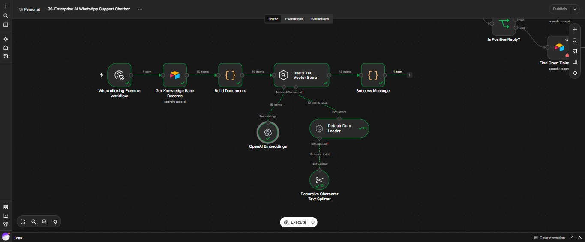
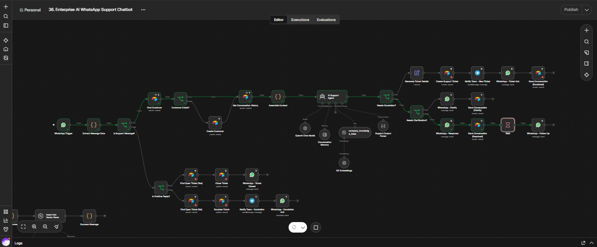

# Enterprise AI WhatsApp Support Chatbot

An AI-powered customer support automation system built using n8n, OpenAI, WhatsApp Cloud API, and Airtable.

The system receives customer messages through WhatsApp, analyzes customer intent and sentiment, retrieves relevant information from a company knowledge base, and determines whether to resolve, clarify, or escalate the request.

## Project Overview

Traditional customer support systems often require manual handling of repetitive inquiries, customer records, and support tickets.

This project automates important parts of the customer support process while providing a human escalation path for issues that require additional assistance.

## Key Features

- WhatsApp-based customer communication
- Automatic customer identification and registration
- Conversation history retrieval
- AI-powered intent classification
- Customer sentiment and priority analysis
- Knowledge-base-powered responses
- Automatic clarification questions
- Support ticket generation
- Department assignment
- Telegram team notifications
- Customer follow-up handling
- Ticket closure or human escalation

## Workflow Architecture

1. **Message Reception:** WhatsApp Trigger receives incoming customer messages.
2. **Data Extraction:** JavaScript normalizes customer name, phone number, message, and timestamp.
3. **Customer Management:** Airtable searches for existing customers and creates new customer records when necessary.
4. **Conversation Context:** Previous conversations are retrieved and assembled.
5. **AI Analysis:** The AI Support Agent analyzes the message, history, sentiment, priority, intent, and category.
6. **Knowledge Retrieval:** The agent uses the company knowledge base to answer factual and policy-related questions.
7. **Decision Making:** The AI chooses one of three actions:
   - Resolve
   - Clarify
   - Escalate
8. **Ticket Management:** Escalated issues generate support tickets in Airtable.
9. **Team Notification:** Telegram sends support ticket and escalation notifications.
10. **Customer Follow-up:** The workflow sends a follow-up message and handles YES/NO replies to close or escalate open tickets.

## Technology Stack

| Technology | Purpose |
|---|---|
| n8n | Workflow automation |
| OpenAI API | AI-powered support analysis |
| WhatsApp Cloud API | Customer communication |
| Airtable | Customer database and ticket management |
| Telegram | Internal team notifications |
| JavaScript | Data extraction and transformation |
| LangChain | AI agent, memory and retrieval components |
| Vector Store | Company knowledge retrieval |

## Knowledge Base

The workflow includes a separate knowledge-base loading process.

- Retrieves knowledge-base records from Airtable.
- Converts records into searchable documents.
- Generates embeddings using OpenAI.
- Loads documents into an in-memory vector store.
- Makes the knowledge base available to the AI Support Agent.

## Support Decision Logic

| AI Decision | Workflow Action |
|---|---|
| Resolve | Sends a customer response and saves conversation history |
| Clarify | Asks one focused question and saves the interaction |
| Escalate | Creates a support ticket and notifies the team |

## Setup Requirements

Before running this workflow, configure:

- n8n instance
- WhatsApp Cloud API credentials and webhook
- OpenAI API credentials
- Airtable account and required tables
- Telegram bot credentials
- Company knowledge-base records

Import the workflow JSON into n8n and configure your own credentials, IDs, database references, and webhook settings.

## Project Files

- `workflow.json` — Sanitized n8n workflow export
- `screenshots/` — Workflow and execution screenshots

## Important Notes

- This repository contains a project demonstration, not a hosted customer support service.
- The exported workflow must be configured with valid credentials and integrations before execution.
- The knowledge base uses an in-memory vector store, so its data needs to be loaded as configured.
- Use test customer data when demonstrating the project.
- The public workflow export must not contain API keys, access tokens, private IDs, personal customer information, or sensitive webhook details.

---

## Workflow Screenshots

### 1. Workflow Overview

### 2. Successful Execution

## Workflow Export

You can find the sanitized n8n workflow export here:

[View workflow.json](workflow.json)

## Author

  <b>Jasvant Malvi</b> 
  <a href="https://github.com/jasvantMalvi">GitHub</a> ·
  <a href="https://www.linkedin.com/in/jasvant-malvi-810305429/">LinkedIn</a>

