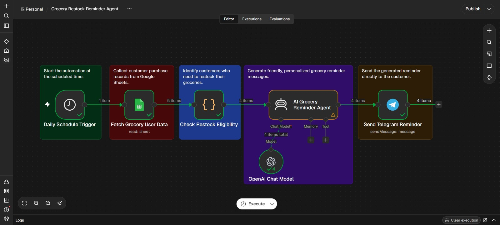
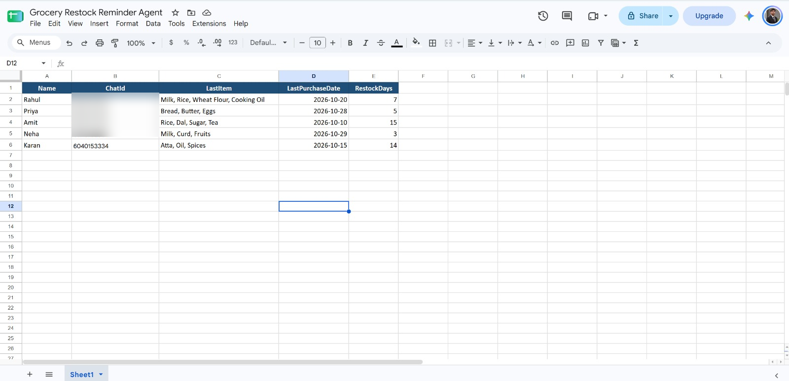
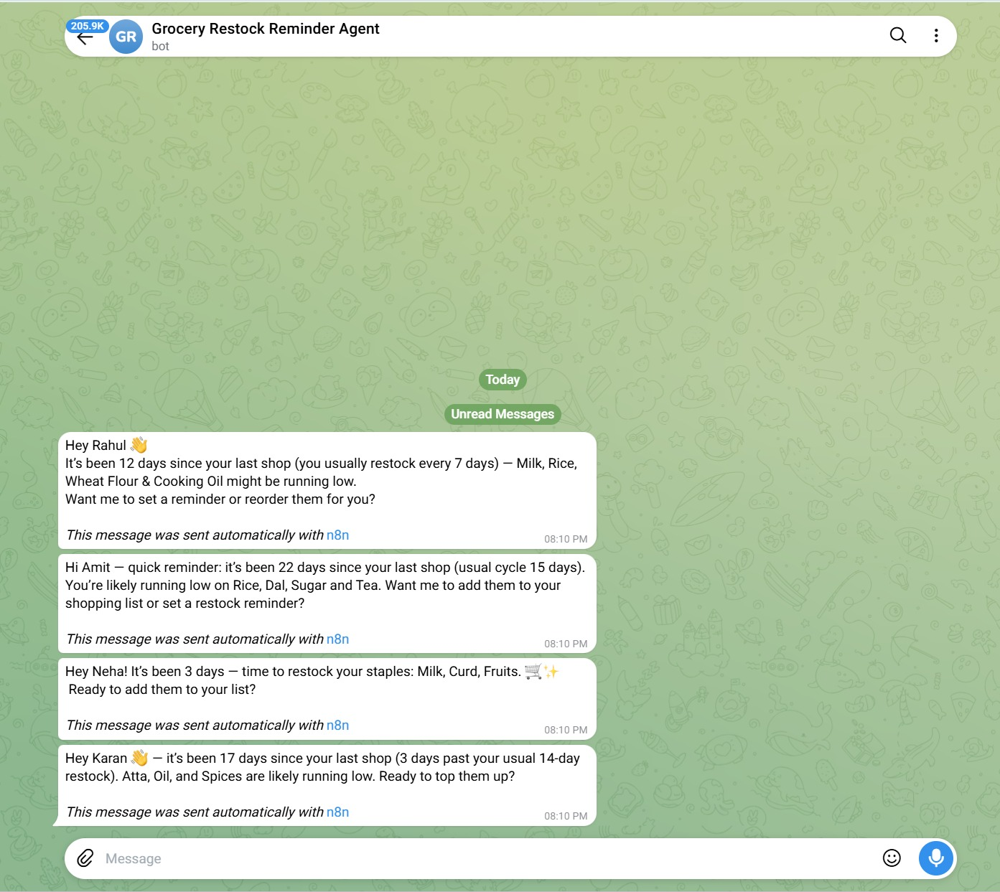

# Grocery Restock Reminder Agent

A scheduled grocery reminder workflow built with n8n, Google Sheets, OpenAI, and Telegram. It checks customers' last grocery purchase dates against their configured restock cycles, identifies records that have reached the restock threshold, generates a short personalized reminder, and sends the message through Telegram.

> **Important:** The supplied workflow has a hard-coded Telegram destination in its send node (replaced with a placeholder in this public export). Although the eligibility code carries a `ChatId` from each sheet row, the send node does not use that field. Configure recipient routing before using this workflow with multiple customers.

## Key Features

- Runs daily at the configured 9:00 hour.
- Reads customer grocery purchase records from Google Sheets.
- Checks elapsed days since each recorded purchase.
- Compares elapsed days with each customer's `RestockDays` threshold.
- Filters records that have reached the configured restock threshold.
- Uses OpenAI `gpt-5-mini` to draft a short, friendly, personalized reminder.
- Mentions the customer's name and previously purchased items.
- Sends generated reminder messages through Telegram.

## Workflow Overview

The supplied export contains 12 nodes: six functional nodes, five sticky notes, and one additional Telegram Trigger node that is not connected to the scheduled reminder path.

The connected scheduled flow is:

1. `Daily Schedule Trigger` starts the workflow every day at the configured 9:00 hour.
2. `Fetch Grocery User Data` reads customer records from the configured Google Sheets worksheet.
3. `Check Restock Eligibility` processes each row with `LastPurchaseDate` and `RestockDays`. It calculates the absolute date difference, rounds it up to whole days using `Math.ceil()`, and keeps rows where `daysPassed >= RestockDays`.
4. `AI Grocery Reminder Agent` receives the customer's name, last purchased items, elapsed days, and restock cycle, then writes a short personalized reminder.
5. `OpenAI Chat Model` supplies `gpt-5-mini` to the AI Agent.
6. `Send Telegram Reminder` sends the agent's generated `output` to a configured Telegram chat ID.

### Additional disconnected node

The export also contains a `Telegram Trigger` configured to listen for incoming messages. It has no outgoing connection and does not take part in the scheduled reminder execution path.

## Google Sheets Structure

The supplied spreadsheet uses five columns:

| Column | Purpose |
|---|---|
| `Name` | Customer name used for personalization |
| `ChatId` | Telegram chat identifier stored with the customer record |
| `LastItem` | Comma-separated list of previously purchased grocery items |
| `LastPurchaseDate` | Date of the latest recorded purchase |
| `RestockDays` | Expected number of days between restocking cycles |

The workflow reads these fields but does not update the purchase date, restock cycle, or a last-reminder timestamp after a message is sent.

## Restock Eligibility Logic

For each row containing `LastPurchaseDate` and `RestockDays`, the JavaScript node calculates:

- `daysPassed`: rounded-up absolute difference between the current runtime date and `LastPurchaseDate`
- `restockDays`: parsed integer from the `RestockDays` column

A row is selected when:

`daysPassed >= restockDays`

The selected values passed to the AI Agent are the customer's name, last purchased items, days passed, and expected restock cycle. This is an estimate based on a saved purchase date and configured cycle; the workflow does not measure actual remaining inventory.

## Reminder Message Generation

The AI Agent is instructed to use the customer's name, mention previously purchased items, and keep the message friendly, polite, short, and easy to read on Telegram. The example messages invite the customer to add items to a shopping list or request a restock reminder.

The workflow generates and sends a message only. It does not create a shopping cart, place an order, or schedule a follow-up based on the customer's reply.

## Technology Stack

- n8n
- Schedule Trigger
- Google Sheets
- JavaScript (n8n Code node)
- OpenAI Chat Model (`gpt-5-mini`)
- n8n AI Agent
- Telegram Bot API

## Workflow File

[Download n8n Workflow JSON](./workflow.json) — Sanitized export of the scheduled grocery reminder workflow.

## Screenshots

### 1. n8n Workflow Architecture


### 2. Google Sheets Customer Purchase Records


### 3. Telegram Reminder Messages


The screenshots show example customer records and reminder messages. They demonstrate the message format and workflow layout, but do not establish correct per-customer Telegram routing.

## Setup

1. Create a Google Spreadsheet with the five columns listed above.
2. Add customer names, Telegram chat IDs, purchased items, last purchase dates, and restock intervals.
3. Import `workflow.json` into n8n. The exported workflow is inactive by default.
4. Replace `REPLACE_WITH_YOUR_GOOGLE_SHEET_ID` in `Fetch Grocery User Data` with your spreadsheet ID.
5. Connect your Google Sheets OAuth credentials.
6. Connect your OpenAI credentials to `OpenAI Chat Model`.
7. Connect your Telegram Bot credentials to `Send Telegram Reminder`.
8. Configure the Telegram destination. The export uses `REPLACE_WITH_YOUR_TELEGRAM_CHAT_ID` in the send node. This represents one fixed destination, not per-row routing.
9. Set and verify the n8n workflow timezone so the 9:00 schedule runs at the intended local time.
10. Test rows below, at, and above the restock threshold, plus invalid and future purchase dates.
11. Activate only after fixing recipient routing and repeated-reminder behavior.

The export removes credential references, webhook IDs, instance metadata, and the original spreadsheet ID. The fixed Telegram destination has been replaced by a configuration placeholder. Reconnect your own Google Sheets, OpenAI, and Telegram credentials after importing.

## Current Limitations and Recommended Improvements

The following limitations are visible in the supplied workflow export:

- **Telegram recipient is hard-coded:** `Send Telegram Reminder` uses a fixed chat ID instead of the `chatId` carried forward by `Check Restock Eligibility`. As supplied, eligible records are not individually routed using their sheet `ChatId` values. Use the incoming row's `chatId` as the send node's dynamic Chat ID, or design the workflow explicitly for one fixed recipient.
- **The Telegram Trigger is disconnected:** It has no outgoing connection and is not used in the scheduled reminder path. Remove it if incoming commands are not needed, or build a separate connected interaction flow.
- **No last-reminder tracking:** The workflow does not update a `LastReminderSentAt` or reminder status. Each eligible customer can be messaged again on every daily run until the purchase date or restock interval is changed.
- **Future purchase dates are treated as elapsed time:** The JavaScript uses `Math.abs(today - lastDate)`. A date in the future can therefore be treated as if the same number of days had elapsed in the past. Validate dates and calculate a signed difference.
- **Rounding can advance eligibility:** `Math.ceil()` rounds a partial day up. Depending on execution time and how purchase dates are stored, a customer may qualify before a complete restock interval has passed.
- **No purchase update or confirmation flow:** The workflow does not listen for customers confirming a purchase or update `LastPurchaseDate` after restocking. The sheet must be updated manually or an interaction path must be added.
- **Fixed sheet schema:** The workflow expects the exact column names above. Missing or renamed columns can cause records to be skipped or reminders to be incomplete.
- **No inventory data:** The workflow infers possible restock needs from the configured cycle; it does not know actual stock remaining.
- **No AI output validation:** Generated text is sent without checking for empty or unsuitable output.
- **No dedicated error handling:** There is no separate recovery path for Google Sheets read errors, OpenAI failures, or Telegram delivery errors.
- **Schedule timezone needs verification:** The trigger specifies the 9:00 hour, but the export does not explicitly set a timezone in the schedule node. Configure the workflow/instance timezone and verify the actual run time.
- **Sample sheet reuses one chat ID:** The provided spreadsheet screenshot shows the same ChatId for all sample customer rows. Use the correct individual chat IDs if each customer is meant to receive their own reminders.

Fix recipient routing and reminder tracking before running this workflow for multiple real customers.

## Repository Structure

```text
Grocery-Restock-Reminder-Agent/
├── screenshots/
│   ├── README.md
│   ├── workflow-overview.png
│   ├── customer-restock-sheet.png
│   └── telegram-reminder-messages.png
├── README.md
└── workflow.json
```


## Author

<p align="left">
  <b>Jasvant Malvi</b><br>
  <a href="https://github.com/jasvantMalvi">GitHub</a> ·
  <a href="https://www.linkedin.com/in/jasvant-malvi-810305429/">LinkedIn</a>
</p>
