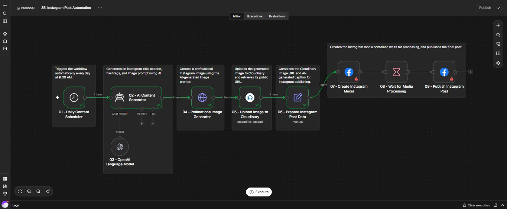

# Screenshots

## n8n Workflow Overview

The screenshot shows the daily scheduler, AI content generator, Pollinations image-generation request, Cloudinary upload, post-data preparation, Instagram media-container creation, wait node, and publishing node. Warning indicators are visible on both Meta Graph API nodes in the supplied screenshot.
