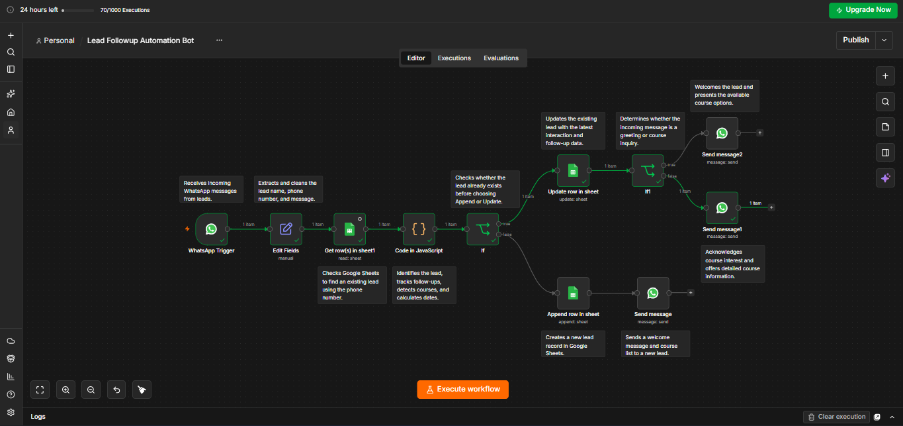
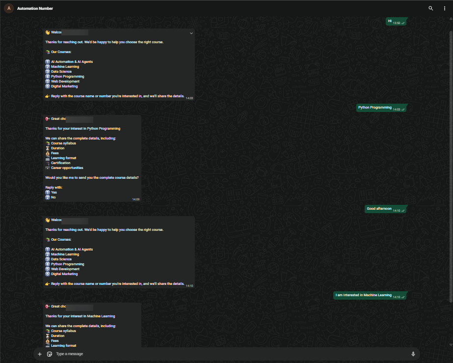
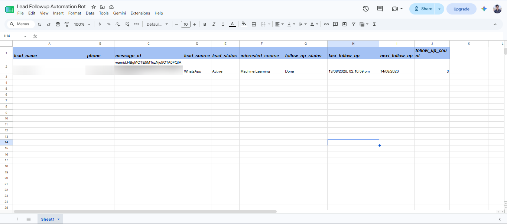

# Lead Follow-up Automation Bot

A WhatsApp-based lead capture and course-interest response workflow built with n8n, the WhatsApp Business Cloud API, and Google Sheets. It receives inbound messages, looks up the sender's phone number in a lead sheet, creates or updates the lead record, detects interest in one of six course options, and sends a welcome or course-interest response.

> **Scope clarification:** The supplied workflow is triggered by incoming WhatsApp messages. It calculates and stores a `next_follow_up` date, but it does not contain a Schedule Trigger or a separate workflow that sends messages at that future date. It is therefore an inbound lead capture and response workflow with follow-up tracking fields, not a scheduled follow-up campaign.

## Key Features

- Receives inbound text messages through WhatsApp
- Extracts the sender's profile name, WhatsApp ID, original message, and lowercased message
- Searches Google Sheets for an existing lead using the sender's phone number
- Creates a new lead row when no matching phone number is found
- Updates an existing lead row when a matching phone number is found
- Detects greetings and course-interest messages using JavaScript keyword matching
- Supports six course options:
  - AI Automation & AI Agents
  - Machine Learning
  - Data Science
  - Python Programming
  - Web Development
  - Digital Marketing
- Tracks lead status, interested course, follow-up status, last interaction, next follow-up date, and interaction count
- Sends a welcome message with the course list to new leads
- Sends a course-interest response to an existing lead when the incoming message is not detected as a greeting

## Workflow Overview

The supplied workflow contains 11 functional nodes and 11 sticky notes.

1. `WhatsApp Trigger` starts the workflow when a WhatsApp message arrives.
2. `Edit Fields` extracts:
   - `userName` from the WhatsApp contact profile
   - `userMessage` in lowercase
   - `userMessageOriginal` with surrounding whitespace removed
   - `userPhonenumber` from the WhatsApp contact ID
3. `Get row(s) in sheet1` searches the Google Sheet using the `phone` column.
4. `Code in JavaScript`:
   - checks whether the phone number already exists;
   - reads the previous `follow_up_count`;
   - increments the interaction count;
   - captures the WhatsApp message ID and message timestamp;
   - formats `last_follow_up` using `Asia/Kolkata`;
   - sets `next_follow_up` to the following calendar day;
   - detects exact greeting phrases;
   - detects one of the six supported course options;
   - assigns lead and follow-up statuses.
5. `If` routes the lead based on whether the phone number already exists.

### New lead — False branch

1. `Append row in sheet` creates a new lead record.
2. `Send message` sends a welcome message containing the six course options.

### Existing lead — True branch

1. `Update row in sheet` updates the existing row by matching the `phone` column. It stores the latest interaction details and sets `follow_up_status` to `Done`.
2. `If1` checks whether the incoming message is an exact greeting phrase.
3. If it is a greeting, `Send message2` sends the welcome message and course list.
4. If it is not a greeting, `Send message1` acknowledges the detected course interest and asks whether the lead wants complete course details.

## Course Detection Logic

The JavaScript Code node uses keyword checks and numeric options:

| User message contains / equals | Detected course |
|---|---|
| `ai automation`, `ai agent`, or exactly `1` | AI Automation & AI Agents |
| `machine learning` or exactly `2` | Machine Learning |
| `data science` or exactly `3` | Data Science |
| `python` or exactly `4` | Python Programming |
| `web development` or exactly `5` | Web Development |
| `digital marketing` or exactly `6` | Digital Marketing |

The message is lowercased before these checks. If no new course match is found, the existing lead's stored `interested_course` value is retained where available.

## Greeting Detection Logic

The workflow treats a message as a greeting only when the entire lowercased message matches one of these exact phrases:

- `hi`
- `hello`
- `hey`
- `hii`
- `hola`
- `good morning`
- `good afternoon`
- `good evening`

Messages such as `Hi, I want Python details` are not exact matches and therefore are treated as non-greeting messages.

## Google Sheets Structure

The supplied sheet screenshot shows these columns:

| Column | Purpose |
|---|---|
| `lead_name` | WhatsApp profile name |
| `phone` | Sender's WhatsApp ID / phone number |
| `message_id` | WhatsApp message ID |
| `lead_source` | Set to `WhatsApp` by the JavaScript node |
| `lead_status` | `New` or `Active` |
| `interested_course` | Detected course of interest |
| `follow_up_status` | `Pending` or `Done`, depending on the workflow branch |
| `last_follow_up` | Timestamp of the latest inbound message, formatted in India time |
| `next_follow_up` | The following calendar date in India time |
| `follow_up_count` | Incremented for each inbound message processed |

The lookup and update nodes match by `phone`. The workflow does not create a separate row for each interaction; existing lead interactions update the matched lead record.

## WhatsApp Responses

### New lead or greeting

The welcome response:
- Greets the sender by their WhatsApp profile name
- Thanks them for reaching out
- Lists the six available courses
- Asks them to reply with a course name or number

### Existing lead with a non-greeting message

The course-interest response:
- Acknowledges the detected course
- Lists syllabus, duration, fees, learning format, certification, and career opportunities as available information
- Asks whether the lead wants the complete course details
- Requests a reply of `1` for Yes or `2` for No

**The current JavaScript does not implement a Yes/No state.** It only recognizes greetings and the six course choices. A `1` or `2` reply is interpreted as a course choice for AI Automation or Machine Learning, respectively, rather than a Yes/No answer.

## Technology Stack

- n8n
- WhatsApp Business Cloud API
- WhatsApp Trigger
- WhatsApp Send Message
- Google Sheets
- JavaScript (n8n Code node)
- `Asia/Kolkata` date/time formatting

## Workflow File

[Download n8n Workflow JSON](./workflow.json) — Sanitized export of the supplied WhatsApp lead capture and response workflow.

## Screenshots

### 1. n8n Workflow Architecture



### 2. WhatsApp Lead Conversation



### 3. Google Sheets Lead Record



The screenshots show example messages and one sample lead record. The public copies blur the lead name, phone number, and WhatsApp message ID visible in the spreadsheet.

## Setup

1. Import `workflow.json` into your n8n instance. The exported workflow is inactive by default.
2. Connect your WhatsApp Business Cloud API credentials to `WhatsApp Trigger` and the three WhatsApp send-message nodes.
3. Replace `REPLACE_WITH_YOUR_WHATSAPP_PHONE_NUMBER_ID` in each WhatsApp send-message node with your own WhatsApp Business phone-number ID.
4. Create a Google Spreadsheet with the ten headers listed in the Google Sheets Structure section.
5. Replace `REPLACE_WITH_YOUR_GOOGLE_SHEET_ID` in the Google Sheets lookup, append, and update nodes with your spreadsheet ID.
6. Connect your Google Sheets OAuth credentials and select the correct worksheet.
7. Confirm the `phone` values stored in the sheet use the same format as `contacts[0].wa_id` received from WhatsApp.
8. Send a new message from a test WhatsApp number and verify that a new lead row is appended.
9. Send another message from the same number and verify that the existing row is updated rather than creating another lead.
10. Test each supported course keyword and numeric option, plus exact greetings and Yes/No replies.
11. Activate the workflow only after reviewing the current Yes/No handling and the missing scheduled follow-up behavior.

The export removes credential references, webhook IDs, the original Google Spreadsheet ID, the original WhatsApp Business phone-number ID, and instance-specific metadata. Reconnect your own WhatsApp and Google Sheets accounts after importing.

## Current Limitations and Recommended Improvements

The following limitations are visible in the supplied workflow export:

- **No scheduled follow-up sender:** `next_follow_up` is calculated as tomorrow, but there is no Schedule Trigger, date-based lookup workflow, or delayed message sender. Add a separate scheduled workflow that searches for due leads and sends follow-ups.
- **Yes/No replies are not implemented:** The course-interest message asks users to reply `1` for Yes or `2` for No, but the JavaScript interprets those values as course options. Add a conversation-state field such as `awaiting_course_details_confirmation` and handle Yes/No before course detection.
- **New-lead append does not store `interested_course`:** The JavaScript can detect a course from the first message, but the `Append row in sheet` mapping omits the `interested_course` column. Add that mapping so an initial course selection is not lost.
- **Follow-up count increments on every inbound message:** The code increments `follow_up_count` for any message from a known lead, including greetings and unrelated messages. Rename it to `interaction_count` or increment it only when an actual follow-up is sent.
- **Follow-up status behavior differs by branch:** The JavaScript sets `follow_up_status` to `Pending`, while the existing-lead update node writes the literal value `Done`. Define the intended meaning and update the status consistently.
- **Greeting detection requires an exact match:** A greeting followed by other words is treated as a non-greeting course inquiry. Use a more robust intent or prefix check if mixed greetings and questions should be supported.
- **Keyword-based course detection:** Course matching is based on substring checks and exact numeric choices. Ambiguous messages, spelling variations, or messages mentioning multiple courses can be misclassified.
- **No duplicate message-ID protection:** The workflow stores a WhatsApp `message_id` but does not check it before processing. Replayed webhook events could increment interaction counts or update a lead more than once.
- **Single-row assumption:** The Code node reads the first row returned by the Google Sheets lookup. Duplicate phone entries in the sheet can make the selected record ambiguous.
- **New-lead status and course interest:** A first inbound course-selection message still follows the new-lead branch and receives the welcome list rather than the existing-lead course-interest response.
- **No explicit Yes/No or opt-out state:** The workflow does not record whether a lead has asked to stop receiving messages. Add an opt-out flag and respect it before future follow-ups.
- **No scheduled or campaign retry logic:** The workflow responds to inbound WhatsApp messages only. It does not include retries, message-delivery status tracking, or a scheduled campaign queue.
- **Text-message input assumption:** `Edit Fields` reads `messages[0].text.body`. Image, document, audio, interactive-button, and other non-text messages are not handled by a dedicated branch.

This is a lead capture and basic course-interest response workflow. It should not be described as a fully automated follow-up campaign until scheduled sending, conversation state, opt-out handling, and delivery tracking are implemented.

## Repository Structure

```text
Lead-Followup-Automation-Bot/
├── screenshots/
│   ├── README.md
│   ├── workflow-overview.png
│   ├── whatsapp-lead-conversation.png
│   └── google-sheets-lead-record.png
├── README.md
└── workflow.json
```
