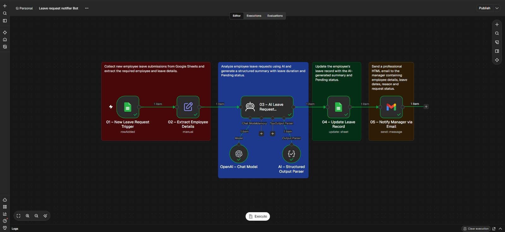
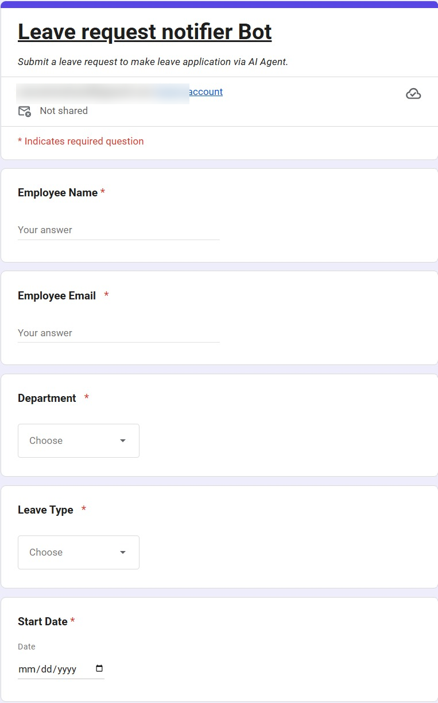
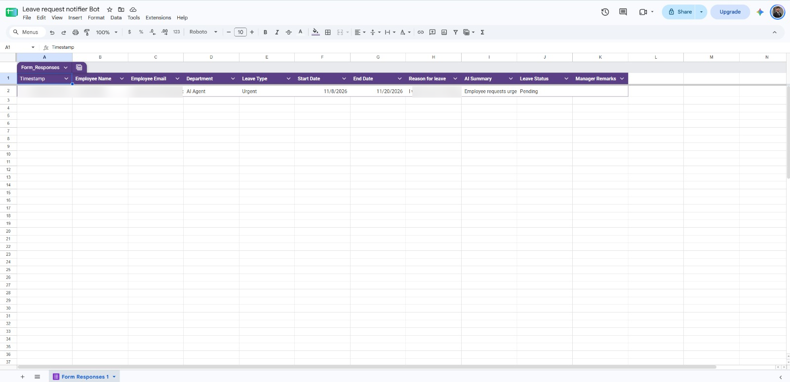
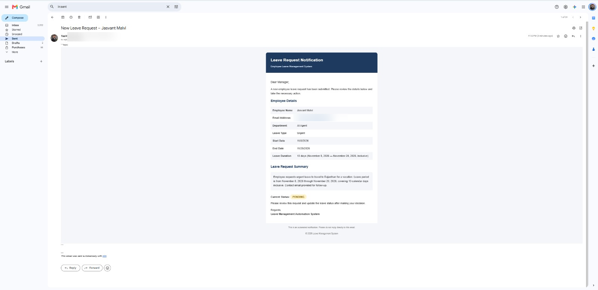

# Screenshots

These screenshots were supplied with the project and show the request form, workflow, stored response row, and email output.

## 1. Workflow Overview

The n8n flow captures a new request, extracts employee fields, creates an AI summary with a Pending status, updates the sheet, and sends an HTML email.

## 2. Leave Request Form

The visible form fields include employee name, employee email, department, leave type, and start date. The Google Sheets response screenshot also shows end date and reason for leave.

## 3. Google Sheets Record

Example response row, including the AI Summary and Leave Status columns.

## 4. Email Notification Example

Example HTML leave-request email. The workflow JSON currently addresses the message to the employee email even though its content is written as a manager notification; see the main README before reusing it.
