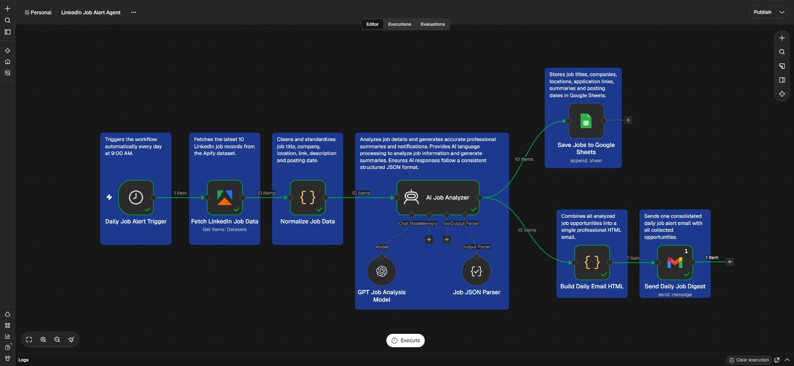
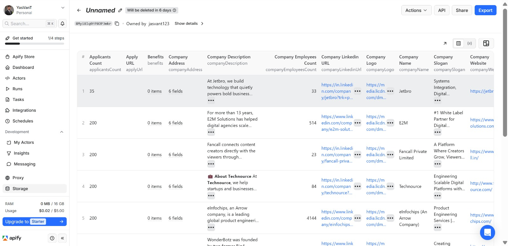
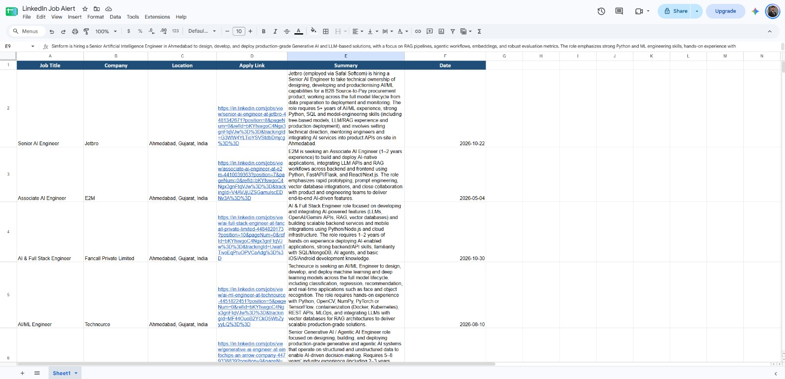
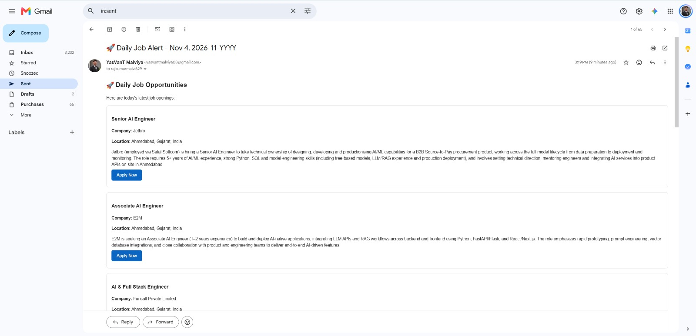
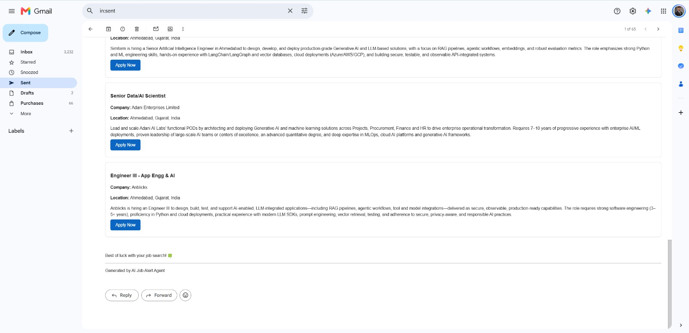

# Screenshots

The screenshots below document the workflow and sample output supplied with this project.

## 1. n8n Workflow Overview

Shows the daily schedule, Apify dataset retrieval, job normalization, GPT-5 Mini analysis, Google Sheets append branch, and consolidated Gmail branch.

## 2. Apify Dataset

Sample job dataset returned by the configured Apify dataset.

## 3. Google Sheets Results

Example stored records, including job title, company, location, apply link, summary, and posting date.

## 4. Gmail Daily Digest

Example consolidated email with job cards and application links. The shown sample is based on the records available at the time of that execution.
