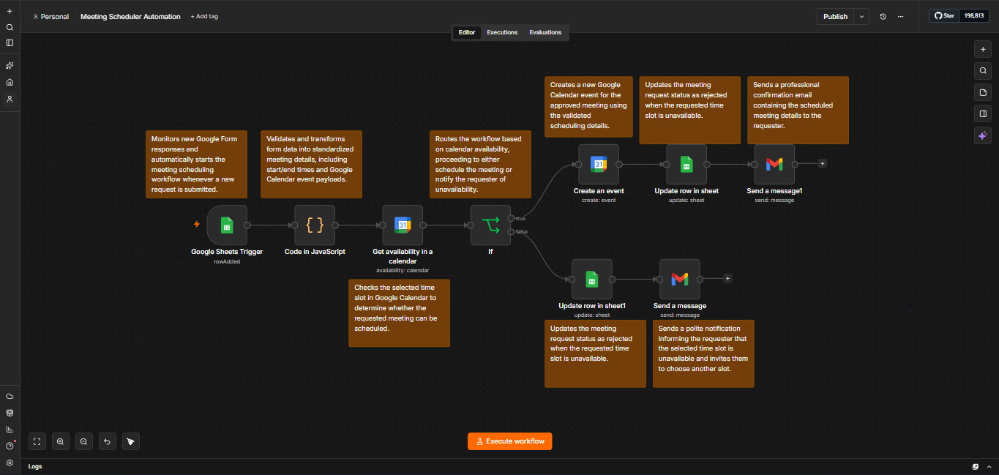
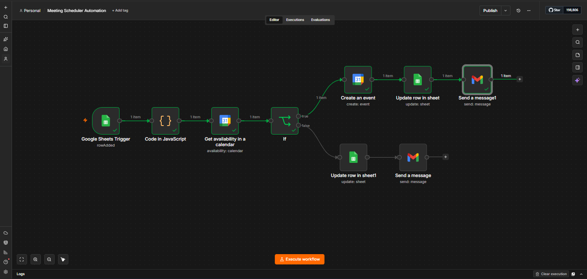
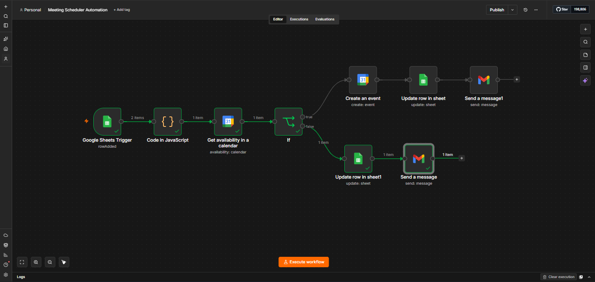
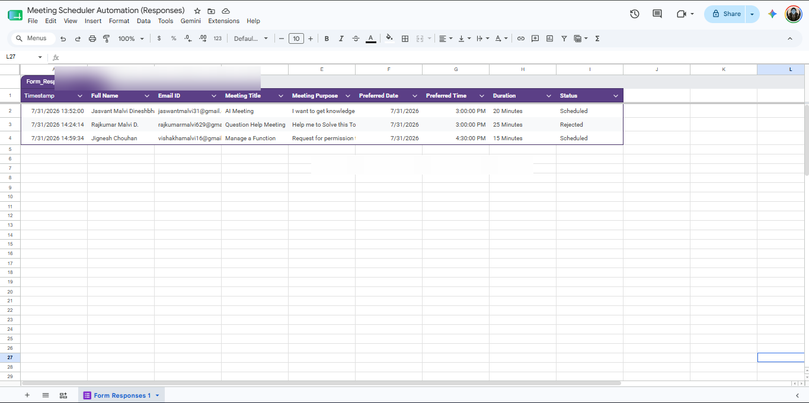
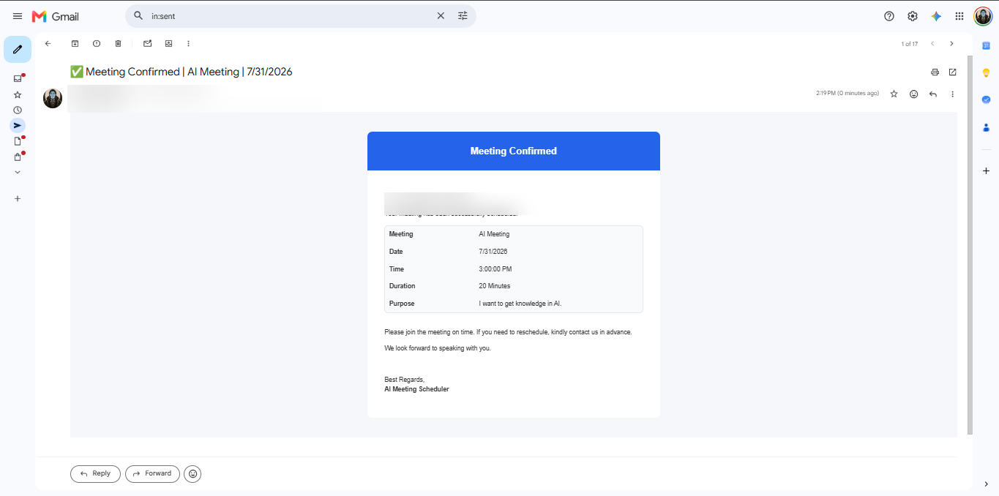
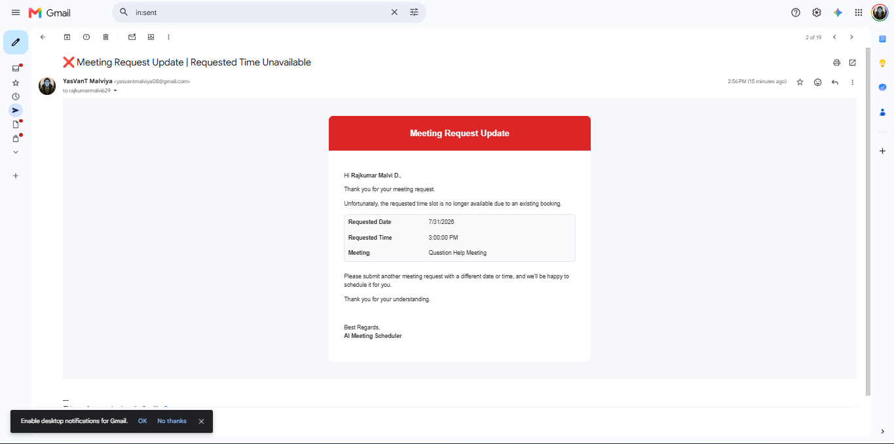

# Meeting Scheduler Automation

A Google Forms-based meeting scheduler built with n8n, Google Sheets, Google Calendar, and Gmail. When a new meeting request arrives in the response sheet, the workflow parses the requested date, time, and duration, checks the selected Google Calendar for availability, then either creates a calendar event and sends a confirmation email or marks the request as rejected and emails the requester.

## Key Features

- Monitors new Google Forms responses through a Google Sheets Trigger
- Checks for new response rows every minute
- Extracts requester name, email, meeting title, purpose, preferred date/time, and duration
- Parses a requested start time and calculates the meeting end time
- Uses `Asia/Kolkata` as the intended meeting timezone in the generated Calendar payload
- Checks the selected Google Calendar for conflicts during the requested time range
- Creates a calendar event when the slot is reported available
- Updates the request status to `Scheduled`
- Sends a meeting confirmation email
- Updates the request status to `Rejected` when the slot is unavailable
- Sends an email asking the requester to choose another date or time

## Workflow Overview

The supplied workflow contains nine functional nodes and nine sticky notes.

1. `Google Sheets Trigger` watches the `Form Responses 1` worksheet for newly added rows. It polls every minute.
2. `Code in JavaScript` uses the latest input item and extracts:
   - `Meeting Title`
   - `Meeting Purpose`
   - `Full Name`
   - `Email ID`
   - `Preferred Date`
   - `Preferred Time`
   - `Duration`
3. The Code node parses the duration (defaulting to 30 minutes when no number is found), parses the date and time, calculates start and end date-time values, and prepares a Calendar availability range and event payload.
4. `Get availability in a calendar` checks the requested time interval in the configured Google Calendar.
5. `If` checks whether the returned `available` field equals `true`.

### Available time slot — True branch

1. `Create an event` creates a Google Calendar event using the calculated start and end values.
2. `Update row in sheet` updates the matching response row's `Status` to `Scheduled`.
3. `Send a message1` emails the requester a meeting confirmation with the meeting title, date, time, duration, and purpose.

### Unavailable time slot — False branch

1. `Update row in sheet1` updates the matching response row's `Status` to `Rejected`.
2. `Send a message` emails the requester that the requested time is unavailable and asks them to submit another request.

## Google Sheets Structure

The supplied `Form Responses 1` screenshot shows these columns:

| Column | Purpose |
|---|---|
| `Timestamp` | Google Form submission timestamp |
| `Full Name` | Requester's name |
| `Email ID` | Requester's email address |
| `Meeting Title` | Requested meeting title |
| `Meeting Purpose` | Reason or agenda for the meeting |
| `Preferred Date` | Requested meeting date |
| `Preferred Time` | Requested start time |
| `Duration` | Requested meeting duration |
| `Status` | Updated by the workflow to `Scheduled` or `Rejected` |

The Google Sheets update nodes currently use `Email ID` as their matching column.

## Date, Time, and Duration Handling

The supplied JavaScript assumes:

- `Preferred Date` is in `M/D/YYYY` order, for example `7/31/2026`;
- `Preferred Time` matches a time string containing seconds and an AM/PM marker, for example `3:00:00 PM`;
- `Duration` contains a number followed by text, for example `20 Minutes`.

The code creates JavaScript `Date` values, calculates the end time by adding the parsed duration, and converts the results to ISO strings for Google Calendar. The Calendar event payload also labels the intended timezone as `Asia/Kolkata`.

## Email Notifications

### Meeting confirmed

The confirmation email includes the requester's name, meeting title, date, time, duration, and purpose. It asks the requester to join on time and contact the organizer in advance if rescheduling is needed.

### Requested time unavailable

The rejection email includes the requested date, requested time, and meeting title. It explains that the selected slot is unavailable and asks the requester to submit another date or time.

## Technology Stack

- n8n
- Google Forms
- Google Sheets Trigger
- Google Sheets
- Google Calendar
- Gmail
- JavaScript (n8n Code node)
- Calendar availability lookup

## Workflow File

[Download n8n Workflow JSON](./workflow.json) — Sanitized workflow export for importing into n8n.

## Screenshots

### 1. Annotated Workflow Architecture



### 2. Successful Scheduling Branch



### 3. Unavailable Slot Branch



### 4. Google Forms Response Sheet



### 5. Meeting Confirmation Email



### 6. Unavailable Slot Email



Public screenshot copies have been blurred to hide requester names, email addresses, and other personal contact details.

## Setup

1. Create a Google Form with fields corresponding to the response columns listed above.
2. Link the form to a Google Spreadsheet and confirm the response worksheet is named `Form Responses 1`.
3. Import `workflow.json` into your n8n instance. The exported workflow is inactive by default.
4. Replace `REPLACE_WITH_YOUR_GOOGLE_SHEET_ID` in the Google Sheets Trigger and both Google Sheets update nodes.
5. Connect your Google Sheets Trigger and Google Sheets OAuth credentials.
6. Replace `REPLACE_WITH_YOUR_GOOGLE_CALENDAR_ID` in both Google Calendar nodes with the calendar ID to check and use for event creation.
7. Connect your Google Calendar OAuth credentials and verify that the account can read availability and create events.
8. Connect your Gmail OAuth credentials to both email nodes.
9. Confirm the form date and time values match the parser's expected formats, or update the parser to support the actual values returned by your form.
10. Set the n8n workflow/server timezone consistently with `Asia/Kolkata`, or revise the date conversion to construct timezone-aware timestamps explicitly.
11. Test one request when the calendar slot is available and another when it is occupied. Verify event creation, sheet status, and the corresponding email in each case.
12. Activate the workflow only after checking row matching, Calendar event details, timezone conversion, and notification behavior.

The export removes credential references, webhook IDs, the original Google Spreadsheet ID, the original Google Calendar email identifier, and instance-specific metadata. Reconnect your own accounts and configure your own IDs after import.

## Current Limitations and Recommended Improvements

The following limitations are visible in the supplied workflow export:

- **Status updates match by email only:** Both Google Sheets update nodes use `Email ID` as their matching column. If the same person submits multiple meeting requests, the update may target the wrong matching row. Prefer the unique `row_number` from the trigger or add a generated Request ID and update by that unique value.
- **Calendar event details are not fully mapped:** The JavaScript prepares `meetingTitle`, `meetingPurpose`, and an attendee array in `calendarEvent`, but the `Create an event` node maps only the start and end times. Its configured attendee list is empty, and the meeting title and purpose are not mapped into the Calendar event. Map the summary, description, and attendee fields explicitly.
- **Timezone depends on the n8n runtime:** The JavaScript constructs the `Date` using the runtime's local timezone, then converts it to ISO format, while also attaching `Asia/Kolkata` to the Calendar payload. If the runtime timezone differs from Asia/Kolkata, the selected slot may shift. Use consistent timezone-aware date conversion and test around daylight/timezone boundaries.
- **Date format is assumed:** The parser splits the date as month/day/year. Other formats, including `DD/MM/YYYY` or ISO date strings, may be parsed incorrectly.
- **Time format is strict:** The parser expects `HH:MM:SS AM/PM`. A time without seconds or using 24-hour format triggers an error.
- **Required fields are not validated first:** The code does not explicitly validate full name, email, title, purpose, or date before parsing and checking availability. Missing or malformed values can cause workflow errors or incomplete events.
- **No past-date or working-hours validation:** The workflow checks calendar availability but does not reject past dates or enforce office hours and minimum notice periods.
- **Availability check is not a booking lock:** Another event could be created between the availability check and event creation. For high-demand calendars, consider conflict rechecking or a controlled booking process.
- **No meeting link generation:** The supplied Create an event node does not configure Google Meet conference data.
- **No dedicated error handling:** The workflow does not show a recovery branch for Google Calendar, Google Sheets, or Gmail failures.
- **No calendar event ID stored:** The event ID returned by Google Calendar is not written back to the response sheet, making later event updates or cancellations harder.

The screenshots show examples of both the scheduled and rejected outcomes. They do not prove that all date formats, timezone configurations, duplicate submissions, or failure scenarios have been tested.

## Repository Structure

```text
Meeting-Scheduler-Automation/
├── screenshots/
│   ├── README.md
│   ├── workflow-overview.png
│   ├── successful-scheduling-execution.png
│   ├── unavailable-slot-execution.png
│   ├── form-responses-sheet.png
│   ├── meeting-confirmation-email.png
│   └── meeting-unavailable-email.png
├── README.md
└── workflow.json
```

## Author

<p align="left">
  <b>Jasvant Malvi</b><br>
  <a href="https://github.com/jasvantMalvi">GitHub</a> ·
  <a href="https://www.linkedin.com/in/jasvant-malvi-810305429/">LinkedIn</a>
</p>
