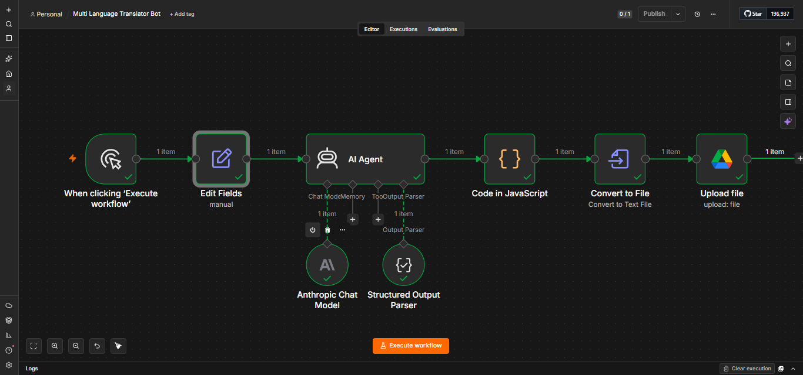
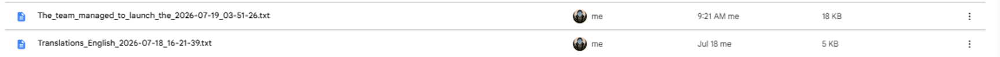
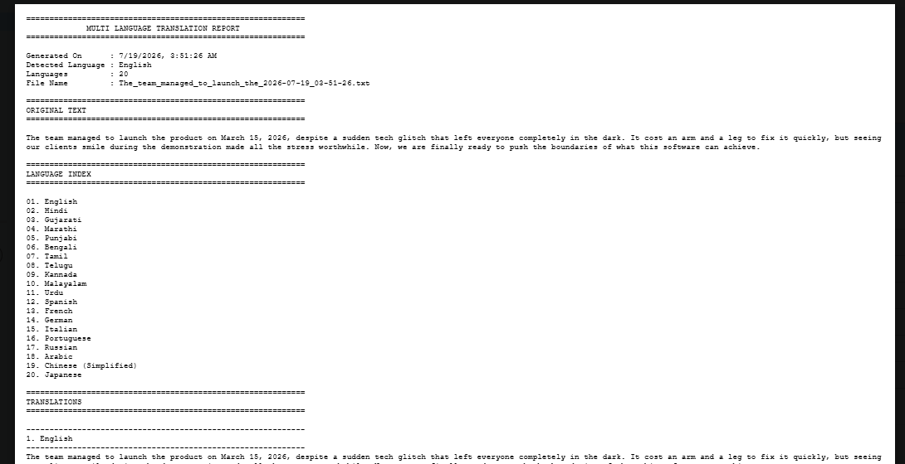

# Multi Language Translator Bot

A manually triggered multilingual translation workflow built with n8n, Anthropic Claude, and Google Drive. It takes text from an editable n8n field, detects the source language, generates translations in 20 configured languages, formats them into a structured text report, converts the report into a `.txt` file, and uploads that file to the root of Google Drive.

> **Important:** This is a manual, single-input workflow—not a live chat bot or a public translation API. The supplied `Edit Fields` node contains a static demonstration paragraph. Replace that text before each run to translate a different input.

## Key Features

- Manual execution from the n8n editor
- Editable source text in an `Edit Fields` node
- Automatic source-language detection by the AI Agent
- Translation into 20 configured languages
- Context-aware translation instructions intended to preserve tone, meaning, formatting, and idioms
- Instructions to retain URLs, email addresses, phone numbers, usernames, hashtags, code, variable names, commands, file paths, and other technical identifiers
- Structured AI output using a Structured Output Parser
- A generated report containing source language, source text, language index, and individual translations
- A timestamped `.txt` filename based on the first six words of the source text
- Automatic conversion of report text into a file
- Upload of the generated `.txt` file to Google Drive's My Drive root folder

## Workflow Overview

The supplied workflow contains eight nodes:

1. `When clicking ‘Execute workflow’` starts the workflow manually.
2. `Edit Fields` supplies the input text in a field named `text`. The exported workflow contains a fixed sample paragraph.
3. `AI Agent` receives the text and follows the translation instructions:
   - detects the source language;
   - translates into the configured 20 languages;
   - aims to preserve meaning, tone, emotion, and formatting;
   - leaves specified technical identifiers unchanged;
   - returns translations in the structured format.
4. `Anthropic Chat Model` supplies the language model. The supplied export selects **Claude Sonnet 4.6**.
5. `Structured Output Parser` defines a JSON object with `detected_language` and a `translations` object containing the 20 configured language keys.
6. `Code in JavaScript` formats the AI output into a report, creates a safe filename, counts the translation keys, and returns the report text and metadata.
7. `Convert to File` converts the report text into a text file using the generated filename.
8. `Upload file` uploads the generated text file to the root of Google Drive (`My Drive`).

## Default Target Languages

The supplied AI Agent prompt and parser define these 20 languages:

1. English
2. Hindi
3. Gujarati
4. Marathi
5. Punjabi
6. Bengali
7. Tamil
8. Telugu
9. Kannada
10. Malayalam
11. Urdu
12. Spanish
13. French
14. German
15. Italian
16. Portuguese
17. Russian
18. Arabic
19. Chinese (Simplified)
20. Japanese

The prompt instructs the model to include the source language among the translations when it is one of these configured languages. It also says that a user-requested alternative language set should replace the default set; however, the Structured Output Parser schema is fixed to the 20 listed languages, so changing the target language set may require changing the parser schema as well.

## Translation Report Format

The JavaScript formatter creates a plain-text report containing:

- Report title
- Generation date and time
- Detected source language
- Number of language keys in the translations object
- Generated filename
- Original text section
- Numbered language index
- Individual translation sections
- Report footer

The output filename uses the first six words of the source text, sanitized to retain Unicode letters and numbers, followed by a timestamp. Example pattern:

`The_team_managed_to_launch_2026-07-19_03-51-26.txt`

The generated file is uploaded to the root folder of Google Drive in the supplied workflow.

## Technology Stack

- n8n
- Manual Trigger
- Edit Fields (Set node)
- AI Agent
- Anthropic Chat Model — Claude Sonnet 4.6
- Structured Output Parser
- JavaScript (Code node)
- Convert to File
- Google Drive Upload

## Workflow File

[Download n8n Workflow JSON](./workflow.json) — Sanitized workflow export for importing into n8n.

## Screenshots

### 1. n8n Workflow Architecture



### 2. Generated Files in Google Drive



### 3. Translation Report Preview



The report preview shows the generated file structure, source-language field, language count, original text, language index, and the beginning of the translation section.

## Setup

1. Import `workflow.json` into your n8n instance. The exported workflow is inactive by default.
2. Connect your Anthropic API credentials to `Anthropic Chat Model`.
3. Connect your Google Drive OAuth credentials to `Upload file`.
4. Open `Edit Fields` and replace the sample paragraph in the `text` field with the content to translate.
5. Review the AI Agent instructions and the fixed 20-language Structured Output Parser schema.
6. Execute the workflow manually.
7. Check the Code node output for `fileName`, `totalLanguages`, `detectedLanguage`, and `generatedAt`.
8. Confirm that `Convert to File` creates the `.txt` file and `Upload file` places it in the intended Google Drive location.
9. Open the uploaded report and review the source language and translations before sharing it.

The export removes credential references, webhook IDs, and instance-specific metadata. Reconnect your own Anthropic and Google Drive credentials after importing.

## Current Limitations and Recommended Improvements

The following limitations are visible in the supplied workflow export:

- **Manual, static input:** The workflow starts with a Manual Trigger and the `Edit Fields` node contains a fixed sample paragraph. It does not accept text dynamically from Telegram, WhatsApp, a form, webhook, or another user-facing interface.
- **Original text is missing from the parser schema:** The Structured Output Parser schema contains `detected_language` and `translations`, but no `original_text` field. The JavaScript formatter tries to read `input.original_text` and falls back to `translations[detectedLanguage]`. If the detected source language is not one of the configured translation keys, the original-text section can be blank. Add `original_text` to the schema and require the AI Agent to return it.
- **Fixed translation schema:** The parser is configured for the 20 default languages. The prompt says that the user may request a different set, but an alternative language set may not fit the fixed parser schema without configuration changes.
- **No separate translation validation:** The workflow trusts the model's structured response. It does not independently verify translation completeness, preserve exact numbers, compare paragraph counts, or check that all output fields contain usable content.
- **No chunking for long inputs:** The workflow passes the entire text to the AI Agent in one request. Very long documents may exceed model or output limits, and the workflow does not split and recombine the text.
- **No explicit retry or error route:** The workflow does not show a dedicated path for model failures, parser errors, incomplete translations, conversion failures, or Google Drive upload failures.
- **Uploads to My Drive root:** The Upload file node uses the root folder. A dedicated output folder would keep generated reports organized.
- **Filename can be long:** The filename uses up to six words from the original text plus a timestamp. Long source words can still produce long filenames.
- **Runtime timestamp and locale:** The report timestamp uses the n8n runtime's local date/time and `toLocaleString()`. Set and test the n8n timezone if consistent report timestamps are required.
- **Translation accuracy needs review:** The prompt aims for natural translations, but it does not guarantee native-level accuracy. Review translations before using them for legal, medical, contractual, or other high-stakes communication.

## Repository Structure

```text
Multi-Language-Translator-Bot/
├── screenshots/
│   ├── README.md
│   ├── workflow-overview.png
│   ├── google-drive-output-files.png
│   └── translation-report-preview.png
├── README.md
└── workflow.json
```

## Author

<p align="left">
  <b>Jasvant Malvi</b><br>
  <a href="https://github.com/jasvantMalvi">GitHub</a> ·
  <a href="https://www.linkedin.com/in/jasvant-malvi-810305429/">LinkedIn</a>
</p>
