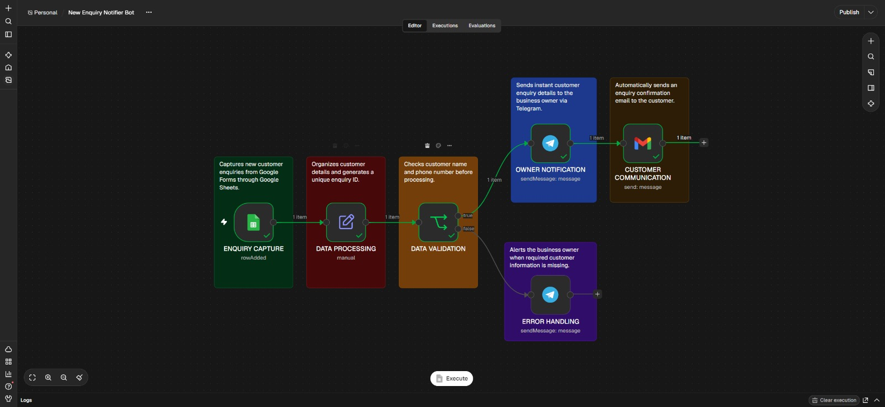
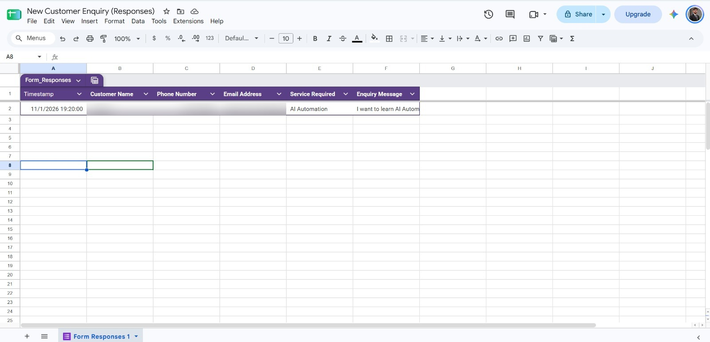
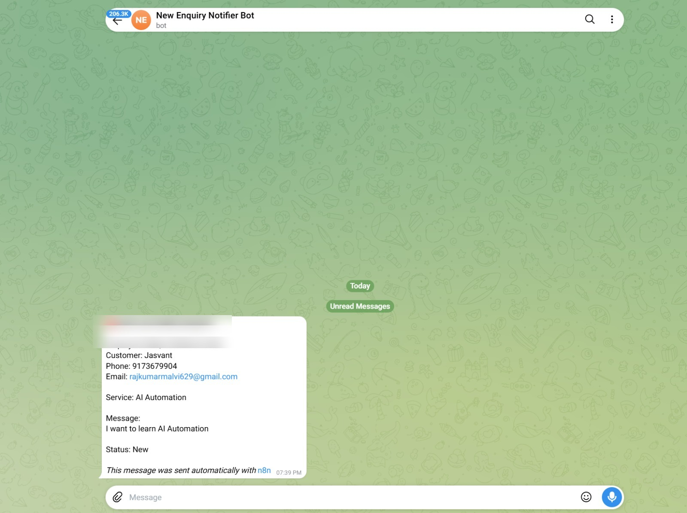
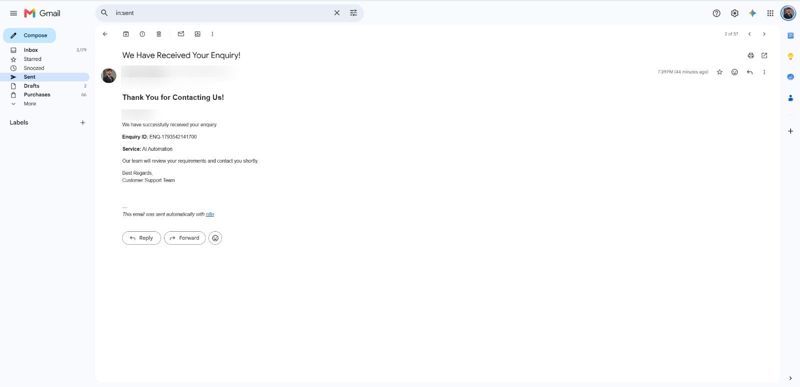

# New Enquiry Notifier Bot

An automated customer enquiry notification workflow built with n8n, Google Forms, Google Sheets, Telegram, and Gmail. When a new form response is added to Google Sheets, the workflow creates an enquiry ID, prepares customer details, validates the required name and phone fields, alerts the business owner through Telegram, and sends an acknowledgement email to the customer.

## Key Features

- Captures Google Form submissions through a Google Sheets row-added trigger
- Checks the responses sheet every minute
- Generates a timestamp-based enquiry ID
- Standardizes customer details into named fields
- Adds enquiry date, initial status, and source metadata
- Validates that customer name and phone number are not empty
- Sends a new-enquiry alert to the business owner through Telegram
- Sends an acknowledgement email to the customer through Gmail
- Sends a Telegram alert to the business owner when the required name or phone field is missing

## Workflow Overview

1. `ENQUIRY CAPTURE` watches the `Form Responses 1` worksheet for newly added rows. It polls every minute.
2. `DATA PROCESSING` maps the form response columns into a consistent enquiry record and adds:
   - `Enquiry_ID` in the format `ENQ-<timestamp in milliseconds>`;
   - `Enquiry_Date` using the n8n current timestamp;
   - `Status` set to `New`;
   - `Source` set to `Google Form`.
3. `DATA VALIDATION` checks two fields:
   - `Customer_Name` must not be empty;
   - `Phone` must not be empty.
4. If validation passes:
   - `OWNER NOTIFICATION` sends the enquiry details to the configured business-owner Telegram chat.
   - `CUSTOMER COMMUNICATION` sends a confirmation email to the customer's submitted email address.
5. If validation fails:
   - `ERROR HANDLING` sends a Telegram alert containing the available name, phone, and email values and asks the owner to inspect the original form response.

The customer confirmation email runs after the owner Telegram notification. The email is therefore dependent on the preceding Telegram node completing successfully.

## Enquiry Data Fields

The workflow creates these downstream fields:

| Field | Source or behavior |
|---|---|
| `Enquiry_ID` | Generated from the current timestamp in milliseconds |
| `Customer_Name` | Google Form `Customer Name` response |
| `Phone` | Google Form `Phone Number` response |
| `Email` | Google Form `Email Address` response |
| `Service` | Google Form `Service Required` response |
| `Message` | Google Form `Enquiry Message` response |
| `Enquiry_Date` | Current n8n timestamp in ISO format |
| `Status` | Set to `New` |
| `Source` | Set to `Google Form` |

## Google Sheets Structure

The supplied spreadsheet screenshot shows a `Form Responses 1` worksheet with the following response headers:

| Column | Purpose |
|---|---|
| `Timestamp` | Form submission timestamp |
| `Customer Name` | Customer name |
| `Phone Number` | Customer phone number |
| `Email Address` | Customer email address |
| `Service Required` | Service selected/requested |
| `Enquiry Message` | Customer's description or question |

The current workflow reads the response row and processes it for notifications. It does not append the generated `Enquiry_ID`, `Enquiry_Date`, or `Status` back into a separate enquiry CRM sheet.

## Notification Behavior

### Business owner — Telegram

The owner alert includes the enquiry ID, customer name, phone, email, requested service, enquiry message, and current status.

### Customer — Gmail

The customer receives an acknowledgement email with the subject:

`We Have Received Your Enquiry!`

The email includes the customer's name, enquiry ID, requested service, and a message that the team will review the requirements and respond shortly.

### Invalid enquiry — Telegram

If customer name or phone is missing, the workflow sends an invalid-enquiry alert to the business owner instead of entering the normal notification path.

## Technology Stack

- n8n
- Google Forms
- Google Sheets Trigger
- Google Sheets
- Set node for data processing
- IF node for required-field validation
- Telegram Bot API
- Gmail
- JavaScript expressions and n8n date/time expressions

## Workflow File

[Download n8n Workflow JSON](./workflow.json) — Sanitized workflow export for importing into n8n.

## Screenshots

### 1. n8n Workflow Architecture


### 2. Google Sheets Form Responses


### 3. Telegram Owner Notification


### 4. Customer Confirmation Email


## Setup

1. Create a Google Form with fields corresponding to the response columns listed above.
2. Link the form to a Google Spreadsheet and confirm the response worksheet is named `Form Responses 1`.
3. Import `workflow.json` into your n8n instance. The exported workflow is inactive by default.
4. Replace `REPLACE_WITH_YOUR_GOOGLE_SHEET_ID` in `ENQUIRY CAPTURE` with your response spreadsheet ID.
5. Connect your Google Sheets Trigger OAuth credentials.
6. Connect your Telegram credentials to `OWNER NOTIFICATION` and `ERROR HANDLING`.
7. Replace `REPLACE_WITH_YOUR_TELEGRAM_OWNER_CHAT_ID` in both Telegram nodes with the business owner's Telegram chat ID.
8. Connect your Gmail OAuth credentials to `CUSTOMER COMMUNICATION`.
9. Confirm the Google Form email field collects a valid customer email address.
10. Test a complete enquiry with name, phone, and email. Verify the Telegram alert and customer acknowledgement.
11. Test an enquiry with a missing name or phone and verify that the owner receives the invalid-enquiry alert.
12. Activate the workflow only after checking credentials, trigger polling, validation behavior, and notification delivery.

The export removes credential references, webhook IDs, the original Google Spreadsheet ID, the original Telegram owner chat ID, and instance-specific metadata. Reconnect your own accounts and values after importing.

## Current Limitations and Recommended Improvements

The following limitations are visible in the supplied workflow export:

- **Email is not included in validation:** The IF node checks only `Customer_Name` and `Phone`. A row with a missing or invalid email can pass validation, trigger the owner alert, and then fail at the Gmail node. Add email presence and format validation before the successful branch.
- **Phone number is treated as a number:** The Set node maps `Phone` as a numeric field. Phone numbers should generally be kept as text to preserve leading zeros, a leading `+`, and country-code formatting.
- **Validation checks only whether name and phone are non-empty:** It does not validate phone length/country code, email format, or whether the requested service and enquiry message contain useful values.
- **Notifications are sequential:** The Gmail customer acknowledgement is connected after the Telegram owner alert. If the Telegram node fails, the customer email will not run. Consider separating the two notification branches or adding error handling.
- **No duplicate enquiry check:** The workflow processes each newly added response row. It does not check whether the same customer has already submitted an identical enquiry.
- **Enquiry records are not written to a separate CRM/status table:** The trigger source sheet stores the form response, but the generated enquiry ID, processing status, and notification outcomes are not written back by this workflow.
- **Timestamp-based ID:** The enquiry ID uses the current timestamp in milliseconds. This is convenient for a prototype, but a dedicated unique ID strategy is more robust for high-volume form submissions.
- **Fixed owner Telegram chat:** The owner notification destination is configured in the Telegram node. Replace the placeholder with the correct owner chat ID or make routing configurable.
- **Polling interval:** The Google Sheets Trigger polls every minute. Notifications are not guaranteed to be instantaneous at the exact moment a form is submitted.
- **No retry or notification delivery log:** The workflow does not include a dedicated retry strategy or a persistent record showing whether Telegram and Gmail notifications succeeded.

The screenshots demonstrate a sample enquiry, the owner alert, and the customer acknowledgement. They do not establish that every invalid-input case or notification failure scenario has been tested.

## Repository Structure

```text
New-Enquiry-Notifier-Bot/
├── screenshots/
│   ├── README.md
│   ├── workflow-overview.jpeg
│   ├── form-responses-sheet.jpeg
│   ├── telegram-owner-notification.jpeg
│   └── customer-confirmation-email.jpeg
├── README.md
└── workflow.json
```
