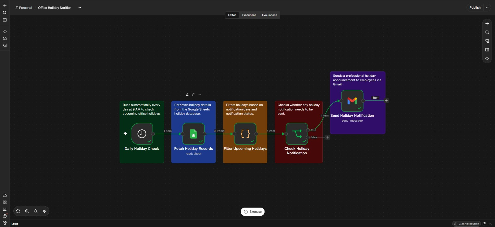
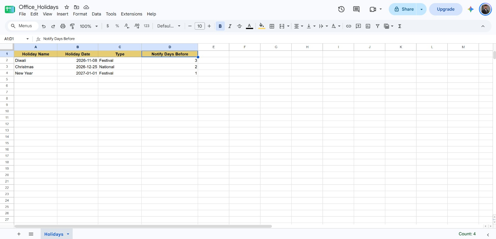
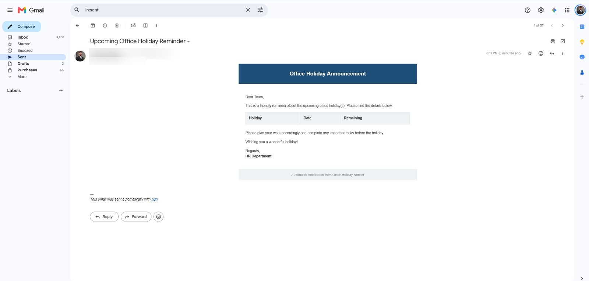

# Office Holiday Notifier

An automated office holiday reminder workflow built with n8n, Google Sheets, and Gmail. It checks a holiday calendar every day, compares each holiday date with its configured notification lead time, prepares a combined HTML email, and sends the announcement through Gmail.

> **Important: the supplied workflow has an inverted IF condition.** The Gmail node is connected to the output for `hasHoliday = false`. As exported, it sends an email when no holiday matches and sends nothing when an upcoming holiday does match. This issue is documented below; the downloadable workflow preserves the supplied logic and does not silently change it.

## Key Features

- Runs a daily holiday check at 9:00 AM according to the n8n workflow timezone
- Retrieves holiday records from Google Sheets
- Supports an individual notification lead time for each holiday
- Uses a default lead time of three days when the field is blank
- Skips records whose `Notification Status` value is `Sent`, if that field exists
- Groups all matching holidays into one HTML email
- Includes holiday name, date, and days remaining in the email table
- Sends the announcement through Gmail

## Workflow Overview

1. `Daily Holiday Check` starts the workflow every day at hour 9.
2. `Fetch Holiday Records` reads the `Holidays` worksheet from the configured Google Spreadsheet.
3. `Filter Upcoming Holidays`:
   - reads `Holiday Name`, `Holiday Date`, and `Notify Days Before`;
   - uses `Asia/Kolkata` when deriving today's date;
   - defaults the lead time to three days if the cell is blank;
   - skips incomplete records;
   - skips rows whose `Notification Status` equals `Sent`;
   - calculates days remaining and retains only records where `daysLeft` equals the configured lead time;
   - builds one combined HTML email with a table of matching holidays.
4. `Check Holiday Notification` checks the `hasHoliday` boolean.
5. `Send Holiday Notification` sends the email using the generated subject and HTML body.

## Google Sheets Structure

The supplied spreadsheet screenshot shows a worksheet named `Holidays` with these four columns:

| Column | Purpose |
|---|---|
| `Holiday Name` | Holiday name shown in the email |
| `Holiday Date` | Holiday date used for the countdown |
| `Type` | Holiday classification, such as Festival or National |
| `Notify Days Before` | Number of days before the holiday when the reminder should be generated |

Example rows in the screenshot include Diwali, Christmas, and New Year.

**Implementation note:** The current JavaScript does not use the `Type` column. It also checks an optional `Notification Status` field, but that column is not visible in the supplied sheet screenshot and the workflow has no node to update notification status after sending.

## Email Output

The generated email contains:

- Subject: `Upcoming Office Holiday Reminder - <holiday names>`
- Heading: `Office Holiday Announcement`
- Greeting to the team
- A table with Holiday, Date, and Remaining columns
- A reminder to plan work before the holiday
- HR Department sign-off
- An automated-notification footer

All holidays matching their configured lead time on the same run are combined into one email.

## Technology Stack

- n8n
- Schedule Trigger
- Google Sheets
- JavaScript (n8n Code node)
- Gmail

## Workflow File

[Download n8n Workflow JSON](./workflow.json) — Sanitized export for importing into n8n.

## Screenshots

### 1. n8n Workflow Architecture


### 2. Google Sheets Holiday Calendar


### 3. Gmail Holiday Announcement Example


The email screenshot shows an empty holiday table. This matches the inverted IF routing described above and should not be interpreted as proof that a valid holiday reminder was delivered.

## Setup

1. Import `workflow.json` into your n8n instance. The exported workflow is inactive by default.
2. Create a Google Spreadsheet with a `Holidays` worksheet and the four columns listed above.
3. Replace `REPLACE_WITH_YOUR_GOOGLE_SHEET_ID` in `Fetch Holiday Records` with your spreadsheet ID.
4. Connect your own Google Sheets credentials.
5. Connect your own Gmail OAuth credentials to `Send Holiday Notification`.
6. Replace `REPLACE_WITH_RECIPIENT_EMAIL` with the intended team or HR distribution-list address.
7. Confirm the n8n workflow timezone. The Schedule Trigger runs at hour 9 in the workflow timezone; the Code node separately uses `Asia/Kolkata` to calculate today's date.
8. Fix the `Check Holiday Notification` condition so the Gmail node runs when `hasHoliday` is `true`.
9. Test with a holiday whose `Holiday Date` is exactly the configured number of days after the test date. Confirm the email includes that holiday.
10. Test a date with no matching holiday and confirm no email is sent.
11. Activate the workflow only after the routing, timezone, recipient, and date calculations have been verified.

The export removes credential references, the original spreadsheet ID, the original recipient email, webhook IDs, and instance-specific metadata. Reconnect your own credentials and values after importing.

## Current Limitations and Recommended Improvements

The following issues are visible in the supplied workflow export:

- **Inverted IF condition (critical):** `Check Holiday Notification` tests whether `hasHoliday` is false, and the Gmail node is connected to that output. As a result, the email is sent when the filtered holiday list is empty. When at least one holiday matches, the other IF output has no connected node. Change the condition to `hasHoliday` is true, or connect the Gmail node to the appropriate output.
- **No persistent notification-status update:** The Code node can skip rows with `Notification Status = Sent`, but the supplied sheet screenshot does not show that column and the workflow has no Google Sheets update node. Add a status/date update after successful delivery if notifications need to be tracked persistently.
- **A zero-day lead time is treated as the default:** The expression `Number(data["Notify Days Before"] || 3)` changes a configured value of `0` to `3`. Use a blank-only default check if same-day reminders should be supported.
- **Recipient is hard-coded:** The Gmail node sends to one configured email address. Use an HR/team distribution list or a configurable recipient value for the intended audience.
- **Holiday type is not used:** The `Type` column is stored in the sheet but does not affect filtering or the generated email table.
- **Timezone configuration is split:** The Code node uses `Asia/Kolkata` to derive today's date, while the Schedule Trigger follows the n8n workflow timezone. Set and verify both consistently.
- **Date parsing depends on the incoming sheet value:** The code uses JavaScript `new Date(holidayDate)` and does not explicitly validate supported date formats or calendar validity. Keep dates consistent and test dates around timezone and month/year boundaries.
- **No email delivery/error branch:** The workflow has no explicit recovery or logging path for a failed Gmail send.

The supplied workflow is a reminder prototype. Correct the inverted condition and add delivery logging before relying on it for official employee holiday communication.

## Repository Structure

```text
Office-Holiday-Notifier/
├── screenshots/
│   ├── README.md
│   ├── workflow-overview.jpeg
│   ├── holiday-calendar.jpeg
│   └── holiday-email-example.jpeg
├── README.md
└── workflow.json
```
