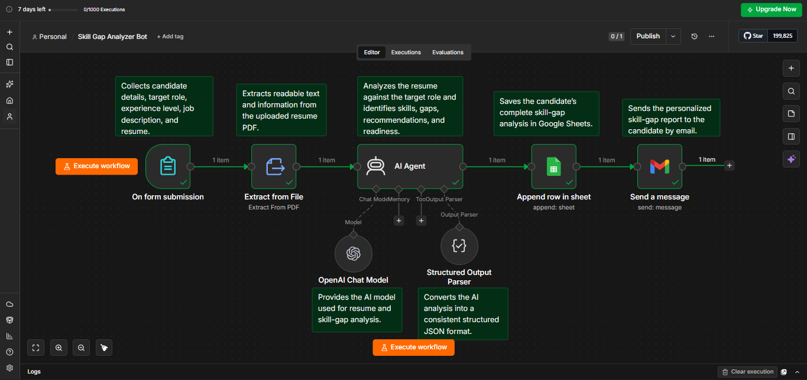
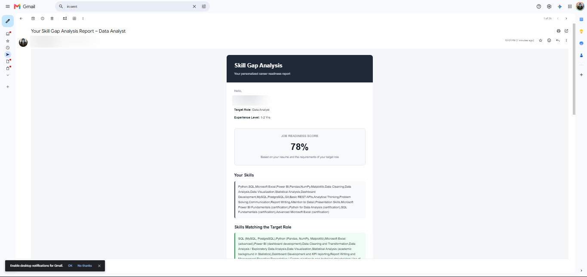
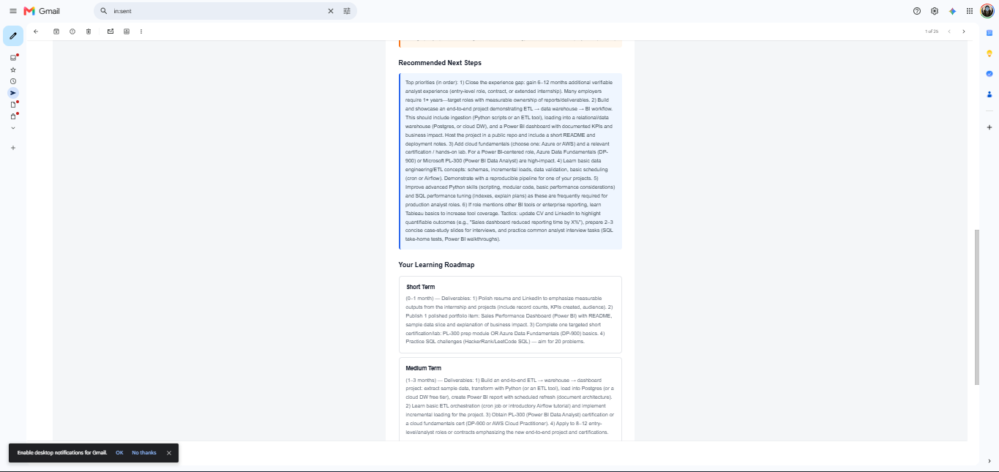
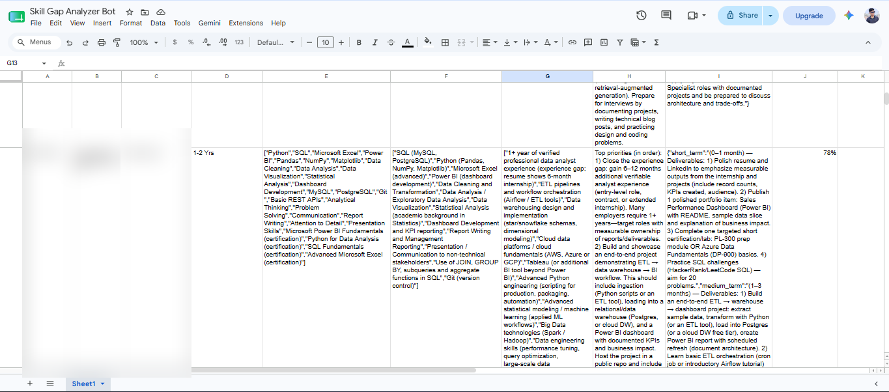

# Skill Gap Analyzer Bot

A resume-based career readiness analysis workflow built with n8n, OpenAI, Google Sheets, and Gmail. Candidates submit a PDF resume, select a target job role and experience level, and provide their contact details through an n8n form. The workflow extracts text from the PDF, uses an AI Agent to identify skills and gaps, calculates a readiness score, saves the structured result in Google Sheets, and emails a formatted report to the candidate.

> **Important scope note:** The current form asks for a target job role but does not collect a full job description. Although the form description and AI prompt refer to a job description, the prompt only passes the selected role and experience level. The result is therefore based on the resume and role label, not a supplied employer-specific job description.

## Key Features

- Collects candidate details through an n8n form
- Accepts a PDF resume upload
- Supports nine target job-role options
- Captures an experience-level selection
- Extracts readable text from the uploaded PDF
- Uses an OpenAI-powered AI Agent to analyze resume skills and experience
- Identifies skills, matching skills, and missing skills
- Calculates a Job Readiness Score from 0 to 100
- Uses a weighted score framework defined in the AI system prompt
- Generates prioritized recommendations and a three-stage learning roadmap
- Stores the structured analysis in Google Sheets
- Sends a formatted HTML skill-gap report to the candidate by Gmail

## Workflow Overview

The supplied workflow contains seven functional nodes and seven sticky notes.

1. `On form submission` displays the **Skill Gap Analyzer Bot** form and collects:
   - `Full Name`
   - `Email Address`
   - `Target Job Role`
   - `Experience Level`
   - `Resume` (PDF upload)
2. `Extract from File` extracts text from the uploaded PDF using the binary field `Resume`.
3. `AI Agent` receives the extracted resume text, selected target role, and experience level. It is instructed to:
   - extract skills supported by the resume;
   - identify matching and missing skills;
   - assess relevant experience and projects;
   - calculate a readiness score;
   - prioritize recommendations;
   - create a short-, medium-, and long-term roadmap.
4. `OpenAI Chat Model` supplies `gpt-5-mini` to the AI Agent.
5. `Structured Output Parser` constrains the response to a JSON object containing candidate identity fields, target role, experience level, skills, recommendations, roadmap, and readiness score.
6. `Append row in sheet` saves the analysis fields to the configured Google Sheets worksheet.
7. `Send a message` sends a formatted HTML report to the `Email Address` submitted through the form.

## Form Fields

| Field | Type / behavior |
|---|---|
| `Full Name` | Text field |
| `Email Address` | Email field; required |
| `Target Job Role` | Required dropdown |
| `Experience Level` | Radio option |
| `Resume` | PDF file upload; required |

### Target Job Role Options

- AI Automation Specialist
- AI Agent Developer
- Data Analyst
- Python Developer
- Full Stack Developer
- Machine Learning Engineer
- Cybersecurity Analyst
- Digital Marketing Specialist
- UI/UX Designer

### Experience Level Options

- 0-1 Yrs
- 1-2 Yrs
- 3 or more Yrs

The current form does not contain a Job Description input. Add one if the analysis must compare a resume with a specific vacancy or employer's requirements.

## AI Analysis and Readiness Score

The system prompt instructs the AI Agent to distinguish between skills supported by the resume, directly matching skills, missing skills, and experience gaps. It also defines this score weighting:

| Assessment component | Weight |
|---|---:|
| Required skills match | 40% |
| Relevant experience and projects | 25% |
| Technical/tools match | 20% |
| Education/qualifications | 10% |
| Additional relevant strengths | 5% |
| **Total** | **100%** |

The workflow requests a readiness score from 0 to 100 and a practical roadmap:

- **Short Term:** 0–1 month
- **Medium Term:** 1–3 months
- **Long Term:** 3–6 months

The supplied parser schema contains `user_skills`, `matching_skills`, `missing_skills`, `recommendation`, `roadmap`, and `readiness_score`. The AI prompt additionally requests partial matches, experience gap, and a final assessment label, but those fields are not included in the supplied parser schema or Google Sheets mapping.

## Google Sheets Structure

The supplied workflow maps these ten columns:

| Column | Purpose |
|---|---|
| `NAME` | Candidate name |
| `EMAIL` | Candidate email |
| `TARGET JOB ROLE` | Selected target role |
| `EXPERIENCE LEVEL` | Selected experience level |
| `READINESS SCORE` | Score with a percent sign |
| `USER'S SKILLS` | Skills extracted from the resume |
| `MATCHING SKILLS` | Skills identified as matching the role |
| `MISSING SKILLS` | Skills to develop |
| `RECOMMENDATION` | Prioritized recommendation text |
| `ROADMAP` | Short-, medium-, and long-term roadmap |

The sheet stores one new analysis row per successful form submission. The supplied screenshot shows a sample candidate report with a 78% readiness score; this is an example output, not a benchmark or guarantee of scoring accuracy.

## Email Report

The Gmail node sends the report to the email address submitted in the form. The subject is generated as:

`Your Skill Gap Analysis Report – <Target Job Role>`

The HTML report includes:

- Candidate name
- Target job role
- Experience level
- Job readiness score
- Extracted user skills
- Matching skills
- Missing skills
- Recommended next steps
- Short-, medium-, and long-term learning roadmap
- An automated-report disclaimer/footer

The workflow saves the analysis to Google Sheets before sending the email.

## Technology Stack

- n8n
- n8n Form Trigger
- PDF text extraction
- AI Agent
- OpenAI Chat Model (`gpt-5-mini` in the supplied export)
- Structured Output Parser
- Google Sheets
- Gmail
- HTML email formatting

## Workflow File

[Download n8n Workflow JSON](./workflow.json) — Sanitized workflow export for importing into n8n.

## Screenshots

### 1. n8n Workflow Architecture



### 2. Skill Gap Report — Candidate Overview and Readiness Score



### 3. Skill Gap Report — Recommendations and Learning Roadmap



### 4. Google Sheets Analysis Record



Public screenshot copies have been blurred to hide candidate names and email addresses. The report examples demonstrate the generated layout and sample values; they do not independently validate the correctness of the AI assessment.

## Setup

1. Import `workflow.json` into your n8n instance. The exported workflow is inactive by default.
2. Publish or activate the Form Trigger according to your n8n setup.
3. Confirm the form has the fields listed above and that the uploaded resume is a PDF.
4. Connect your OpenAI credentials to `OpenAI Chat Model`.
5. Create a Google Spreadsheet with the ten headers listed in the Google Sheets Structure section.
6. Replace `REPLACE_WITH_YOUR_GOOGLE_SHEET_ID` in `Append row in sheet` with your spreadsheet ID and select the correct worksheet.
7. Connect your Google Sheets OAuth credentials.
8. Connect your Gmail OAuth credentials to `Send a message`.
9. Submit a test resume with an email address you control.
10. Verify the extracted PDF text, AI Agent structured output, appended row, readiness score, and received email.
11. Test different target roles, experience levels, missing or unreadable PDF text, and malformed resumes before enabling the workflow for general use.

The export removes credential references, the original Google Spreadsheet ID, webhook IDs, and instance-specific metadata. It also replaces the parser example's demo identity with empty strings. Reconnect your own OpenAI, Google Sheets, and Gmail credentials after importing.

## Current Limitations and Recommended Improvements

The following limitations are visible in the supplied workflow export:

- **No job description field:** The form description and AI prompt refer to a job description, but the actual form has no such field and the prompt does not receive one. Add a required `Job Description` long-text field and pass its value into the AI Agent. Without it, the analysis cannot be tailored to the detailed requirements of a specific vacancy.
- **Candidate name/email are not passed to the AI prompt:** The Structured Output Parser example includes `name` and `email`, and the Google Sheets mapping reads those fields from AI output. However, the AI Agent prompt only receives resume text, target role, and experience level. The model therefore does not have reliable source data for those identity fields. Map `NAME` and `EMAIL` directly from the original form submission instead of asking the model to reproduce them.
- **Prompt/parser mismatch:** The AI prompt requests partial matches, experience gap, and a final assessment, but the parser schema does not define those fields. The current Google Sheets mapping also does not store them. Add the missing fields to the parser and sheet if they are required in the report.
- **Readiness scoring is model-generated:** The score is instructed through a weighted methodology, but the workflow does not calculate the score independently with deterministic code. Results may vary between runs and should be treated as an indicative assessment rather than an objective hiring score.
- **PDF-only extraction:** `Extract from File` uses PDF extraction. Word documents, image files, and scanned/image-only PDFs are not handled by a dedicated conversion or OCR branch.
- **No resume extraction validation:** The workflow does not check whether extracted PDF text is empty, incomplete, or corrupted before passing it to the AI Agent.
- **No structured-output recovery path:** There is no dedicated retry/error route if the model output fails the parser or required fields are missing.
- **No email delivery status:** The sheet records the analysis, but the workflow does not store a delivery status, Gmail message ID, or email failure reason.
- **No data retention controls:** Candidate resumes and personal data are handled by the form, n8n execution, AI model, Google Sheets, and Gmail. Define retention and access policies before using real candidate data.
- **Potential formatting issues for array/object fields:** Skills arrays and the roadmap object are mapped directly into Google Sheets. Consider joining arrays and serializing objects into readable text or separate columns for easier filtering and reporting.
- **No human review step:** The report is emailed automatically after the AI analysis. Add a reviewer approval step before delivery if the assessment will influence recruitment, promotion, or other consequential decisions.

Use the report as a candidate development aid, not as an automated hiring decision. Review the resume evidence and score methodology before acting on the result.

## Repository Structure

```text
Skill-Gap-Analyzer-Bot/
├── screenshots/
│   ├── README.md
│   ├── workflow-overview.png
│   ├── report-overview.png
│   ├── report-roadmap.png
│   └── google-sheets-record.png
├── README.md
└── workflow.json
```
