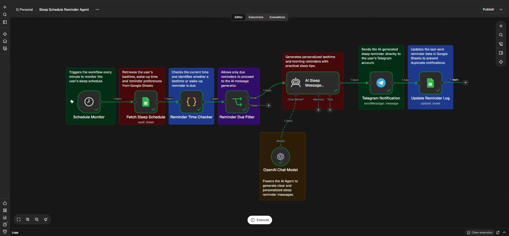
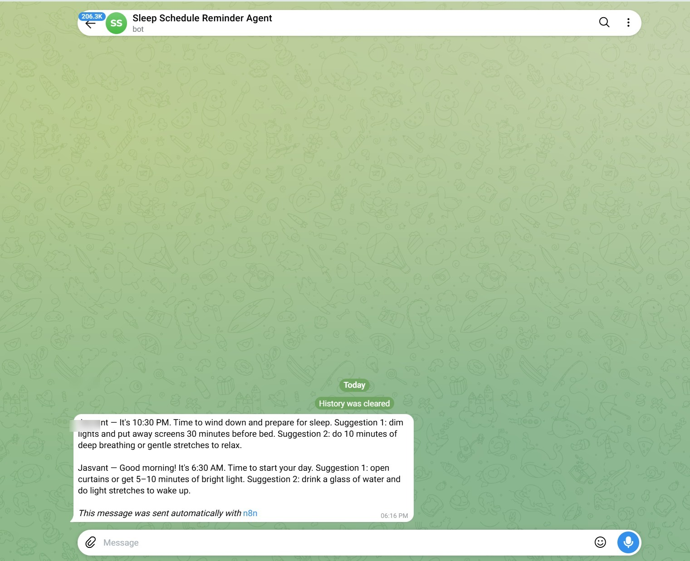
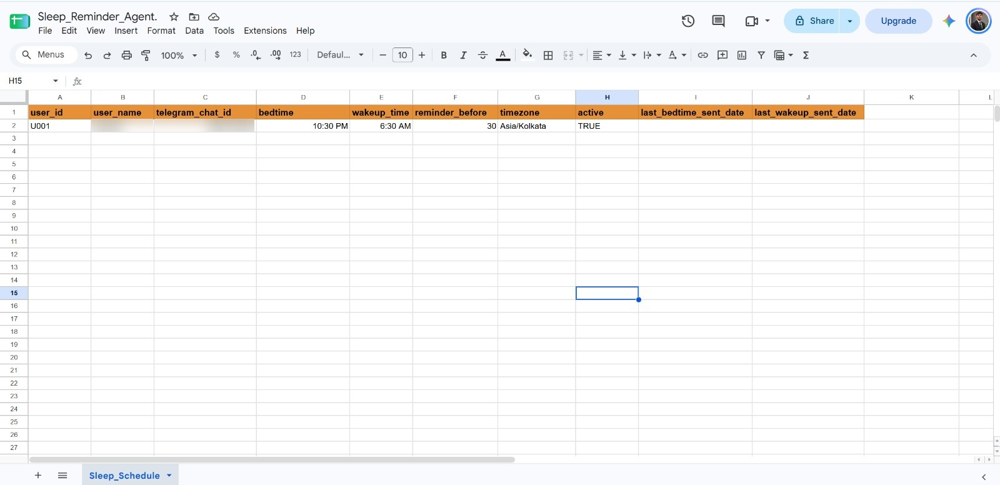

# Sleep Schedule Reminder Agent

A scheduled sleep routine reminder workflow built with n8n, Google Sheets, Telegram, and OpenAI. It checks each active user's bedtime and wake-up preferences, generates a personalized reminder message, sends it through Telegram, and records the last reminder date to avoid repeated notifications on the same day.

## Key Features

- Checks registered sleep schedules every minute
- Reads user bedtime, wake-up time, reminder offset, and Telegram chat details from Google Sheets
- Supports active/inactive schedule records
- Checks whether a bedtime or wake-up reminder is due
- Uses a configurable number of minutes before bedtime (defaults to 30 when blank)
- Generates short personalized messages using an OpenAI-powered AI Agent
- Includes two practical suggestions in each generated reminder
- Sends reminders through Telegram
- Updates the last bedtime or wake-up reminder date in Google Sheets

## Workflow Overview

1. `Schedule Monitor` runs the workflow every minute.
2. `Fetch Sleep Schedule` retrieves user schedule rows from the `Sleep_Schedule` sheet.
3. `Reminder Time Checker`:
   - uses `Asia/Kolkata` to calculate the current date and minute;
   - converts the stored AM/PM bedtime and wake-up times into minutes after midnight;
   - calculates the bedtime reminder time using `reminder_before` (30 minutes by default);
   - checks whether bedtime or wake-up time falls within the five-minute matching window;
   - skips reminders already sent on the current date;
   - produces `reminder_type`, `should_send`, and the time fields for the next nodes.
4. `Reminder Due Filter` allows only records with `should_send = true` to continue.
5. `AI Sleep Message Generator` creates a concise bedtime or wake-up message with two practical suggestions.
6. `OpenAI Chat Model` powers the AI message generator.
7. `Telegram Notification` sends the generated message to the user's Telegram chat ID.
8. `Update Reminder Log` updates the last bedtime or wake-up sent date for the matching `user_id`.

## Technology Stack

- n8n
- Schedule Trigger
- Google Sheets
- Telegram Bot API
- OpenAI Chat Model (`gpt-5-mini` in the supplied export)
- n8n AI Agent
- JavaScript (n8n Code node)
- JavaScript `Intl.DateTimeFormat` for timezone-aware date/time extraction

## Google Sheets Structure

The workflow expects a `Sleep_Schedule` sheet with these columns:

| Column | Purpose |
|---|---|
| `user_id` | Unique user identifier used to update the schedule row |
| `user_name` | Name included in the reminder message |
| `telegram_chat_id` | Telegram destination for the reminder |
| `bedtime` | Preferred bedtime in AM/PM format |
| `wakeup_time` | Preferred wake-up time in AM/PM format |
| `reminder_before` | Number of minutes before bedtime to send the reminder |
| `timezone` | Timezone field stored in the sheet (not currently used by the supplied code) |
| `active` | Whether the schedule is enabled; expected value is `TRUE` |
| `last_bedtime_sent_date` | Date the bedtime reminder was last sent |
| `last_wakeup_sent_date` | Date the wake-up reminder was last sent |

### Time Format

The JavaScript time parser expects values such as:

- `10:30 PM`
- `6:30 AM`

The current code uses `Asia/Kolkata` for every row. Although the sheet contains a `timezone` column, the code does not read it when calculating the current date and time.

## Workflow File

[Download n8n Workflow JSON](workflow.json) — Sanitized workflow export for importing into n8n.

## Screenshots

### 1. n8n Workflow Architecture


### 2. Telegram Bedtime and Wake-up Reminders


### 3. Google Sheets Sleep Schedule


## Setup

1. Import `workflow.json` into your n8n instance. The export is inactive by default.
2. Create a Google Spreadsheet with a `Sleep_Schedule` tab and the column names listed above.
3. Replace `REPLACE_WITH_YOUR_GOOGLE_SHEET_ID` in both Google Sheets nodes with your spreadsheet ID.
4. Connect your own Google Sheets credentials.
5. Connect your own OpenAI credentials to the Chat Model node.
6. Create a Telegram bot and connect your Telegram credentials to the Telegram Notification node.
7. Add one row per user with a unique `user_id`, a valid Telegram chat ID, bedtime, wake-up time, reminder offset, timezone label, and `active` set to `TRUE`.
8. Use AM/PM values such as `10:30 PM` and `6:30 AM` for the time fields.
9. Test bedtime and wake-up reminders separately. The current workflow uses a five-minute matching window.
10. Verify the reminder log fields update after a successful Telegram message.
11. Activate the workflow only after credentials, sheet mappings, time settings, and duplicate behavior have been tested.

The export removes credential references, webhook IDs, the original spreadsheet ID, and instance-specific metadata. Reconnect your own credentials and spreadsheet after importing.

## Current Limitations and Recommended Improvements

The following issues are visible in the supplied workflow export:

- **Timezone column is ignored:** The `timezone` field exists in Google Sheets, but the Code node hard-codes `Asia/Kolkata`. Users in other time zones will receive reminders based on India time. Read each row's timezone if multi-timezone support is required.
- **Five-minute matching window can miss reminders:** The workflow checks whether the current time is within five minutes after the reminder target. If n8n is offline or delayed for longer than this window, that reminder may be skipped until the next day.
- **Multi-user reminder-log mapping uses the first item:** `Update Reminder Log` uses the current item's `user_id`, but the last-sent date expressions use `.first()` for `reminder_type`, `current_date`, and existing date values. When multiple users have reminders due in the same run, one user's reminder details can be written to another user's row. Use item-linked values consistently.
- **Inactive rows are parsed before the active check:** The Code node parses bedtime and wake-up values before evaluating `active`. A malformed time in an inactive row can still cause the Code node to throw an error. Check `active` before parsing time fields.
- **Schedule runs every minute:** This allows the workflow to catch a due reminder within its five-minute window, but it also causes a spreadsheet read every minute. Consider a lower polling frequency if the schedule volume grows.
- **AI text is not a sleep or medical assessment:** The AI Agent generates general routine suggestions. It does not diagnose or treat sleep problems.

The screenshot demonstrates example bedtime and morning messages. The exported workflow should still be tested for different users, time zones, invalid sheet rows, missed polling windows, and simultaneous reminder events.

## Repository Structure

```text
Sleep-Schedule-Reminder-Agent/
├── screenshots/
│   ├── README.md
│   ├── workflow-overview.jpeg
│   ├── telegram-sleep-reminders.jpeg
│   └── sleep-schedule-sheet.jpeg
├── README.md
└── workflow.json
```

## Author

<p align="left">
  <b>Jasvant Malvi</b><br>
  <a href="https://github.com/jasvantMalvi">GitHub</a> ·
  <a href="https://www.linkedin.com/in/jasvant-malvi-810305429/">LinkedIn</a>
</p>
