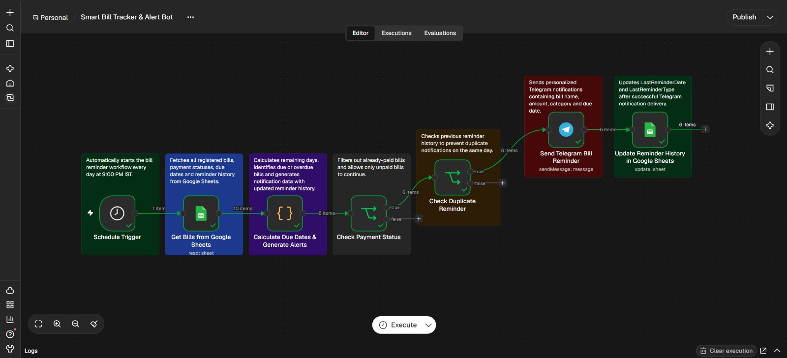
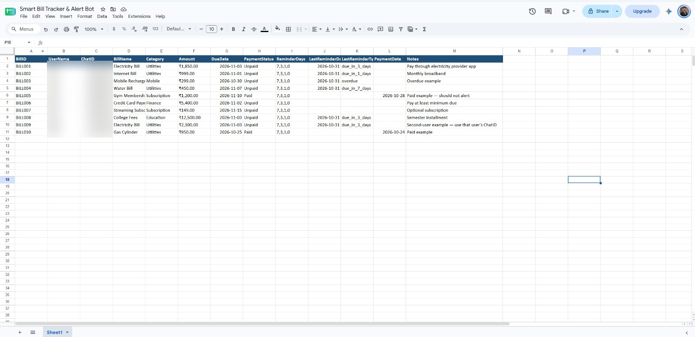
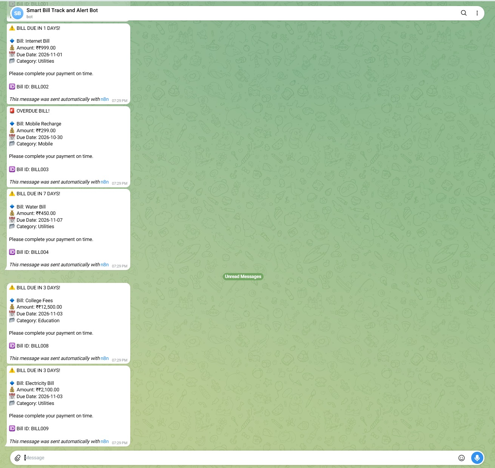

# Smart Bill Tracker & Alert Bot

An automated bill reminder workflow built with n8n, Google Sheets, and Telegram. It checks unpaid bills against their due dates, sends reminders for upcoming and overdue payments, and updates reminder history to reduce repeat notifications.

## Key Features

- Runs from a scheduled n8n trigger
- Reads bill records and payment statuses from Google Sheets
- Supports configurable reminder days per bill
- Calculates days remaining until each due date
- Detects due-soon, due-today, and overdue bills
- Skips bills marked as paid
- Checks previous reminder date and type
- Sends Telegram alerts containing bill name, amount, category, due date, and bill ID
- Updates reminder history in Google Sheets after sending an alert
- Uses the Asia/Kolkata timezone for date comparison

## Workflow Overview

The exported workflow has one connected reminder path and one disconnected Telegram Trigger node.

### 1. Scheduled Reminder Path

1. `Schedule Trigger` starts the bill-checking process. The workflow sticky note describes this as a daily run at 9:00 PM IST; verify the node schedule and workflow timezone after import.
2. `Get Bills from Google Sheets` retrieves registered bills from the configured spreadsheet.
3. `Calculate Due Dates & Generate Alerts`:
   - processes only bills with `PaymentStatus` set to `Unpaid`;
   - validates required fields and the due date;
   - calculates the number of days remaining using `Asia/Kolkata`;
   - uses `ReminderDays` (default `7,3,1,0`) to identify upcoming reminders;
   - identifies overdue bills;
   - skips the same reminder type if it was already sent on the same date;
   - creates the Telegram reminder message.
4. `Check Payment Status` allows only unpaid bills to continue.
5. `Check Duplicate Reminder` performs an additional duplicate check before sending.
6. `Send Telegram Bill Reminder` sends the reminder to the configured Telegram chat.
7. `Update Reminder History in Google Sheets` updates `LastReminderDate` and `LastReminderType` for the matching `BillID`.

### 2. Telegram Trigger Node

The workflow export also contains a `Telegram Trigger` listening for message updates. However, it is not connected to any other node in the exported connections. It does not currently create bills, update payment status, or handle commands. Bill records are maintained in Google Sheets.

## Technology Stack

- n8n
- Schedule Trigger
- Telegram Bot API
- Google Sheets
- JavaScript (n8n Code node)
- Asia/Kolkata date handling

## Google Sheets Structure

The workflow expects a bill tracker sheet with these columns:

| Column | Purpose |
|---|---|
| `BillID` | Unique identifier used to update reminder history |
| `UserName` | Person associated with the bill |
| `ChatID` | Telegram chat ID associated with the bill record |
| `BillName` | Name or description of the bill |
| `Category` | Bill category, such as Utilities, Mobile, or Education |
| `Amount` | Amount due |
| `DueDate` | Bill due date |
| `PaymentStatus` | Payment state; only `Unpaid` records are processed |
| `ReminderDays` | Comma-separated reminder days, for example `7,3,1,0` |
| `LastReminderDate` | Date on which the last reminder was sent |
| `LastReminderType` | Reminder type last sent, such as `due_in_3_days` or `overdue` |
| `PaymentDate` | Date the bill was paid |
| `Notes` | Optional notes |

Accepted due date formats in the Code node are `YYYY-MM-DD` and `DD/MM/YYYY`.

## Workflow File

[Download n8n Workflow JSON](workflow.json) — Sanitized workflow export for importing into n8n.

## Screenshots

### 1. n8n Reminder Workflow


### 2. Google Sheets Bill Tracker


### 3. Telegram Bill Reminder Messages


## Setup

1. Import `workflow.json` into your n8n instance. It is inactive by default.
2. Create a Google Spreadsheet with the bill tracker columns listed above.
3. Replace `REPLACE_WITH_YOUR_GOOGLE_SHEET_ID` in the Google Sheets nodes with your spreadsheet ID and select the correct worksheet.
4. Connect your own Google Sheets credentials.
5. Create a Telegram bot and connect your own Telegram credentials to the Telegram nodes.
6. Replace `REPLACE_WITH_YOUR_TELEGRAM_CHAT_ID` in `Send Telegram Bill Reminder` with the intended recipient's chat ID.
7. Add bill records with unique `BillID` values and `PaymentStatus` set to `Unpaid` or `Paid`.
8. Set `ReminderDays` for each bill, for example `7,3,1,0`. If left blank, the Code node uses `7,3,1,0`.
9. Ensure due dates use `YYYY-MM-DD` or `DD/MM/YYYY`.
10. Verify the schedule hour and workflow timezone. The sticky note describes a daily 9:00 PM IST run.
11. Test with sample unpaid bills, confirm Telegram delivery, and check that reminder history is updated.
12. Activate the workflow only after verifying the recipient, credentials, sheet mapping, and schedule.

The export removes credential references, webhook IDs, the original spreadsheet ID, the original Telegram chat ID, and instance-specific metadata. Reconnect your own credentials and configure your own IDs after importing.

## Current Limitations and Recommended Improvements

The following issues are visible in the supplied workflow export:

- **Hard-coded Telegram recipient:** `Send Telegram Bill Reminder` uses a fixed chat ID instead of the `ChatID` field from each bill record. The sample sheet contains different chat IDs, but the current send node routes messages to one configured recipient. For multi-user support, use the bill's `ChatID` dynamically and validate ownership.
- **Disconnected Telegram Trigger:** The workflow contains a Telegram Trigger for message updates, but it has no outgoing connection. It currently does not support adding bills or marking bills as paid through Telegram.
- **Duplicate-check IF expression needs review:** The `Check Duplicate Reminder` condition refers to lowercase properties such as `lastReminderDate` and `reminderType`, while the Code node emits `LastReminderDate`, `LastReminderType`, and `ReminderType`. Its expression also contains unusual tab/equality text. The Code node already checks the previous reminder date and type, so simplify this extra check or correct and test it.
- **Redundant payment-status check:** The Code node already skips records that are not unpaid; `Check Payment Status` repeats that filter. This is not necessarily harmful, but one check may be unnecessary.
- **Reminder history is updated after sending:** If Telegram delivery succeeds but the subsequent Google Sheets update fails, the next schedule run may send the same reminder again. Add retry/error handling or a delivery log for stronger reliability.
- **Schedule and timezone must be confirmed:** The sticky note says daily at 9:00 PM IST. Verify that the Schedule Trigger and n8n workflow timezone match this expectation.
- **No bill-entry or payment-update flow:** Bill data and payment status must be maintained in Google Sheets unless a separate connected workflow is added.

This project automates reminders, not bill payments. It does not connect to banks, payment gateways, or utility providers.

## Repository Structure

```text
Smart-Bill-Tracker-and-Alert-Bot/
├── screenshots/
│   ├── README.md
│   ├── workflow-overview.jpeg
│   ├── google-sheets-bill-tracker.jpeg
│   └── telegram-bill-reminders.jpeg
├── README.md
└── workflow.json
```

## Author

<p align="left">
  <b>Jasvant Malvi</b><br>
  <a href="https://github.com/jasvantMalvi">GitHub</a> ·
  <a href="https://www.linkedin.com/in/jasvant-malvi-810305429/">LinkedIn</a>
</p>
