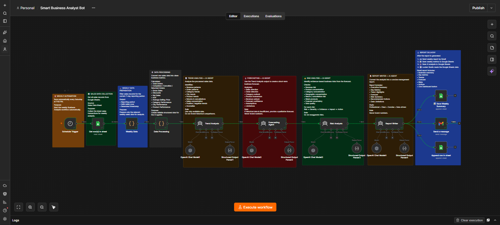
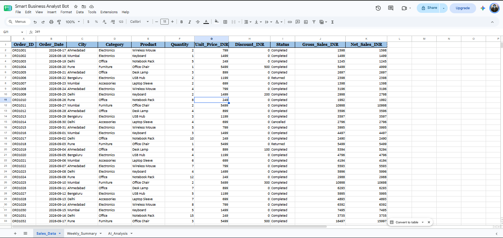
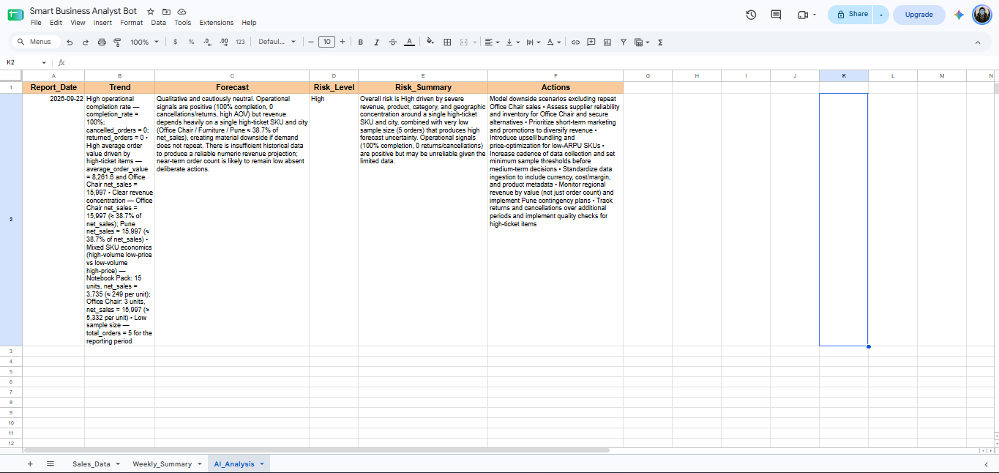
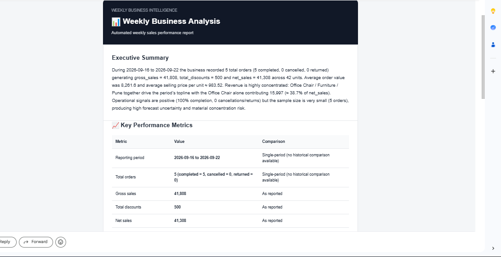
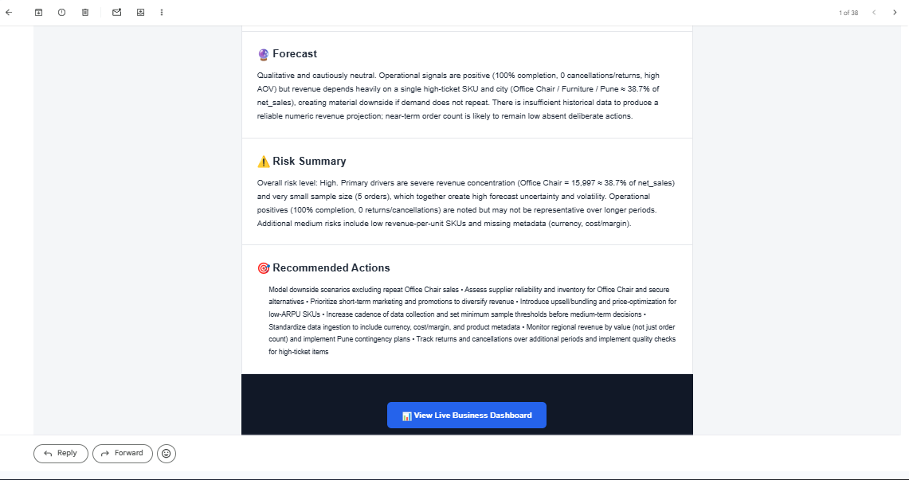
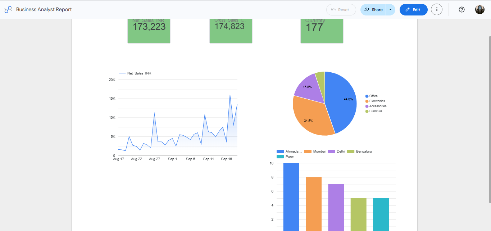

# Smart Business Analyst Bot

An automated weekly business intelligence workflow built with n8n, Google Sheets, OpenAI, Gmail, and Looker Studio. It processes sales records, calculates business metrics, runs AI-assisted trend, forecast, and risk analysis, and prepares a management-ready weekly report.

## Key Features

- Runs on a weekly schedule
- Retrieves sales transactions from Google Sheets
- Filters the latest seven calendar days of sales data
- Calculates order, revenue, discount, and sales-status metrics
- Summarizes performance by category, city, and product
- Runs separate AI agents for trend analysis, forecasting, and risk analysis
- Uses structured output parsers for consistent AI results
- Generates an executive-level weekly business report
- Sends the report through Gmail
- Saves weekly metrics and AI analysis to Google Sheets
- Supports a Looker Studio dashboard connected to the reporting data

## Workflow Architecture

The workflow is organized into the following stages:

### 1. Weekly Schedule and Data Collection

- `Schedule Trigger` starts the weekly workflow. The exported trigger is configured for Saturday at 18:00.
- `Get row(s) in sheet` retrieves the sales records from the configured Google Sheets tab.

### 2. Weekly Data Preparation

- `Weekly Data` filters the source records to the latest seven calendar days, including the current day.
- It passes the reporting start date, end date, generated timestamp, row count, and filtered sales records to the next stage.

### 3. Sales Data Processing

- `Data Processing` calculates total orders, completed/cancelled/returned orders, quantities, gross sales, discounts, net sales, realized sales, average order value, and average selling price.
- It also groups metrics by category, city, and product, and identifies the top and lowest five products by calculated net sales.

### 4. AI Business Analysis

Four OpenAI-powered model connections support the analysis agents:

- `Trend Analysis` identifies observed revenue, order, category, city, product, return, cancellation, and concentration patterns.
- `Forecasting Agent` produces a conservative short-term outlook and states when the available data is insufficient for a numerical forecast.
- `Risk Analysis` assigns risk levels and provides evidence, impact, and suggested actions.
- `Report Writer` combines processed metrics, trend analysis, forecast, and risk analysis into a structured management report.

Structured Output Parser nodes are connected to the four AI agents to enforce the expected JSON output shapes.

### 5. Report Delivery and Storage

The `Report Writer` output branches to three destinations:

- `Send a message` sends the formatted weekly report using Gmail.
- `📊 Save Weekly Summary` appends weekly KPI metrics to the `Weekly_Summary` sheet.
- `Append row in sheet` appends AI trend, forecast, risk, and recommended-action information to the `AI_Analysis` sheet.

Looker Studio can use the reporting sheets as its dashboard data source.

## Technology Stack

- n8n
- Google Sheets
- OpenAI Chat Model (`gpt-5-mini` in the supplied export)
- n8n AI Agents
- Structured Output Parser
- Gmail
- Looker Studio
- JavaScript (n8n Code nodes)

## Google Sheets Structure

The supplied screenshots show three spreadsheet tabs:

| Sheet | Purpose |
|---|---|
| `Sales_Data` | Source order transactions, including order date, city, category, product, quantity, unit price, discount, and status |
| `Weekly_Summary` | Weekly reporting period and calculated business KPIs |
| `AI_Analysis` | AI-generated trend, forecast, risk, and recommended-action summaries |

The export's source Google Sheets node is cached as `Sheet1`, while the screenshot displays `Sales_Data`. After importing, select the intended source tab explicitly.

### Source Sales Data Columns

The screenshots show these source columns:

`Order_ID`, `Order_Date`, `City`, `Category`, `Product`, `Quantity`, `Unit_Price_INR`, `Discount_INR`, `Status`, `Gross_Sales_INR`, `Net_Sales_INR`

The Data Processing code recalculates gross and net values from `Quantity`, `Unit_Price_INR`, and `Discount_INR`; it does not rely on the existing `Gross_Sales_INR` and `Net_Sales_INR` columns.

## Workflow File

[Download n8n Workflow JSON](workflow.json) — Sanitized workflow export for importing into n8n.

## Screenshots

### 1. n8n Workflow Architecture


### 2. Source Sales Data


### 3. AI Analysis Sheet


### 4. Weekly Business Report


### 5. Report Details and Recommendations


### 6. Looker Studio Dashboard


## Setup

1. Import `workflow.json` into your n8n instance. The exported workflow is inactive by default.
2. Create or select a Google Spreadsheet containing the source sales data, `Weekly_Summary`, and `AI_Analysis` tabs.
3. Replace `REPLACE_WITH_YOUR_GOOGLE_SHEET_ID` in all Google Sheets nodes with your spreadsheet ID.
4. In the source data node, select the correct source tab. The JSON is cached as `Sheet1`, while the screenshot labels the source tab `Sales_Data`.
5. Reconnect your Google Sheets credentials.
6. Reconnect your OpenAI credentials to all four Chat Model nodes.
7. Reconnect your Gmail credential and replace `REPLACE_WITH_REPORT_RECIPIENT_EMAIL` with the intended report recipient.
8. Replace `REPLACE_WITH_YOUR_LOOKER_STUDIO_DASHBOARD_URL` in the Gmail message with your own dashboard URL.
9. Verify the workflow timezone and schedule. The exported trigger uses Saturday at 18:00, while one workflow sticky note describes Saturday at 19:00.
10. Ensure `Order_Date` values are consistently formatted and that order amounts, discounts, and statuses are populated correctly.
11. Test each reporting branch and verify the resulting rows and email before activating the schedule.

The export removes credential references, webhook IDs, the original Google Spreadsheet ID, the recipient email address, the original Looker Studio URL, and instance-specific workflow metadata. Reconnect and configure your own accounts and resources after import.

## Current Limitations and Recommended Improvements

The following issues are visible in the supplied workflow export:

- **Schedule note mismatch:** The Schedule Trigger is configured for Saturday at 18:00, while its sticky note says Saturday at 7:00 PM. Confirm the intended run time and workflow timezone.
- **Hard-coded report recipient:** The Gmail node has a fixed recipient in the original export. Configure the intended recipient after importing.
- **Hard-coded dashboard URL:** The email contains a specific Looker Studio report URL. Replace it with the correct dashboard link.
- **Leading spaces in summary field mappings:** The `📊 Save Weekly Summary` node maps fields named ` Week_End`, ` Discounts`, ` Average_Order_Value`, and ` Cancellation_Rate` with leading spaces. Ensure these match the exact headers in the destination sheet or correct the mapping.
- **Sales calculations mix order statuses:** The `net_sales` and category/city/product totals include all rows, including cancelled and returned orders, while `realized_sales` counts completed orders only. Define how cancelled and returned orders should affect financial reporting and make each metric consistent.
- **Average selling price denominator:** `average_selling_price` divides completed-order realized sales by `totalQuantity`, which includes quantities from all statuses. Consider using completed-order quantity for this metric.
- **Risk agent input is narrower than its system prompt:** Its user prompt passes the immediate Forecasting Agent output. The system prompt says it should analyze processed metrics, trend analysis, and forecast. Pass the relevant earlier outputs explicitly if the risk assessment must consider all three.
- **Source sheet name differs from screenshot:** The export's source tab is cached as `Sheet1`; the screenshot shows `Sales_Data`. Select the correct tab after importing.
- **Seven-day window and timezone need validation:** The weekly filter uses JavaScript date parsing and the n8n runtime timezone. Confirm the timezone and test boundary dates around midnight.
- **Dashboard and report sample size:** AI-generated insights and forecasts depend on the available reporting rows. The screenshots include a small sample for at least one reporting period; recommendations and forecasts should be interpreted with that limitation in mind.

The workflow is intended as a weekly reporting automation, not a substitute for validating source accounting data. Review financial definitions, date boundaries, and generated recommendations before relying on the report for management decisions.

## Repository Structure

```text
Smart-Business-Analyst-Bot/
├── screenshots/
│   ├── README.md
│   ├── workflow-overview.png
│   ├── sales-data-sheet.png
│   ├── ai-analysis-sheet.png
│   ├── weekly-email-report.png
│   ├── email-report-details.png
│   └── business-dashboard.png
├── README.md
└── workflow.json
```
