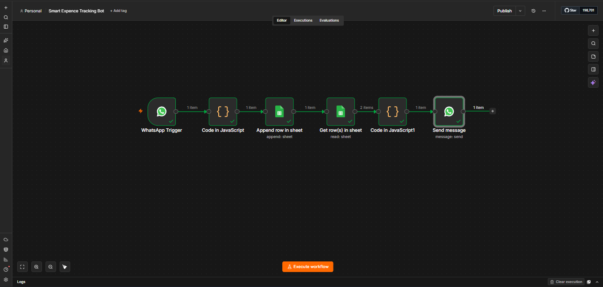
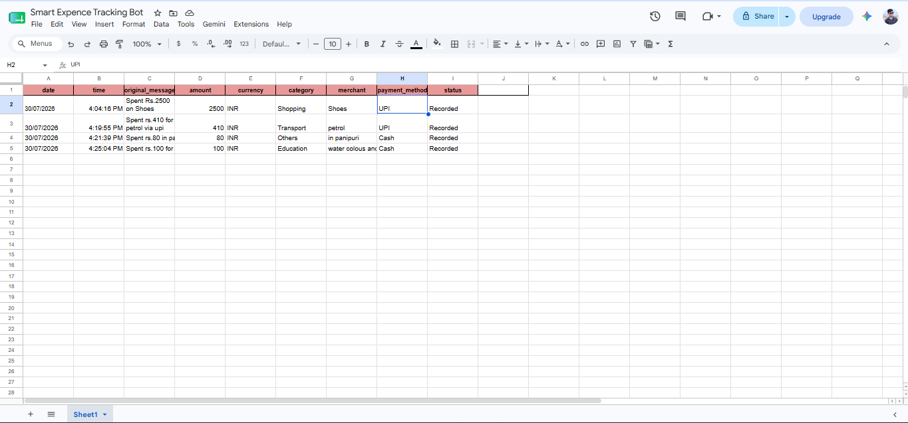
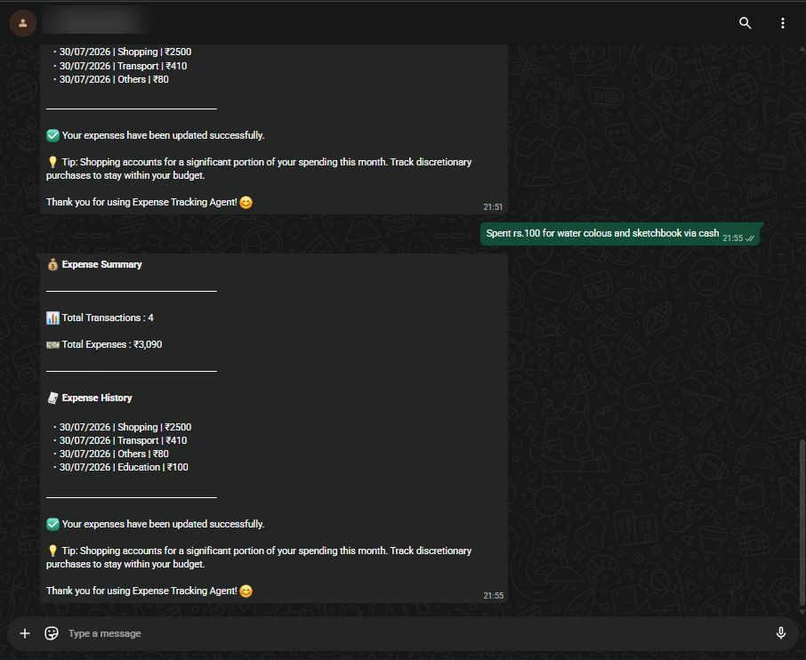

# Smart Expense Tracking Bot

A WhatsApp-based expense logger built with n8n and Google Sheets. It reads an expense message, extracts an amount, currency, category, merchant/item description, and payment method using JavaScript rules, appends the record to a spreadsheet, reads the stored expense rows, and sends a WhatsApp summary.

> **Important:** The supplied workflow does not use an AI model. Expense extraction is performed with regular expressions and keyword matching in a JavaScript Code node.

## Key Features

- Receives expense messages through WhatsApp
- Extracts the first numeric amount found in the message
- Detects a currency marker for INR, USD, EUR, or GBP
- Categorizes expenses using keyword matching
- Detects common payment methods such as UPI, Google Pay, PhonePe, Paytm, cards, cash, and net banking
- Derives a merchant/item description by removing common transaction words and payment terms
- Records date, time, original message, amount, currency, category, merchant, payment method, and status
- Appends each incoming transaction to Google Sheets
- Reads saved expense rows and calculates a transaction count and total
- Sends an expense history and summary back through WhatsApp

## Workflow Overview

The supplied workflow contains six nodes:

1. `WhatsApp Trigger` receives an incoming WhatsApp message.
2. `Code in JavaScript` extracts the message text and derives:
   - date and time from the n8n runtime;
   - the first amount-like numeric value;
   - currency from `$`, `€`, or `£` markers, defaulting to `INR`;
   - category from configured keyword lists;
   - payment method from known payment terms;
   - merchant/item text by removing common transaction and payment words;
   - status as `Recorded` when an amount is found, otherwise `Need Confirmation`.
3. `Append row in sheet` appends the extracted transaction to Google Sheets.
4. `Get row(s) in sheet` retrieves rows from the configured worksheet.
5. `Code in JavaScript1` sums the `amount` values across the rows it receives, counts transactions, and builds a WhatsApp expense history message.
6. `Send message` sends the summary to the WhatsApp sender who triggered the workflow.

## Expense Categories

The first matching category in the JavaScript keyword list is used:

| Category | Example keywords |
|---|---|
| Food | food, restaurant, pizza, burger, cafe, coffee, tea, Swiggy, Zomato |
| Transport | Uber, Ola, petrol, diesel, fuel, bus, train, auto, taxi |
| Shopping | shopping, shirt, shoe, shoes, clothes, jeans, Amazon, Flipkart, mall |
| Grocery | grocery, vegetable, fruit, milk, DMart |
| Bills | bill, electricity, Wi-Fi, internet, recharge, mobile |
| Entertainment | movie, cinema, Netflix, Spotify, game |
| Health | medicine, hospital, doctor, medical, pharmacy |
| Education | course, book, fees, college, exam |
| Others | Used when none of the listed keyword groups match |

This is keyword-based classification, not AI classification. The first matching group wins if a message contains keywords from more than one category.

## Payment Methods

The JavaScript checks for these payment methods:

- Google Pay
- PhonePe
- Paytm
- UPI
- Credit Card
- Debit Card
- Card
- Cash
- Net Banking

If none is found, the payment method is recorded as `Unknown`.

## Google Sheets Structure

The supplied spreadsheet uses these columns:

| Column | Purpose |
|---|---|
| `date` | Transaction date in `DD/MM/YYYY` format |
| `time` | Transaction time in 12-hour format |
| `original_message` | Original WhatsApp expense message |
| `amount` | Extracted numeric amount |
| `currency` | Detected currency code (`INR`, `USD`, `EUR`, or `GBP`) |
| `category` | Keyword-based expense category |
| `merchant` | Extracted merchant/item description |
| `payment_method` | Detected payment method or `Unknown` |
| `status` | `Recorded` or `Need Confirmation` |

The current sheet does not include a WhatsApp sender ID, user ID, or chat ID column.

## WhatsApp Summary

After appending the new transaction, the workflow reads the expense rows and builds a message containing:

- Total transaction count
- Total expense amount
- Expense history showing date, category, and amount
- A fixed spending tip
- A success confirmation

The summary currently formats the total with the Indian rupee symbol (`₹`) regardless of the currencies stored in the `currency` column.

## Technology Stack

- n8n
- WhatsApp Business Cloud API
- WhatsApp Trigger
- WhatsApp send-message node
- Google Sheets
- JavaScript (n8n Code nodes)
- Regular expressions and keyword-based parsing

## Workflow File

[Download n8n Workflow JSON](./workflow.json) — Sanitized workflow export for importing into n8n.

## Screenshots

### 1. n8n Workflow Architecture


### 2. Google Sheets Expense Records


### 3. WhatsApp Expense Summary


The screenshots demonstrate example expenses and a summary response. They do not establish that all amount formats, categories, currencies, or payment methods are detected correctly.

## Setup

1. Import `workflow.json` into your n8n instance. The exported workflow is inactive by default.
2. Create a Google Spreadsheet with a worksheet containing the nine headers listed above.
3. Replace `REPLACE_WITH_YOUR_GOOGLE_SHEET_ID` in both Google Sheets nodes with your spreadsheet ID.
4. Connect your Google Sheets OAuth credentials.
5. Connect your WhatsApp Business API credentials to the WhatsApp Trigger and Send message nodes.
6. Replace `REPLACE_WITH_YOUR_WHATSAPP_PHONE_NUMBER_ID` in the Send message node with your own WhatsApp Business phone-number ID.
7. Confirm that inbound WhatsApp messages reach the trigger and that the workflow can reply to the sender.
8. Test common input formats, for example:
   - `Spent Rs.2500 on Shoes via UPI`
   - `Spent Rs.410 for petrol via UPI`
   - `Spent Rs.80 in panipuri cash`
9. Verify the extracted amount, currency, category, merchant, payment method, and status in Google Sheets.
10. Confirm the WhatsApp summary totals match the intended set of records.
11. Activate the workflow only after user isolation, currency handling, and validation have been addressed for your intended use.

The export removes credential references, webhook IDs, the original spreadsheet ID, and the original WhatsApp Business phone-number ID. Reconnect your own accounts and replace the placeholders after importing.

## Current Limitations and Recommended Improvements

The following limitations are visible in the supplied workflow export:

- **No per-user filtering or isolation:** The Google Sheets lookup node has no filters and retrieves the rows from the configured sheet. The summary code totals all rows it receives. The spreadsheet has no sender/chat ID column. In a shared deployment, a sender can receive a summary containing other users' expense records. Add a user/chat ID column and filter every read by that sender before generating a summary.
- **Summary is not limited to the current month:** The summary code does not filter by month or date. It totals all rows returned by the Google Sheets node, so the history and total grow as more records are added.
- **Currency totals are mixed:** The parser can mark transactions as INR, USD, EUR, or GBP, but the summary adds all numeric amounts together and always displays the result with `₹`. Do not mix currencies in a total; group by currency or convert using an explicit exchange-rate source.
- **Missing amounts are still appended:** When no amount is found, status becomes `Need Confirmation`, but the workflow still appends the row and proceeds to the summary. Add a validation/confirmation branch so incomplete transactions are not treated as final expenses.
- **Only the first number is extracted:** The amount regex takes the first amount-like number. Messages with multiple numbers, dates, quantities, or split amounts can be misread.
- **Currency detection is limited:** The code defaults to INR and checks `$`, `€`, and `£`. It does not explicitly recognize many currency names or symbols. A message containing a plain number is assumed to be INR.
- **Category detection is keyword-based:** It uses substring matching and a fixed order of categories. Ambiguous descriptions, spelling variations, or messages containing several category keywords may be assigned incorrectly.
- **Merchant extraction is heuristic:** It removes common words and payment terms from the message. This can remove parts of legitimate merchant/item names and does not guarantee a clean merchant field.
- **No duplicate transaction protection:** Every incoming WhatsApp message is appended. Sending the same message again records another transaction.
- **Date/time timezone is not explicitly configured:** The code uses the n8n runtime's locale methods. Set and verify the n8n timezone so transaction timestamps match the intended local timezone.
- **Fixed spending tip:** The WhatsApp message contains a static shopping tip, not a recommendation calculated from the sender's actual category distribution or budget.
- **No budget tracking:** The supplied workflow does not compare spending with a user-defined budget or provide budget thresholds and alerts.

Review the stored rows and totals before relying on the workflow for personal financial records. This is an expense logging automation, not a bank-connected reconciliation or financial advisory system.

## Repository Structure

```text
Smart-Expense-Tracking-Bot/
├── screenshots/
│   ├── README.md
│   ├── workflow-overview.png
│   ├── expense-google-sheet.png
│   └── whatsapp-expense-summary.png
├── README.md
└── workflow.json
```
