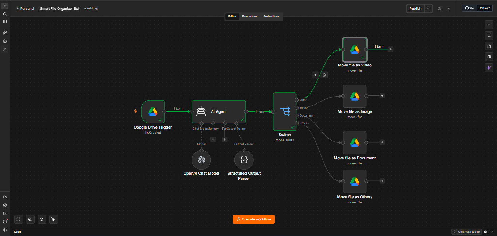
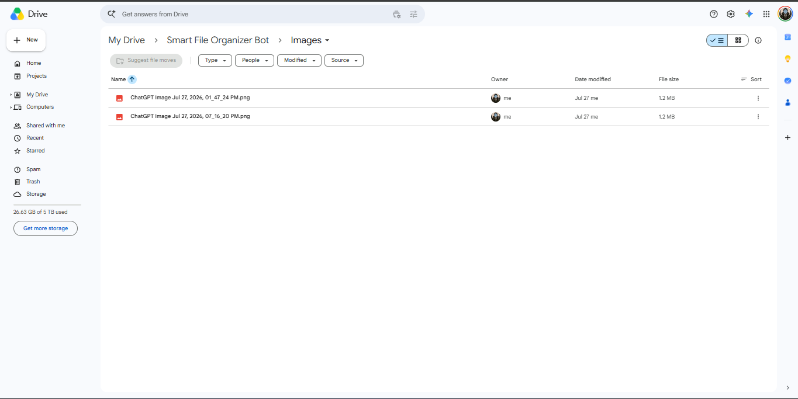
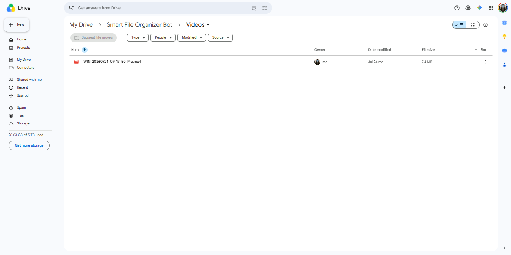

# Smart File Organizer Bot

An automated Google Drive file organizer built with n8n, Google Drive, and OpenAI. It monitors a selected Drive folder for newly created files, classifies each file using available metadata, and moves the file into a configured destination folder.

## Key Features

- Monitors a selected Google Drive folder for newly created files
- Checks for new files every minute
- Uses file name, extension, MIME type, and file size as classification context
- Uses an OpenAI-powered AI Agent to classify files
- Defines six classification categories: Image, Video, Document, Audio, Archive, and Others
- Routes Video, Image, and Document classifications through dedicated Switch branches
- Sends unmatched categories to the Others fallback branch
- Moves files using Google Drive move operations

## Workflow Overview

1. `Google Drive Trigger` polls the configured source folder every minute for newly created files.
2. `AI Agent` receives the file name, extension, MIME type, and file size and classifies the file.
3. `OpenAI Chat Model` provides the language model used by the classifier.
4. `Structured Output Parser` defines a JSON schema containing `category`, `reason`, and `destination_folder`.
5. `Switch` routes based on the AI output category:
   - `Video` → `Move file as Video`
   - `Image` → `Move file as Image`
   - `Document` → `Move file as Document`
   - Fallback → `Move file as Others`
6. The Google Drive move nodes relocate the original file from the watched folder to the configured destination.

## Classification Categories

The AI prompt defines these categories:

| Category | Examples |
|---|---|
| Image | PNG, JPG, JPEG, GIF, WEBP, SVG, BMP, TIFF, HEIC |
| Video | MP4, MOV, AVI, MKV, WEBM, FLV, MPEG, M4V |
| Document | PDF, DOC, DOCX, XLS, XLSX, CSV, PPT, PPTX, TXT, Google Workspace files |
| Audio | MP3, WAV, FLAC, AAC, M4A, OGG, OPUS |
| Archive | ZIP, RAR, 7Z, TAR, GZ, BZ2, ISO |
| Others | File types that do not fit the supported categories |

**Important:** Although Audio and Archive are named in the AI classification prompt, the exported Switch has explicit routes only for Video, Image, and Document. Audio and Archive therefore reach the Others fallback route in the current workflow.

## Technology Stack

- n8n
- Google Drive Trigger
- Google Drive move operations
- OpenAI Chat Model (`gpt-5-mini` in the supplied export)
- n8n AI Agent
- Structured Output Parser
- Switch node

## Workflow File

[Download n8n Workflow JSON](workflow.json) — Sanitized workflow export for importing into n8n.

## Screenshots

### 1. n8n Workflow Architecture


### 2. Google Drive Images Folder


### 3. Google Drive Videos Folder


## Setup

1. Import `workflow.json` into your n8n instance. The export is inactive by default.
2. Connect your own Google Drive OAuth credentials to the Google Drive Trigger and all four Google Drive move nodes.
3. Connect your own OpenAI credentials to the OpenAI Chat Model node.
4. Create or select a source folder to monitor.
5. Create destination folders for Videos, Images, Documents/PDFs, and Others.
6. Replace the five folder placeholders in the workflow:
   - `REPLACE_WITH_YOUR_SOURCE_FOLDER_ID`
   - `REPLACE_WITH_YOUR_VIDEOS_FOLDER_ID`
   - `REPLACE_WITH_YOUR_IMAGES_FOLDER_ID`
   - `REPLACE_WITH_YOUR_DOCUMENTS_FOLDER_ID`
   - `REPLACE_WITH_YOUR_OTHERS_FOLDER_ID`
7. Verify that the Google Drive account has permission to monitor the source folder and move files into each destination.
8. Test with sample image, video, document, audio, archive, and unknown file types.
9. Confirm the destination of each test file before activating the workflow.

The export removes credential references, original Google Drive folder IDs, cached folder URLs, and instance-specific metadata. Reconnect your own credentials and set your own source/destination folder IDs after importing.

## Current Limitations and Recommended Improvements

The following issues are visible in the supplied workflow export:

- **Prompt and parser schema conflict:** The AI Agent's user prompt asks for only one category string, while the System Message and Structured Output Parser expect a JSON object containing `category`, `reason`, and `destination_folder`. Align the user prompt with the parser schema so the agent consistently returns the required JSON.
- **Audio and Archive do not have dedicated routes:** The prompt lists Audio and Archive as categories, but the Switch has explicit outputs only for Video, Image, and Document. Audio and Archive therefore go to the Others fallback. Add dedicated destination folders and Switch rules if they should be organized separately.
- **Document destination is named PDFs:** The Document branch moves supported document types (including DOCX, XLSX, CSV, and PPTX) into a folder cached as `PDFs`. Rename the folder or split documents into more specific types if that behavior is not intended.
- **Destination folder IDs are fixed:** The four move nodes use specific folder IDs. If folders are renamed, deleted, or moved, update the node configuration.
- **Classification uses metadata, not file contents:** The AI receives filename, extension, MIME type, and size. It does not read or inspect file contents. Ambiguous or incorrectly labeled metadata may lead to misclassification.
- **Potential trigger scope:** The Google Drive Trigger watches one selected folder for file-created events. Confirm how it behaves for files created in nested folders and for files moved into the watched folder.
- **No explicit error-handling branch:** The export does not show a dedicated recovery path for failed classification, permission errors, or unsuccessful move operations.

The screenshots show the configured workflow and example files in the Images and Videos folders. They do not prove that every category or file type has been tested.

## Repository Structure

```text
Smart-File-Organizer-Bot/
├── screenshots/
│   ├── README.md
│   ├── workflow-overview.png
│   ├── images-folder.png
│   └── videos-folder.png
├── README.md
└── workflow.json
```
