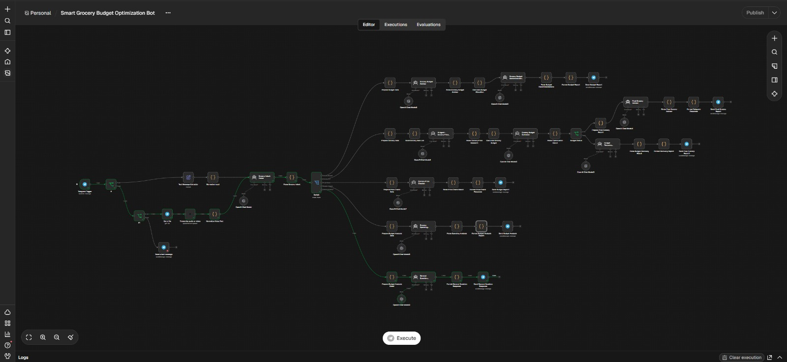
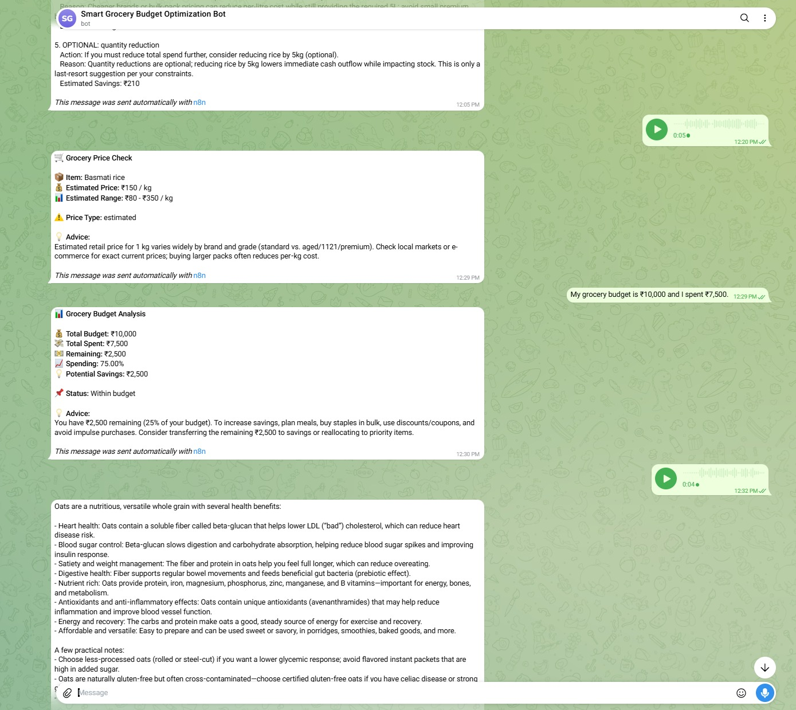
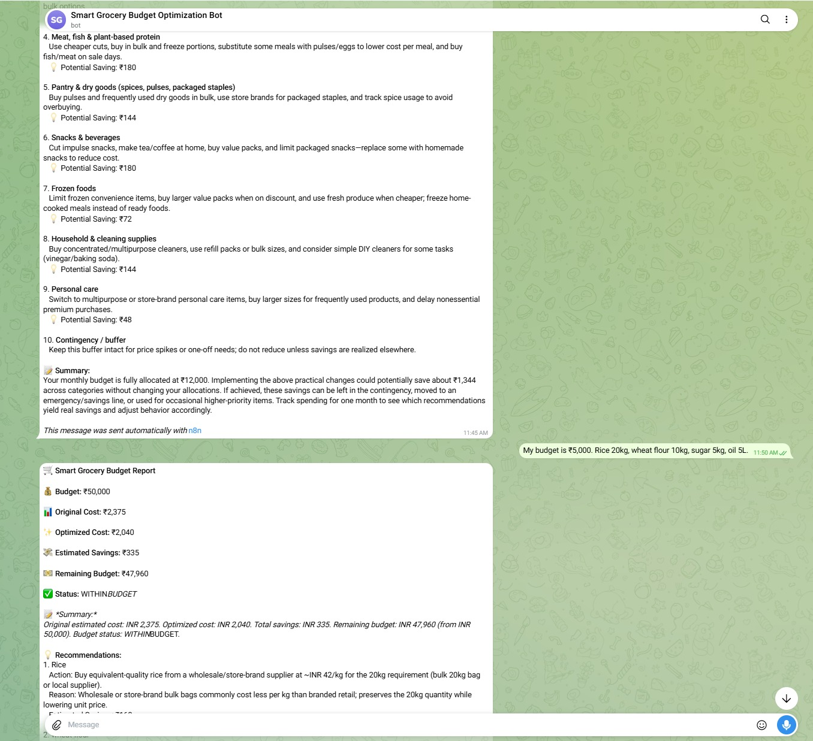

# Screenshots

These screenshots are supplied examples for the **Smart Grocery Budget Optimization Bot** project.

## n8n Workflow Overview

The overview shows the Telegram text/voice input, shared intent classifier, five intent routes, AI processing stages, budget checks, and Telegram response branches.

## Telegram Examples — Price and Budget Responses

This sample includes an estimated grocery price and a budget-analysis response. The price is an AI estimate, not a live-verified retail quote.

## Telegram Examples — Optimized Grocery List

This sample shows the formatted grocery optimization report with estimated original cost, optimized cost, estimated savings, remaining budget, and purchase recommendations.

The screenshots are illustrative execution examples. Review the root README's known limitations before treating every field shown in the screenshots as guaranteed behaviour of the supplied JSON export.
