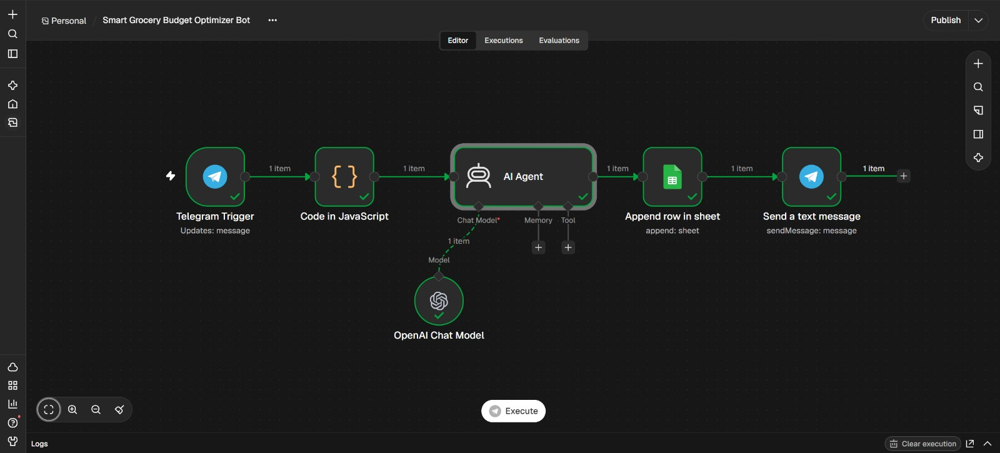
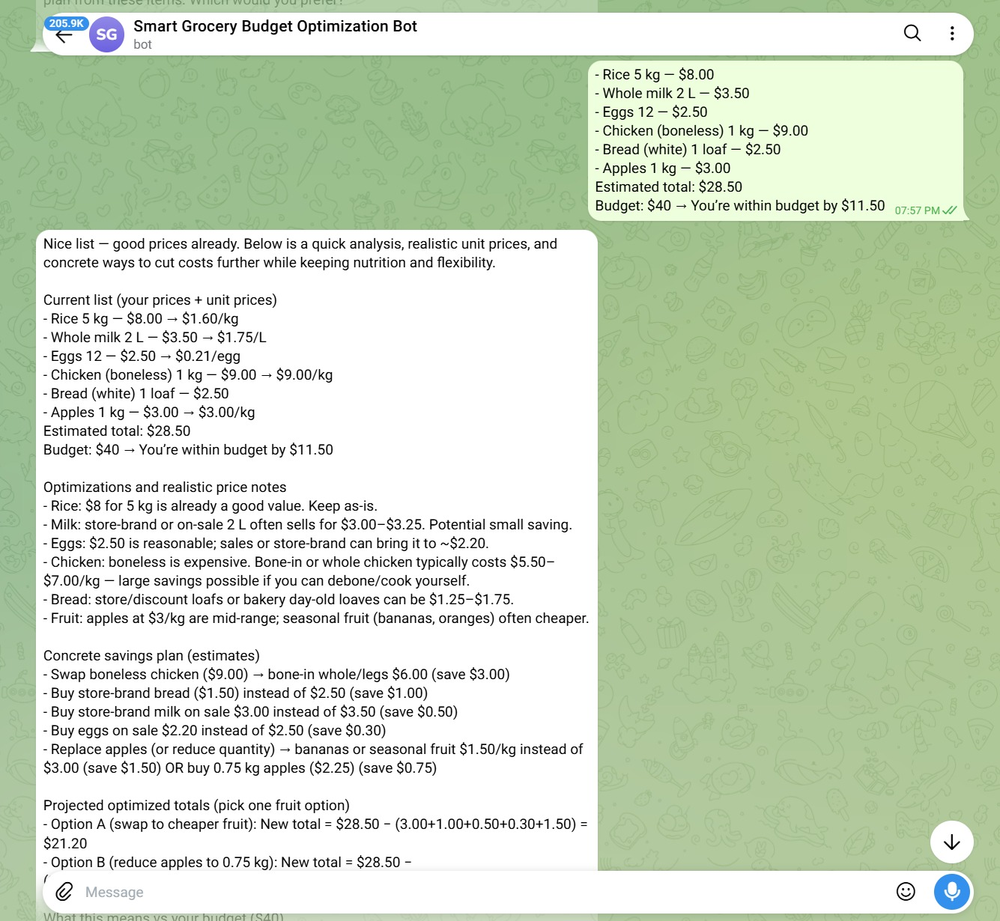
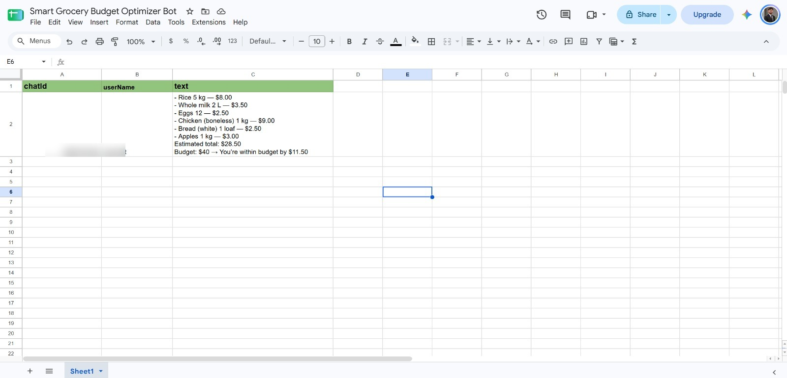

# Smart Grocery Budget Optimizer Bot

An AI-powered grocery budget assistant built with n8n, Telegram, OpenAI, and Google Sheets. Users send a grocery list and an optional budget through Telegram. The AI Agent returns an estimated cost breakdown, compares the estimate with the stated budget, and suggests possible lower-cost alternatives.

## Key Features

- Accepts grocery lists through Telegram messages
- Extracts the message text, Telegram chat ID, and sender's first name
- Uses an OpenAI-powered AI Agent to analyze the grocery list
- Estimates item prices and total grocery cost
- Compares the estimated total with a user-provided budget
- Suggests cheaper alternatives and possible savings
- Logs the original user request to Google Sheets
- Sends the AI-generated response back through Telegram

## Workflow Overview

1. `Telegram Trigger` receives an incoming Telegram message.
2. `Code in JavaScript` extracts the message text, chat ID, and sender's first name.
3. `AI Agent` analyzes the grocery list and budget using the configured instructions.
4. `OpenAI Chat Model` provides the language model for the AI Agent.
5. `Append row in sheet` logs the incoming chat ID, username, and original message in Google Sheets.
6. `Send a text message` sends the AI Agent's response to the originating Telegram chat.

## Technology Stack

- n8n
- Telegram Bot API
- OpenAI Chat Model (`gpt-5-mini` in the supplied export)
- Google Sheets
- JavaScript (n8n Code node)
- n8n AI Agent

## Google Sheets Structure

The supplied workflow appends one row for each processed request using these columns:

| Column | Purpose |
|---|---|
| `chatId` | Telegram chat identifier associated with the request |
| `userName` | Sender's first name, or `User` if unavailable |
| `text` | Original grocery list / message sent to the bot |

**Data logging note:** The current workflow saves the original incoming message and sender details. It does not save the AI-generated cost analysis or recommendations in the spreadsheet.

## Workflow File

[Download n8n Workflow JSON](workflow.json) — Sanitized workflow export for importing into n8n.

## Screenshots

### 1. n8n Workflow Architecture


### 2. Telegram Grocery Budget Analysis


### 3. Google Sheets Request Log


## Setup

1. Import `workflow.json` into your n8n instance. The exported workflow is inactive by default.
2. Create a Telegram bot and connect your own Telegram credentials to the Telegram Trigger and Send a text message nodes.
3. Configure your own OpenAI credentials in the OpenAI Chat Model node.
4. Create a Google Spreadsheet with the exact column headers `chatId`, `userName`, and `text`.
5. In `Append row in sheet`, replace `REPLACE_WITH_YOUR_GOOGLE_SHEET_ID` with your spreadsheet ID and select the correct worksheet.
6. Test by sending a grocery list and, where applicable, a budget through Telegram.
7. Review the AI response and confirm that the original request is logged in Google Sheets.
8. Activate the workflow only after your credentials and spreadsheet connection have been tested.

The export removes credential references, the original spreadsheet ID, and instance-specific metadata. Reconnect your own credentials and select your own spreadsheet after importing.

## Current Limitations and Recommended Improvements

The following limitations are visible in the supplied workflow:

- **No live price lookup:** The AI Agent is instructed to estimate realistic market prices, but the workflow has no live grocery price API, web search, retailer integration, or product catalogue. Treat generated prices as estimates, not verified current store prices.
- **Location and currency are not configured:** The system prompt does not set a required country, city, or currency. The user should specify these in the message; otherwise price context may be unclear. The sample conversation shows USD values, but this is not enforced by the workflow.
- **Only the original request is logged:** The Google Sheets node stores `chatId`, `userName`, and `text`. It does not store the generated analysis, estimated total, budget comparison, or savings suggestions.
- **Text input only:** The JavaScript node reads `message.text`. Voice notes, images, and other non-text updates are not processed by this workflow.
- **No structured validation of calculations:** The model generates the response as natural language. Estimated prices, totals, and savings should be checked before relying on them for an actual shopping decision.
- **Personal data is stored:** The sheet contains Telegram chat IDs, sender names, and user-submitted messages. Restrict spreadsheet access and avoid publishing real user records.

## Repository Structure

```text
Smart-Grocery-Budget-Optimizer-Bot/
├── screenshots/
│   ├── README.md
│   ├── n8n-workflow-overview.jpeg
│   ├── telegram-budget-analysis.jpeg
│   └── google-sheets-request-log.jpeg
├── README.md
└── workflow.json
```

## Author

<p align="left">
  <b>Jasvant Malvi</b><br>
  <a href="https://github.com/jasvantMalvi">GitHub</a> ·
  <a href="https://www.linkedin.com/in/jasvant-malvi-810305429/">LinkedIn</a>
</p>
