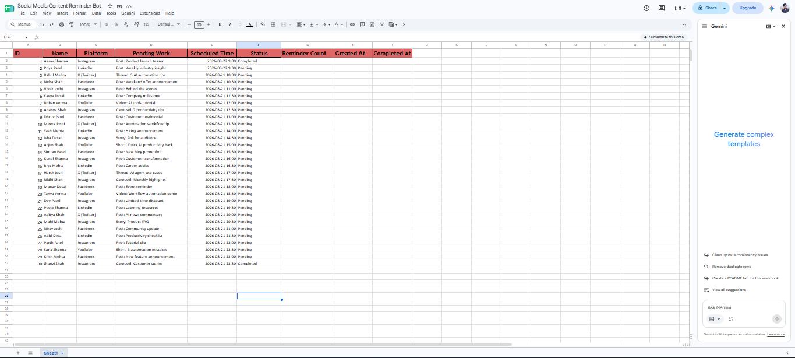
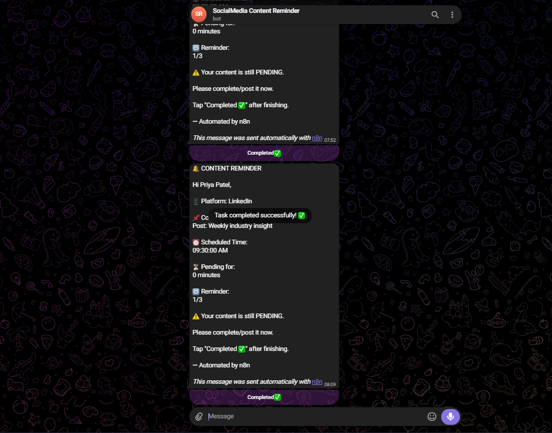
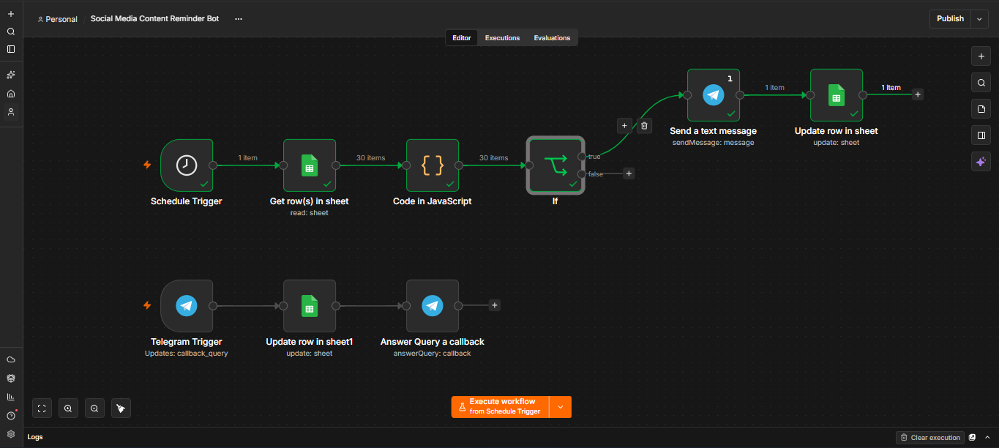
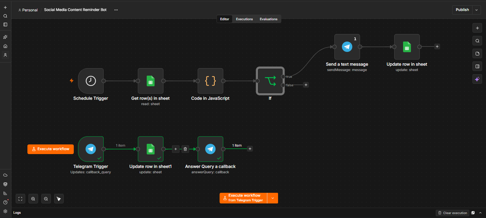

# Social Media Content Reminder Bot

An n8n automation that tracks scheduled social media content in Google Sheets and sends Telegram reminders when content is still pending. A Telegram inline button lets the recipient mark a content item as completed.

## Key Features

- Checks the content tracker every 30 minutes
- Reads scheduled content records from Google Sheets
- Filters for pending work whose scheduled time has arrived
- Calculates how long each item has been pending
- Tracks the reminder count
- Sends Telegram reminders with a **Completed** inline button
- Updates the Google Sheets status and completion timestamp when the button is pressed

## Workflow Architecture

The workflow contains two independent trigger paths.

### 1. Scheduled Reminder Path

1. `01 - Reminder Scheduler` starts the check every 30 minutes.
2. `02 - Fetch Pending Tasks` reads rows from the Google Sheets tracker.
3. `03 - Check Reminder Conditions` filters for pending records with a valid scheduled time, calculates minutes pending, and determines whether another reminder is due.
4. `04 - Check Reminder Eligibility` checks that the outgoing item has `Pending` status.
5. `05 - Send Telegram Reminder` sends the reminder with a **Completed** inline button.
6. `06 - Update Reminder Count` updates the reminder count in Google Sheets.

### 2. Completion Callback Path

1. `07 - Handle Completion Button` receives a Telegram callback query.
2. `08 - Mark Task as Completed` updates the matching record by ID, sets the status to `Completed`, and records `Completed At`.
3. `09 - Confirm Task Completion` acknowledges the button press in Telegram.

## Technology Stack

- n8n
- Telegram Bot API
- Google Sheets
- JavaScript (n8n Code node)
- Schedule Trigger and Telegram callback queries

## Google Sheets Structure

The workflow expects one tracker sheet with these columns:

| Column | Purpose |
|---|---|
| `ID` | Unique content/task identifier used when updating a row |
| `Name` | Person responsible for the content |
| `Platform` | Social media platform |
| `Pending Work` | Post, video, reel, thread, or other content description |
| `Scheduled Time` | Planned publishing time |
| `Status` | `Pending` or `Completed` |
| `Reminder Count` | Number of reminders sent |
| `Created At` | Record creation timestamp |
| `Completed At` | Timestamp recorded when the completion button is pressed |

The date parsing code expects a scheduled-time string in the form `YYYY-MM-DD HH:mm` and interprets it using the fixed India offset `+05:30`.

## Workflow File

[Download n8n Workflow JSON](workflow.json) — sanitized workflow export for importing into n8n.

## Screenshots

### 1. Google Sheets Content Tracker


### 2. Telegram Reminder Message


### 3. Scheduled Reminder Workflow


### 4. Completion Callback Workflow


## Setup

1. Import `workflow.json` into your n8n instance. The exported workflow is inactive by default.
2. Create or prepare a Google Spreadsheet with the nine columns listed above.
3. Replace `REPLACE_WITH_YOUR_GOOGLE_SHEET_ID` in the Google Sheets nodes with your spreadsheet ID, then select the correct worksheet.
4. Connect your own Google Sheets credentials.
5. Create a Telegram bot and connect your own Telegram credentials to both Telegram Trigger nodes and the Telegram send/answer nodes.
6. Replace `REPLACE_WITH_YOUR_TELEGRAM_CHAT_ID` in `05 - Send Telegram Reminder` with the intended recipient's Telegram chat ID.
7. Add unique IDs to all content rows and use `Pending` or `Completed` as the status values.
8. Ensure `Scheduled Time` values follow `YYYY-MM-DD HH:mm` and are scheduled in India time (UTC+05:30), as assumed by the code.
9. Test the scheduled reminder path and the completion-button callback path separately.
10. Activate the workflow after verifying the settings and test results.

The export removes credential references, webhook IDs, the original spreadsheet ID, the original Telegram chat ID, and instance-specific metadata. Reconnect credentials and configure your own IDs after import.

## Current Limitations and Recommended Improvements

The following points are visible in the supplied workflow export:

- **Hard-coded Telegram recipient:** All reminders are sent to the configured `chatId`. The spreadsheet does not contain a chat ID per owner, so this version is designed for one configured recipient rather than multiple independent users.
- **Created At is overwritten:** `06 - Update Reminder Count` updates the `Created At` field when a reminder is sent. This replaces the original creation timestamp. Use a separate `Last Reminder At` column instead.
- **Send node executes once:** `05 - Send Telegram Reminder` has `executeOnce: true`. If multiple rows are eligible in the same scheduler run, the node may process only one input item. Remove this setting or handle items individually if every eligible row must receive a reminder.
- **Scheduled-time format is strict:** The Code node appends seconds and a fixed `+05:30` offset. Other date formats or time zones can be parsed incorrectly or skipped.
- **Reminder display differs from the screenshot:** The screenshot shows a `1/3` counter, while the supplied workflow code generates `Reminder #1`, `Reminder #2`, and so on. The JSON does not enforce a three-reminder maximum.
- **No sender ownership check in callback path:** The completion path updates a row using the ID from callback data. Add a check that the callback came from the intended owner before updating shared task data.

The workflow export is inactive by default. The screenshots are evidence of the illustrated sheet and Telegram/workflow interactions, but they do not establish that the current JSON has been tested with every edge case.

## Repository Structure

```text
Social-Media-Content-Reminder-Bot/
├── screenshots/
│   ├── README.md
│   ├── google-sheets-content-tracker.png
│   ├── telegram-reminder-interaction.png
│   ├── n8n-reminder-scheduler.png
│   └── n8n-completion-callback.png
├── README.md
└── workflow.json
```

## Author

<p align="left">
  <b>Jasvant Malvi</b><br>
  <a href="https://github.com/jasvantMalvi">GitHub</a> ·
  <a href="https://www.linkedin.com/in/jasvant-malvi-810305429/">LinkedIn</a>
</p>
