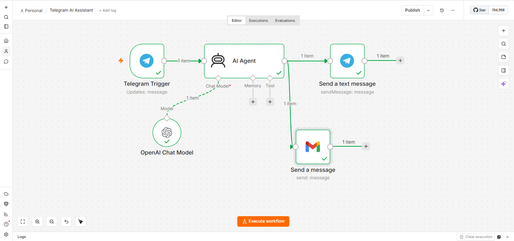
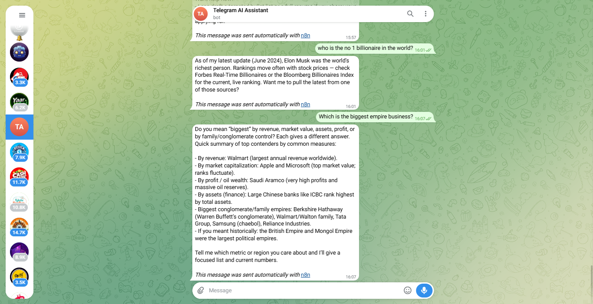

# Telegram AI Assistant

A general-purpose AI chatbot built with n8n, Telegram, OpenAI GPT-5 Mini, and Gmail. Users send text messages to a Telegram bot. An AI Agent interprets the request and generates a conversational answer, then the workflow sends that answer to the same Telegram user and, in parallel, sends a formatted HTML email to a configured inbox.

This is the **Telegram AI Assistant** project, distinct from the separate **AI Voice Telegram Assistant** project. The supplied workflow processes text messages only; it does not transcribe voice messages or return audio.

> **Important privacy behaviour:** Every processed Telegram message produces an AI response that is sent both to the originating Telegram user and to the fixed Gmail recipient configured in the Gmail node. Configure this recipient deliberately and disclose this email copy to bot users before using the bot with other people.

## Key Features

- Receives Telegram `message` updates.
- Passes `message.text` to an n8n AI Agent.
- Uses OpenAI GPT-5 Mini through the AI Agent's language-model connection.
- Uses a detailed system prompt for general-purpose question answering and task assistance.
- Covers technology, business, education, writing, career development, productivity, creative work, finance education, and general wellness information.
- Instructs the assistant to reply in the user's language where possible, including English, Hindi, and Gujarati.
- Sends the generated answer back to the Telegram sender.
- Sends the same generated answer as a formatted HTML email to a configured recipient.
- Runs the Telegram and Gmail output nodes as parallel branches from the AI Agent.

## Workflow Overview

The supplied workflow export contains **5 nodes**.

1. `Telegram Trigger` — receives Telegram `message` updates.
2. `AI Agent` — reads the incoming message from `={{ $json.message.text }}` and generates a response using the configured system prompt.
3. `OpenAI Chat Model` — provides the `gpt-5-mini` language model to the AI Agent.
4. `Send a text message` — sends the AI Agent's `output` to the Telegram sender using the sender's Telegram user ID.
5. `Send a message` — sends the AI Agent's `output` in a formatted HTML email with the subject `Here is the Answer!`.

### Main data path

```text
Telegram User Message
        ↓
Telegram Trigger
        ↓
AI Agent  ←  OpenAI GPT-5 Mini
        ↓
        ├── Send answer to originating Telegram user
        └── Send formatted HTML email to configured inbox
```

Both output nodes are connected directly to the AI Agent's main output. There is no conditional routing between the Telegram and Gmail branches: both are intended to run for each successful AI Agent execution.

## AI Assistant Behaviour

The AI Agent's system prompt instructs it to:

- Be friendly, approachable, practical, and conversational.
- Give a direct answer first and ask clarifying questions when necessary.
- Break complex topics into steps and provide examples where useful.
- Admit uncertainty and avoid inventing facts or sources.
- Help with technology, business, education, writing, careers, productivity, creative tasks, personal-finance education, and general wellness information.
- Provide code with explanations and mention common mistakes.
- Adapt to the user's language where possible, including English, Hindi, Gujarati, and other major languages.
- Avoid medical diagnoses, legal advice, financial guarantees, and harmful or dangerous assistance.
- Keep answers short and understandable by default, with more detail when the task requires it.

These are prompt instructions to the language model, not separately implemented validation or topic-routing rules.

## Output Destinations

### Telegram response

The `Send a text message` node uses:

- Chat ID: the sender ID from the incoming Telegram message
- Text: the AI Agent's `output`

This returns the response to the Telegram account that sent the request.

### Gmail response

The `Send a message` node uses:

- Recipient: `REPLACE_WITH_YOUR_EMAIL` in this sanitized export
- Subject: `Here is the Answer!`
- Body: a prebuilt HTML email layout containing the AI Agent's response

The original workflow had a fixed Gmail destination. The public export replaces that address with a placeholder. Set it to an inbox you control before testing.

## Technology Stack

- n8n
- Telegram Bot API
- n8n AI Agent
- OpenAI GPT-5 Mini
- Gmail node
- HTML email template

## Workflow File

[Download n8n Workflow JSON](./workflow.json) — Sanitized export of the actual 5-node workflow. The export is inactive, the hard-coded Gmail recipient is replaced with a placeholder, and credential references, webhook IDs, and instance-specific metadata are removed.

## Screenshots

### 1. n8n Workflow Architecture



### 2. Telegram Conversation Example



The conversation screenshot is an example of the Telegram interaction, not a live-data verification. In the sample, the assistant explicitly referred to a June 2024 knowledge update when asked about a current ranking. This illustrates why current or time-sensitive answers should be independently checked: the workflow has no live web-search tool connected.

## Setup

1. Import `workflow.json` into your n8n instance. The exported workflow is inactive.
2. Connect your Telegram Bot credentials to `Telegram Trigger` and `Send a text message`.
3. Connect your OpenAI credentials to `OpenAI Chat Model`.
4. Connect your Gmail credentials to `Send a message`.
5. Replace `REPLACE_WITH_YOUR_EMAIL` with the intended recipient address.
6. Confirm that your Gmail node is authorized to send messages from the connected account.
7. Test with a simple Telegram text question.
8. Confirm that the answer is returned to the same Telegram sender.
9. Confirm that the same answer is delivered to the configured Gmail inbox.
10. Test Hindi and Gujarati input, a longer question, and a request that needs clarification.
11. Review the privacy implications of sending every response to the configured email inbox before activating the bot for multiple users.

## Current Limitations and Recommended Improvements

The following limitations are visible in the supplied workflow JSON:

- **Text messages only:** The AI Agent reads `message.text`. Voice notes, photos, documents, and other non-text Telegram updates are not transcribed or processed by this workflow.
- **No live web search:** The AI Agent has no connected search tool. It cannot independently retrieve current news, live rankings, current prices, or newly changed facts. The conversation screenshot includes an answer that references a June 2024 knowledge update.
- **No conversation memory:** The AI Agent has no memory node connected. Each request is handled without a configured persistent conversation-history component.
- **No external action tools:** The AI Agent's Tool connector is unused. It can draft instructions and suggestions, but cannot execute actions such as scheduling calendar events, managing tasks, or sending messages to third-party services on the user's behalf.
- **Gmail recipient is fixed:** All responses are sent to the single email address configured in the Gmail node. The workflow does not ask which email should receive a copy or route email to the Telegram sender's own address.
- **Every answer is copied to Gmail:** The Gmail branch is parallel to the Telegram branch. A response may contain private user content, so the fixed inbox and this behaviour must be disclosed and deliberately configured.
- **No message-type filter:** The trigger listens for all `message` updates, but the prompt expression expects `message.text`. Non-text updates may provide an empty or missing prompt.
- **No error-handling branch:** There are no dedicated fallback paths for Telegram delivery failure, OpenAI errors, Gmail authorization failures, or malformed input.
- **No explicit rate limit or access control:** The supplied workflow does not show an allowlist or user-specific usage control. Configure bot access and operational limits before public deployment.
- **No structured output validation:** The AI Agent returns free-form text. There is no output parser or schema validation before either delivery node.
- **Fixed email subject and template:** The Gmail subject is always `Here is the Answer!`; the HTML template is static and does not add the user's question or sender identity as structured metadata.
- **Model responses still require judgement:** The system prompt asks for accuracy and honesty, but does not guarantee that every answer is correct or appropriate.

## Repository Structure

```text
Telegram-AI-Assistant/
├── screenshots/
│   ├── README.md
│   ├── workflow-overview.png
│   └── telegram-conversation.png
├── README.md
└── workflow.json
```

## Author

<p align="left">
  <b>Jasvant Malvi</b><br>
  <a href="https://github.com/jasvantMalvi">GitHub</a> ·
  <a href="https://www.linkedin.com/in/jasvant-malvi-810305429/">LinkedIn</a>
</p>
