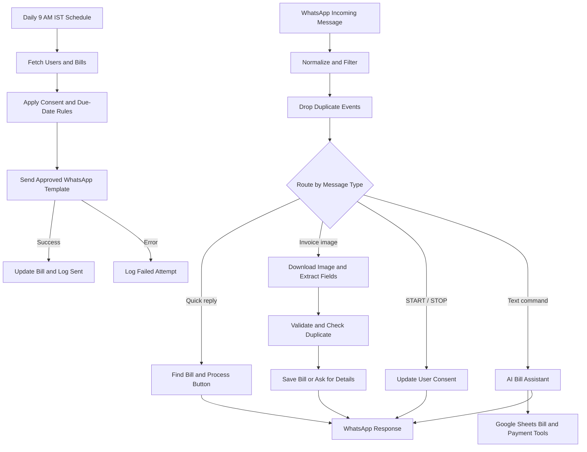

# WhatsApp Bill Manager – Inbound, Payments & Scheduled Reminders

A WhatsApp-based bill-management automation built with **n8n**, **WhatsApp Cloud API**, **OpenAI**, and **Google Sheets**. The supplied workflow combines inbound bill operations, AI-assisted invoice registration, interactive reminder actions, user consent handling, and a daily reminder engine in one n8n workflow export.

> **Portfolio note:** The uploaded n8n workflow was inactive. The supplied screenshots show example bill conversations, the inbound workflow, the reminder engine, and the four Google Sheets tabs. The included `workflow.json` is a sanitized, inactive import template; reconnect your own services and complete the setup checklist before activating it.

## What it does

| Capability | How it works |
|---|---|
| WhatsApp message intake | Receives incoming messages, normalizes their fields, filters empty events, and drops recently seen duplicate webhook message IDs. |
| AI bill assistant | Uses an OpenAI-powered agent with conversation memory and Google Sheets tools to answer bill queries and perform bill-management actions. |
| Invoice-photo registration | Retrieves an incoming image, downloads it, extracts bill fields with vision AI, validates required values, checks for duplicate invoices, and stores valid new bills. |
| Interactive reminder actions | Handles quick-reply buttons to mark a bill paid, defer to the next normal reminder cycle, or request bill details. |
| Payment history | Updates the bill status and writes a payment-history record. Payment entries are explicitly marked `Self-reported`. |
| Consent management | Supports `START` to opt in and `STOP` / `UNSUBSCRIBE` to opt out of bill reminders. |
| Scheduled reminders | Runs daily at 9:00 AM in the Asia/Kolkata timezone, checks configured reminder days, skips repeat sends of the same reminder type on the same day, and sends a WhatsApp template message. |
| Reminder audit | Records sent and failed reminder attempts in the Reminder History tab. |

## Workflow architecture



## Main branches

### 1. Inbound message handling

The inbound branch starts with `WhatsApp Incoming Message`. It normalizes the sender, profile name, message ID, message type, text, image ID, interactive button ID, and WhatsApp phone-number ID. It then filters out events without a message ID, keeps a rolling list of recently processed message IDs, and routes the message to the relevant branch.

### 2. Text-based AI bill assistant

The `WhatsApp Bill Assistant` uses the OpenAI Chat Model configured as **GPT-4o-mini** and a conversation-memory window of eight messages. Its connected Google Sheets tools are:

- `get_my_bills` — retrieve the current sender's bill rows.
- `add_bill` — create a bill with amount, category, due date and reminder settings.
- `update_bill_status` — update a bill's payment status.
- `log_payment` — append a payment-history record.

The assistant prompt describes commands such as `Add bill`, `Show bills`, `Upcoming bills`, `Overdue bills`, `Paid BILL001`, `Monthly report`, `Delete BILL001`, and `Help`, as well as natural-language bill queries.

### 3. Invoice image registration

When an image arrives, the workflow gets the WhatsApp media URL, downloads the image, and sends it to the OpenAI vision node. The extraction prompt asks for bill name, category, amount, due date and invoice number. A JavaScript node parses and validates the extracted result. Missing bill name, amount or due date routes to a clarification message. Valid data is checked against the sender's existing bills to avoid duplicate registration before it is saved.

### 4. Interactive quick replies

The reminder template includes three quick replies:

- **Mark as Paid** — looks up the bill for the sender, marks it Paid, writes a Payment History row, and sends a confirmation.
- **Remind Later** — acknowledges the request and leaves the bill for the next normal scheduled reminder cycle; it does not create a custom snooze date.
- **Details** — sends the current bill's details over WhatsApp.

### 5. Consent controls

The workflow stores `OptedIn` or `OptedOut` status in the `Users` tab when the user sends `START`, `STOP`, or `UNSUBSCRIBE`. In the packaged workflow, the scheduled reminder filter has been tightened to send only to numbers explicitly marked `OptedIn`.

### 6. Scheduled reminder engine

The scheduler runs daily at **9:00 AM Asia/Kolkata**. It fetches users and bills, calculates the number of days until the due date, and uses each bill's `ReminderDays` field (normally `7,3,1,0`). It also creates an overdue reminder label for unpaid bills past their due date. A bill's same reminder type is not sent more than once on the same date. The HTTP Request node sends the approved WhatsApp template `bill_reminder` with four body values and three quick-reply buttons.

## Google Sheets data model

Use one Google spreadsheet with these four tabs. The packaged workflow's Google Sheets nodes all point to one placeholder spreadsheet ID and resolve tabs by **tab name** rather than cached sheet IDs.

| Tab | Columns |
|---|---|
| `Bills` | `BillID`, `UserID`, `WhatsAppNumber`, `BillName`, `Category`, `Amount`, `DueDate`, `PaymentStatus`, `PaymentDate`, `ReminderDays`, `LastReminderDate`, `LastReminderType` |
| `Users` | `WhatsAppNumber`, `Name`, `ConsentStatus` |
| `Reminder History` | `ReminderID`, `BillID`, `UserID`, `ReminderType`, `ScheduledAt`, `SentAt`, `WhatsAppMessageID`, `DeliveryStatus`, `WhatsAppNumber`, `BillName`, `Amount`, `DueDate`, `Category`, `reminderType`, `label`, `today` |
| `Payment History` | `PaymentID`, `BillID`, `UserID`, `Amount`, `PaymentDate`, `PaymentMethod`, `ReceiptURL`, `VerificationStatus` |

Create the column headers exactly as shown. Keep WhatsApp numbers as **plain-text values** including the country code; do not let Google Sheets convert them into scientific notation.

See [`docs/GOOGLE-SHEETS-STRUCTURE.md`](docs/GOOGLE-SHEETS-STRUCTURE.md) for the header rows in copy-ready form.

## Tech stack

- n8n workflow automation
- WhatsApp Cloud API / WhatsApp Business Platform
- OpenAI GPT-4o-mini chat model
- OpenAI vision model node for invoice extraction
- Google Sheets as the bill, consent, payment and reminder datastore
- JavaScript for message normalization, duplicate detection, invoice validation and reminder-date calculations

## Repository contents

```text
WhatsApp-Bill-Manager-Inbound-Registration-Payments-AI-Assistant/
├── README.md
├── workflow.json
├── docs/
│   └── GOOGLE-SHEETS-STRUCTURE.md
└── screenshots/
    ├── README.md
    ├── full-workflow-overview.png
    ├── inbound-message-workflow.png
    ├── scheduled-reminder-engine.png
    ├── bills-tab.png
    ├── users-tab.png
    ├── reminder-history-tab.png
    ├── payment-history-tab.png
    ├── whatsapp-help-and-bill-list.png
    └── whatsapp-bill-query.png
```

## Setup

1. Import `workflow.json` into n8n. The workflow is intentionally **inactive**.
2. Create one Google spreadsheet with the four tabs and the exact column headers listed above.
3. Replace `REPLACE_WITH_BILL_MANAGER_SPREADSHEET_ID` in **every Google Sheets node/tool** with that spreadsheet's ID. The public export uses one placeholder because the original file pointed different parts of the workflow at three separate spreadsheets.
4. Connect your WhatsApp Trigger and WhatsApp Business credentials in the relevant nodes.
5. Set `REPLACE_WITH_WHATSAPP_PHONE_NUMBER_ID` in `Send WhatsApp Reminder Template` to the phone-number ID from your WhatsApp Business Platform configuration. Do not put a display phone number there.
6. Create and get approval for the WhatsApp message template named `bill_reminder`. Its language, four body parameters and three quick-reply button payloads must match the request configured in the workflow.
7. Connect your OpenAI credential to both OpenAI nodes and your Google Sheets credential to all Sheets nodes/tools.
8. Check the workflow timezone is `Asia/Kolkata`; the daily schedule is configured for 9:00 AM.
9. Make sure users have an explicit `OptedIn` row in the `Users` tab before expecting scheduled reminders. Users can opt in by sending `START` and opt out using `STOP` or `UNSUBSCRIBE`.
10. Test each branch using a test WhatsApp number and test spreadsheet before activating the workflow.

## Important safeguards and limitations

- **Payment status is self-reported.** The workflow records the user's claim that a bill was paid; it does not verify a bank or UPI transaction.
- **Template dependency.** Scheduled reminders require an approved WhatsApp template whose name, language, body-variable order and quick-reply buttons match the configuration.
- **Remind Later is not a custom snooze.** It acknowledges the request and waits for the next regular reminder cycle.
- **Invoice extraction needs review.** The workflow validates required fields and duplicate candidates, but does not independently verify invoice authenticity or guarantee OCR accuracy.
- **Soft deletion depends on assistant instructions.** The `Delete Bill` process is described in the AI prompt; production use should add deterministic confirmation-state validation before enabling destructive actions.
- **External setup is not included.** WhatsApp accounts, API credentials, approved message templates, OpenAI access and Google Sheets permissions must be configured by the importer.
- **The original workflow export had inconsistent Google Sheets targets.** Some nodes used the main workbook, while AI tools and scheduled reminders referenced other spreadsheet IDs. The packaged version standardizes all nodes to one replaceable spreadsheet placeholder and uses tab names.

## Packaging adjustments in this public copy

The included export is based on the uploaded workflow, with these portfolio/import-readiness changes:

1. Removed credential bindings, webhook IDs, instance metadata and account-specific spreadsheet/phone-number IDs.
2. Standardized every Google Sheets node/tool to a single workbook placeholder and tab-name lookup.
3. Tightened scheduled reminders to require explicit `OptedIn` status.
4. Scoped bill-status updates by both `BillID` and `WhatsAppNumber` to reduce cross-user update risk.
5. Populated the failed-reminder log instead of leaving its column mapping empty.
6. Set the workflow timezone to `Asia/Kolkata` and kept the workflow inactive.

These changes make the export a safer starting template, but they do not replace end-to-end testing in your own n8n and Meta environments.

## Author

**Jasvant Malvi**

- GitHub: https://github.com/jasvantMalvi
- LinkedIn: https://www.linkedin.com/in/jasvant-malvi-810305429/
