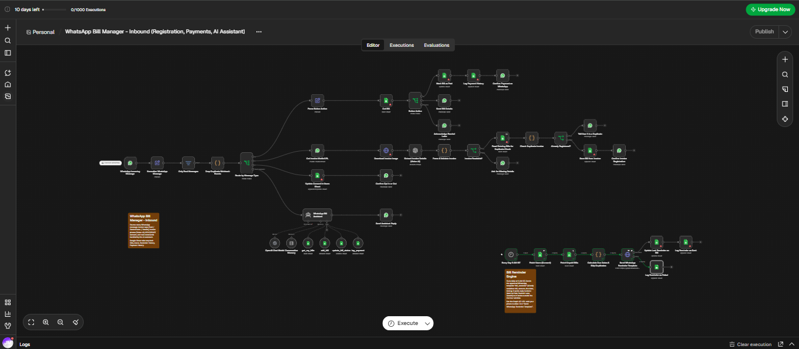
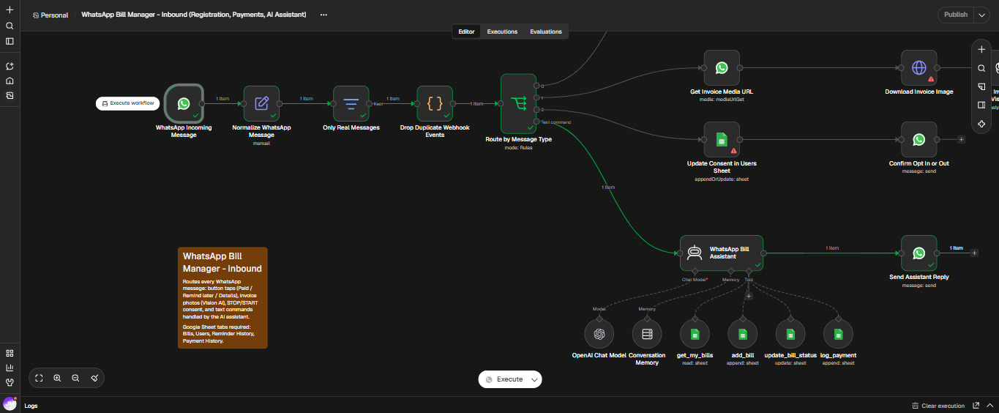
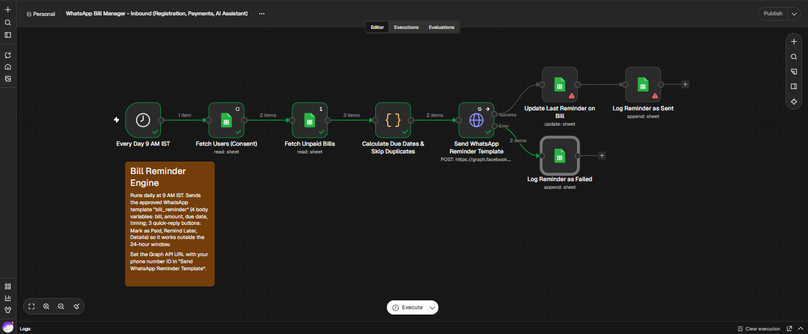
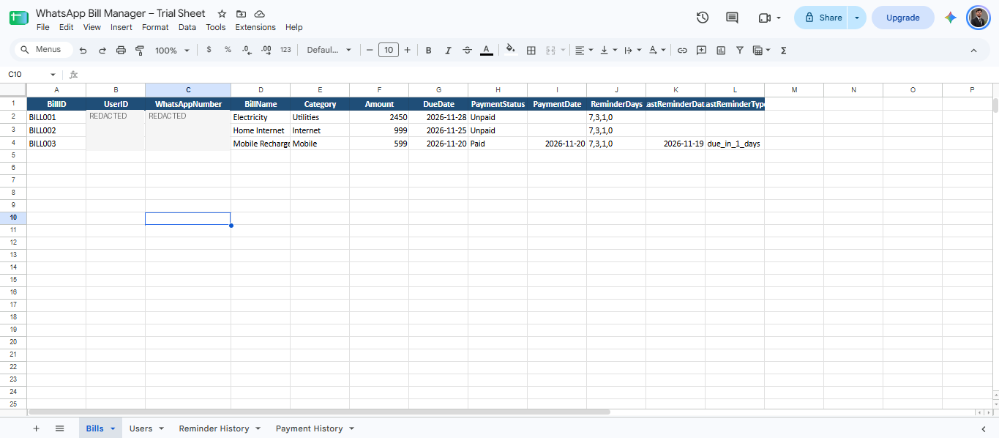
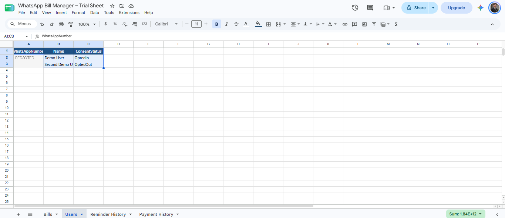
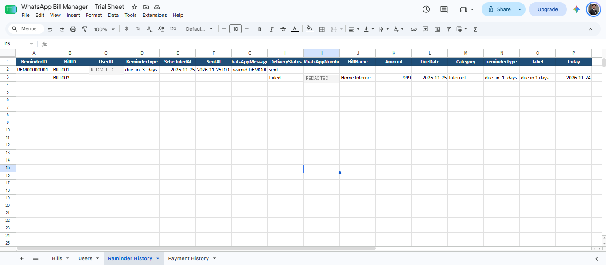
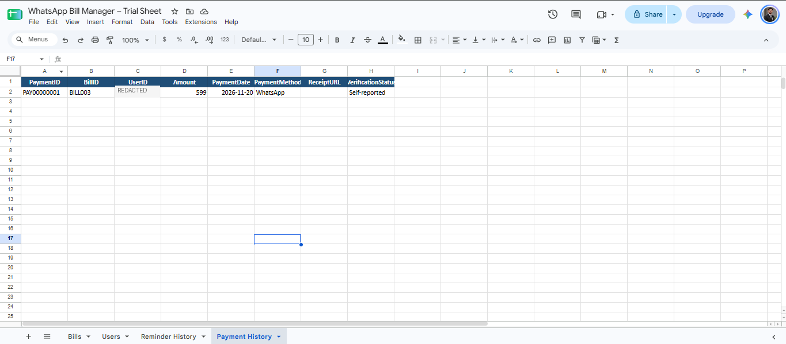
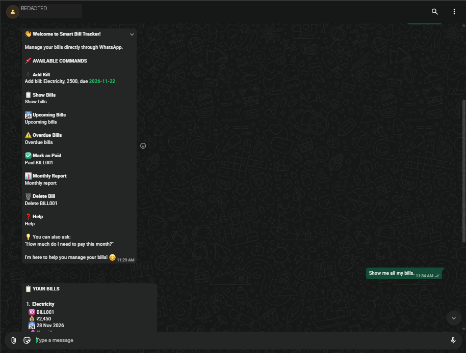
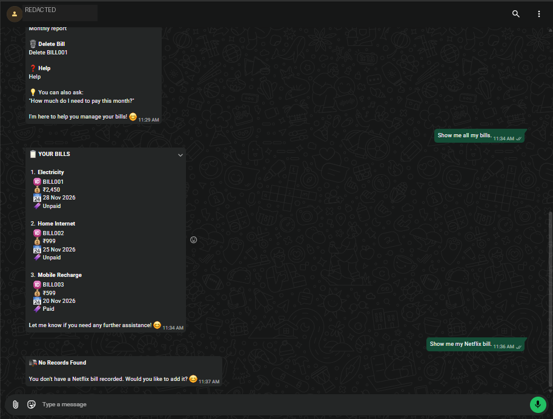

# Project screenshots

The screenshots document the n8n workflow, the separate daily reminder branch, the four Google Sheets tabs, and sample WhatsApp interactions. Example contact numbers and spreadsheet user identifiers are obscured in the portfolio copies.

## Full workflow

## Inbound WhatsApp workflow

## Scheduled reminder engine

## Google Sheets data tabs

**Bills**

**Users / consent**

**Reminder History**

**Payment History**

## WhatsApp examples

